# SRS System Information - User Guide

Version 2.3.1. Package `srs-sysinfo`. Programs: `srs-gui`, `sysreport-search`, `srs-root`, `srs-sysreport`.

I wanted a Linux version of SIV (System Information Viewer) for myself, so I built one and set out to improve on it along the way. SRS is free and open source for the Linux and open-source community. (SRS is an independent project, not affiliated with SIV or its author.)

> **Credit.** SRS ("System Report Search") is modelled on **SIV64X - System Information Viewer**.
> SIV is the work of **Ray Hinchliffe, RH Software** (<https://rh-software.com>). All credit for
> SIV's design, its item set and its presentation belongs to Ray Hinchliffe.
>
> **No SIV code.** SRS contains **no SIV code, binaries or data files**, and SIV was **not
> disassembled or decompiled**. SRS was specified only from SIV's observable output (its `-save`
> text dump, its panels and its printable strings) and written independently in C on Linux data
> sources (sysfs, procfs, CPUID, hwmon, udev, hwdata). See `EVIDENCE.md` in the source.
>
> **Not affiliated.** SRS is an independent project. It is **not affiliated with, endorsed by or
> supported by RH Software**. Please do not send SRS questions or bug reports to RH Software.
> "SIV" and "System Information Viewer" are names of RH Software's product, used here only to say
> what SRS is modelled on.

Other pages:

- [SECTIONS/README.md](SECTIONS/README.md) - **Section Reference**: every one of the 558 items,
  field by field, what each value means, what is normal and what is not. Start here to *learn*.
- [CLI-REFERENCE.md](CLI-REFERENCE.md) - every command-line command and option.
- [GLOSSARY.md](GLOSSARY.md) - every technical word, in plain English.

---

## Contents

1. [What it is, in plain words](#1-what-it-is-in-plain-words)
2. [Who it is for](#2-who-it-is-for)
3. [Install](#3-install)
4. [First launch](#4-first-launch)
5. [Root-only data (srs-root)](#5-root-only-data-srs-root)
6. [A tour of the main window](#6-a-tour-of-the-main-window)
7. [The panels and their buttons](#7-the-panels-and-their-buttons)
8. [The Menu](#8-the-menu)
9. [Tools](#9-tools)
10. [Options](#10-options)
11. [System tray](#11-system-tray)
12. [Keyboard shortcuts](#12-keyboard-shortcuts)
13. [Reports and exports](#13-reports-and-exports)
14. [Settings and files](#14-settings-and-files)
15. [Reading results and comparing runs](#15-reading-results-and-comparing-runs)
16. [Known limits and differences from SIV](#16-known-limits-and-differences-from-siv)
17. [Privacy: before you share a report](#17-privacy-before-you-share-a-report)
18. [Troubleshooting](#18-troubleshooting)
19. [Uninstall](#19-uninstall)
20. [FAQ](#20-faq)
21. [Glossary](#21-glossary)

---

## 1. What it is, in plain words

SRS tells you **what is inside your computer and how it is doing right now**.

It lists your processor, memory sticks, motherboard, drives, graphics card, monitors, USB and PCI
devices, network adapters, sensors (temperatures, fan speeds, voltages) and a great deal of
operating-system detail. Most values update live.

It also has tools:

- **Stress & Burnin** - load every CPU thread and / or the graphics card to check the PC is stable and cool enough.
- **Benchmark** - classic Dhrystone and Whetstone CPU scores.
- **IPI Delay** - how long cores take to signal each other.
- **Latency** - how long memory takes to answer, by block size (shows your cache levels).
- **Device ID Lookup** - turn a number like `1002:7550` into a device name.
- **Find** - search a saved full system report.

Its main window puts everything in one place: an **Overview** that answers "Is my PC OK?", and
one page per topic (processor, memory, sensors ...). For SIV users, the **classic view** looks and
behaves like SIV, the long-running Windows tool, so they feel at home.
It has all 538 of SIV 5.87's report items (558 in total with SRS's own extras):

- **364** show real Linux data.
- **136** are hardware most PCs do not have (Itanium, IPMI, RAID cards...). On a normal PC they
  say "not present", as SIV would.
- **38** are Windows-only ideas. Most show the Linux equivalent instead
  (Windows services -> systemd units, drivers -> kernel modules, registry -> `/etc` and `~/.config`,
  Windows Error Reporting -> `coredumpctl`).

**SRS is read-only.** It never changes a setting, never writes to hardware or firmware, and makes
no network traffic except one `ping` to your router when you open the Ping item. The one place
that changes something is the Startup manager ([6.9](#69-the-startup-manager)), and only when you
click its switches or buttons: it turns startup items off and on, and never deletes anything.

## 2. Who it is for

- **Beginners** who want to know what hardware they have ("which graphics card? how much RAM?
  is my RAM at its rated speed?") without opening the case.
- **Enthusiasts and tuners** who watch temperatures, clocks and fan speeds, run a burn-in after a
  change, and compare before and after.
- **SIV users moving to Linux** who want the same layout and item names (the classic view).
- **Helpers and support people** who need a full text report from someone else's PC.
- **Power users** who script it: everything is also available as plain text from the command line.

## 3. Install

SRS runs on 64-bit x86 Linux with GTK 3. The command line (`sysreport-search`) also runs without
a desktop, for example over SSH.

### 3.1 Arch Linux and derivatives - AUR

```
yay -S srs-sysinfo
```

or by hand:

```
git clone https://aur.archlinux.org/srs-sysinfo.git
cd srs-sysinfo
makepkg -si
```

### 3.2 Arch Linux - prebuilt package from the release

```
sudo pacman -U srs-sysinfo-2.3.1-1-x86_64.pkg.tar.zst
```

### 3.3 Optional extras (recommended)

SRS works on its own. These packages let it show more (Arch names; other distributions use
similar names):

| Package | What it adds |
|---|---|
| `libayatana-appindicator` | System tray icon |
| `polkit` | The password prompt for `srs-root` |
| `dmidecode` | Memory stick, board and BIOS details, serials (via srs-root) |
| `smartmontools`, `nvme-cli` | Drive health (SMART) (via srs-root) |
| `i2c-tools` | Memory SPD decode (via srs-root) |
| `pciutils`, `usbutils` | Full PCI config space, `lsusb` in the full report |
| `lm_sensors` | Sensor labels and the full report's sensor section |
| `vulkan-tools`, `clinfo`, `mesa-utils` | Vulkan, OpenCL and OpenGL details |
| `iw`, `bluez-utils` | Wi-Fi link and Bluetooth details |
| `wireplumber`, `libpulse` | Audio graph details |
| `inxi`, `lshw`, `hwinfo` | Extra sections in the full system report |
| `zlib`, `zstd`, `lz4`, `xz` | The compression rows of Everyday Work ([9.15](#915-everyday-work)); almost every system has them, a missing one only skips its rows |
| `curl` (libcurl) | The internet speed test of the Network Benchmark ([9.16](#916-network)) |
| `vulkan-icd-loader` and your GPU's Vulkan driver (`vulkan-radeon`, `vulkan-intel`, `nvidia-utils`) | The GPU Benchmarks ([9.17](#917-gpu-benchmark)); almost every desktop has them |
| `rocm-hip-runtime` (and `hipblas`), `cuda` (or the NVIDIA driver), `opencl-icd-loader` with an OpenCL driver, `clblast` | The ROCm / HIP, CUDA and OpenCL back ends of GPU Burnin ([9.18](#918-gpu-burnin)) and the GPU Compute comparison; only if you want them |

### 3.4 Any other distribution - generic tarball

Each release has `srs-sysinfo-<version>-linux-x86_64.tar.gz`, built on an older distribution
(Ubuntu 24.04) so it runs on most current ones (glibc 2.38 or newer, GTK 3).

```
tar xzf srs-sysinfo-2.3.1-linux-x86_64.tar.gz
cd srs-sysinfo-2.3.1-linux-x86_64
./usr/bin/srs-gui                       # try it without installing
sudo cp -r usr/bin usr/share /usr/local/     # install for all users
```

The optional boot-time unit (see [5.3](#53-refresh-root-data-at-boot)) expects `/usr/bin/srs-root`.
`INSTALL.txt` in the tarball shows how to point it at `/usr/local/bin` instead.

Run-time needs: glibc 2.38+, GTK 3, GLib, Pango, Cairo, and **hwdata** (the PCI / USB name lists in
`/usr/share/hwdata`). Debian/Ubuntu: `sudo apt install hwdata libgtk-3-0`.

### 3.5 Any distribution - AppImage

Each release also has `srs-sysinfo-<version>-x86_64.AppImage`: the whole program in one file,
with GTK and everything else it needs inside. Nothing is installed; you just run the file. It is
built on Ubuntu 22.04, so it runs on distributions from about 2022 on (glibc 2.35 or newer).

```
chmod +x srs-sysinfo-2.3.1-x86_64.AppImage
./srs-sysinfo-2.3.1-x86_64.AppImage                   # the window
./srs-sysinfo-2.3.1-x86_64.AppImage --version         # with arguments it is the command line
./srs-sysinfo-2.3.1-x86_64.AppImage srs-sysreport     # the full system report
```

- **Command line:** every `sysreport-search` command works with the AppImage, for example
  `./srs-sysinfo-2.3.1-x86_64.AppImage find smart`. A link named `sysreport-search` that points to
  the AppImage behaves like the real `sysreport-search`.
- **Updates:** the AppImage knows where its updates are. AppImageUpdate (or an AppImage manager
  that uses it, such as AppImageLauncher) downloads only the parts that changed in the newest
  release.
- **Run as root** works (see 5.2). **Refresh root data at boot** (5.3) is greyed out: the
  boot-time service can only be installed by the package for your distribution.
- **Device names:** SRS uses your system's PCI / USB name lists (`hwdata`) when they are
  installed, and its own copy when they are not.
- **If it does not start** with a message about FUSE: install the `fuse3` package (or `fuse`
  on older systems), or run it with `--appimage-extract-and-run`.
- **Window theme:** the AppImage uses GTK's own Adwaita theme, light or dark as your desktop asks.
- **Start with the desktop:** an update gives the AppImage a new file name, so tick
  **Options -> Start with the desktop** again after updating.
- **Licences:** the libraries inside the AppImage (GTK and the rest) come from Ubuntu 22.04
  packages. Their licence files are inside it in `usr/share/doc/<package>/copyright`, and
  `usr/share/doc/srs-sysinfo/BUNDLED-LIBRARIES.txt` lists which library came from which package
  (see them with `./srs-sysinfo-2.3.1-x86_64.AppImage --appimage-extract`).

### 3.6 Build from source

You need `gcc`, `make`, `pkg-config` and the GTK 3 development files
(Arch `gtk3`; Debian/Ubuntu `libgtk-3-dev`; Fedora `gtk3-devel`).

```
git clone https://github.com/eugenesflanagin-spec/srs-sysinfo.git
cd srs-sysinfo
make native                                        # dist/native/srs-gui and sysreport-search
sudo make install-system DESTDIR= SYSPREFIX=/usr   # what the Arch package does
```

Other targets:

| Target | What it does |
|---|---|
| `make native` | Build for this machine, with your `CFLAGS` / `LDFLAGS` (the packaging path). |
| `make install-system DESTDIR=... SYSPREFIX=/usr` | Install programs, menu entries, icon, docs, systemd unit. |
| `make install` | Per-user install under `~/.local` (also builds the cross targets below, so it needs the cross compilers). |
| `make all` | Also i686 and aarch64 command-line builds and the Windows images `SRS64X.exe` / `SRS32X.exe` (needs mingw-w64 and cross gcc). |
| `make clean` | Delete `dist/`. |

Note: `make` / `make all` build into `dist/linux-x86_64/`; only `make native` builds `dist/native/`.
If you test from `dist/native/`, rebuild with `make native`.

The optional Windows images (`SRS64X.exe`, `SRS32X.exe`) contain only the device-ID lookup and
report search features, not the full system viewer.

## 4. First launch

Open your application menu. SRS installs four entries (category System / Monitor):

| Menu entry | Opens |
|---|---|
| **SRS System Information** | The main window. Right-click it in the menu for shortcuts: Sensors, Processors, Stress & Burnin, Benchmark, Cache & Memory, Storage, OS latency, CPU compute, Everyday work, Network, GPU Benchmark, GPU compute comparison, SRS Pi, Device ID Lookup, Find in System Report, Classic View (16 in all). |
| **SRS Stress & Burnin** | The Stress & Burnin tab (CPU and GPU load; nothing starts until you press Start). |
| **SRS Benchmark** | The Benchmark, IPI Delay and Latency windows (nothing runs until you press Run). |
| **SRS Full System Report** | A terminal that writes a full text report folder (see [13.3](#133-full-system-report-srs-sysreport)). |

Or type `srs-gui` in a terminal.

**What you see first:** the main window. The first time it opens, SRS asks which tabs you want on
its pages - **Welcome to SRS** with Basic, Enthusiast or Expert (the default); if you used SRS 2.0,
the question is **SRS 2.2: your tabs** with Enthusiast, the 2.0 tabs, already picked. Click OK (or
close it: the preselected one is used); you can change it at any time ([6.7](#67-arranging-the-tabs-and-lineups)).
On the left is a list of pages; the first one, **Overview**, tells you whether the PC looks healthy
and shows its key facts. (The SIV-style
window of SRS 1.1 is still there: see [Classic view](#66-classic-view-the-siv-style-windows).)

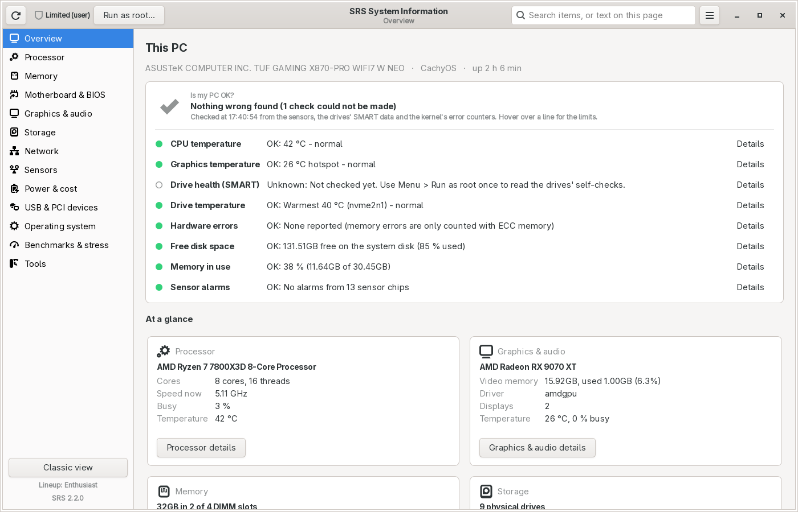

*The main window with the Overview page, on the author's PC (light theme).*

**First things to try:**

1. Read **Is my PC OK?** on the Overview. Every line has a green, yellow or red light and says
   what it means; press **Details** to see the readings behind it.
2. Click **Sensors** on the left for temperatures, fans and voltages.
3. Click **Processor** for the CPU, its cores and caches, and **Memory** for the memory sticks.
4. Type a word such as `temperature` or `BIOS` into the search box at the top and pick an item.
5. Run **Menu -> Run as root (srs-root)...** once, so the items that need root data fill in
   (next section). Until then the drive health line says "Not checked yet".

## 5. Root-only data (srs-root)

### 5.1 In plain words

A few things on Linux can only be read by the administrator (root): memory stick details (SPD),
SMBIOS serial numbers and UUID, drive health (SMART), ACPI tables, CPU model-specific registers
(MSRs) and the full PCI configuration space.

SRS itself **always runs as your normal user**. Instead, a small helper called **`srs-root`**
reads those things once, as root, and saves them as text files in your own folder
`~/.cache/srs/root/`. From then on every panel shows them, without root.

`srs-root` is read-only. It runs: `dmidecode`, `decode-dimms`, `smartctl -x` and
`nvme smart-log` for each disk, copies of `/sys/firmware/acpi/tables`, `lspci -vvvnnxxx`, copies
of `/proc/ioports` and `/proc/iomem`, `dmesg`, `smbstatus` (if Samba is installed) and reads of a
fixed list of AMD and architectural MSRs through `/dev/cpu/N/msr` (it loads the `msr` kernel module
for that). It then gives the files to you (`chown`).

### 5.2 Three ways to run it

1. **From the window:** **Menu -> Run as root (srs-root)...** -> OK -> enter your password once.
   When it finishes, a dialog says "Root data collected into ~/.cache/srs/root" and every open
   panel refreshes.
2. **From a terminal:** `pkexec srs-root` (or `sudo srs-root`).
3. **At every boot, automatically:** see 5.3.

**From the AppImage:** way 1 works the same. The administrator account cannot look inside a
running AppImage (only you can), so SRS first copies the `srs-root` script into a new folder that
only you can open (in `/run/user/<your id>`, or `~/.cache/srs` if that is not possible) and
asks for the password to run that copy. The copy is the same read-only script and is deleted as
soon as it has finished. Nothing is installed and no system settings are changed.

Run it again after you change hardware (new RAM, new drive) or update the BIOS, so the cache is
current. `~/.cache/srs/root/collected.txt` holds the date of the last collection.

**USB drives:** SMART is skipped for USB-attached disks by default, because SMART pass-through is
meaningless on USB sticks and can upset flaky USB enclosures. To include them anyway:
`pkexec env SRS_SMART_USB=1 srs-root`.

**Running the command line as root:** `sudo sysreport-search -save` uses the cache of the user who
ran sudo (or collects one first if there is none). You do not need to do this normally.

### 5.3 Refresh root data at boot

**Menu -> Options -> Refresh root data at boot** keeps the cache fresh with no prompts.

- Ticking it asks for your password **once** and enables the systemd unit
  `srs-root@<your user>.service`. It also collects straight away.
- At every boot the unit runs `srs-root --user <you>` as root, at the lowest CPU priority (Nice 19)
  and idle disk priority, so boot is not slowed. The files are owned by you.
- Unticking it disables the unit (one password prompt). If you cancel the prompt, the tick stays
  as it was.
- By hand: `sudo systemctl enable --now srs-root@$USER.service` (or `disable`).
- The option is greyed out if the unit file is not installed (`/usr/lib/systemd/system/srs-root@.service`
  or `/etc/systemd/system/srs-root@.service`). That is always the case with the AppImage: use the
  package for your distribution if you want this.

## 6. A tour of the main window

The main window is one window with everything in it. In plain words: **the left side is a list of
topics, the right side shows the topic you picked.** Nothing that SRS showed before is gone: every
detail is still on the pages, and the SIV-style windows are one click away
([6.6](#66-classic-view-the-siv-style-windows)).

From top to bottom:

| Part | What it is |
|---|---|
| **Title bar** | **Refresh** (left; also **F5**) reads the page again. Next to it the **badge** says whether SRS can read everything: **Full access** or **Limited (user)** with a **Run as root...** button ([6.10](#610-full-access-or-limited-the-badge)). The **search box** finds any item or text ([6.4](#64-search)). The **menu button** (three lines; also **Ctrl+M**) has Save Report, Lineup, Options, Run as root and more ([6.5](#65-the-menu)). |
| **Sidebar** (left) | The pages: Overview, Processor, Memory, Motherboard & BIOS, Graphics & Audio, Storage, Network, Sensors, Power & Cost, USB & PCI devices, Operating system, Benchmarks & Stress, Tools. **Alt+1** ... **Alt+9**, **Alt+0**, **Alt+-**, **Alt+=** and **Alt+Backspace** jump straight to them, in that order ([12](#12-keyboard-shortcuts)). Below the list: **Classic view**, the tab **lineup** in use ([6.7](#67-arranging-the-tabs-and-lineups)) and the SRS version. |
| **Page** (right) | What you picked. The title bar's second line names it. |

The window follows your desktop's light or dark theme (see **Options -> Theme** in [10](#10-options)).

### 6.1 The pages and the items on them

Every page groups the items of one topic. "Item" is SRS's word for one table of information, such
as **Sensor status** or **SMART drives**; there are 558 of them.

| Page | What it covers | Tabs |
|---|---|---|
| **Overview** | Is the PC healthy, and its key facts | - |
| **Processor** | The CPU: model, cores and threads, clocks, features, caches | CPU Summary, Processors, CPU Clocks, CPUID Features, Cache Levels, CPUID, Microcode, Speculation Control |
| **Memory** | RAM: installed, in use, the sticks and their timings | Memory, DIMMs, SPD (DIMMs), Memory timings, DIMM status/temperatures, Physical memory map, NUMA |
| **Motherboard & BIOS** | The board and its firmware | Machine, Hardware summary, Firmware, BIOS / SMBIOS tables, UEFI information, ACPI tables, TPM device |
| **Graphics & Audio** | Graphics cards, monitors, sound | Graphics, GPU information, GPU clock speeds, GPU temperatures, Monitors, OpenCL, Audio devices |
| **Storage** | Drives, file systems, drive health | Disk drives, Volumes, SMART drives, Partitions, Disk performance, USB disk drives |
| **Network** | Adapters, addresses, Wi-Fi, Bluetooth, connections | Network adapters, IP address, Wi-Fi SSIDs, Bluetooth radios, Routing table, TCP V4 ports, TCP/IP counters |
| **Sensors** | Temperatures, fans, voltages, power | Sensor status, Hardware status, Cooling status (fans), Power status |
| **Power & Cost** | How much power the PC uses, what it costs, history (estimates; see [6.11](#611-power--cost)) | Now, History, Sessions, Price, Setup, Alarms, Sources |
| **USB & PCI devices** | Every device in or plugged into the PC | ALL Devices, PCI bus, USB bus, USB tree, HID bus, Thunderbolt |
| **Operating system** | Linux itself | General Info (SIV's "Windows" panel; the classic **Linux** button), Drivers, Processes, Startup programs, Installed software, Environment, Users |
| **Benchmarks & Stress** | Measure or load the CPU, memory, drives, network and GPU | CPU Benchmarks, Cache & Memory, Storage, OS Latency, CPU Compute, Everyday Work, Network, GPU Benchmark, GPU Burnin, GPU Compute comparison, SRS Pi, Crypto, Prime Sieve, CPU IPI Delay, Memory Latency, Benchmark History (the last results) |
| **Tools** | Look-ups, reports and SRS's own items | About SRS, Help |

The tabs above are the standard ones (the **Enthusiast** lineup; SRS's default is **Expert**). You can change
them on any page at any time ([6.7](#67-arranging-the-tabs-and-lineups)).

**All N items** at the right end of the tab row lists **every** item of the page, the expert ones
included, in alphabetical order. It is a jump list: type a few letters to filter it (every word
must match), then pick an item or press **Enter** for the first one. If the item already has a
tab, SRS goes to it ("open" at the right of the row); otherwise it opens as a **temporary tab**
(its name in *italics*), which is gone the next time SRS starts unless you keep it
(right-click it > **Keep this tab**). On the Processor page the list ends with **Processor CPU-n**
and **Cache levels CPU-n** for each CPU (SIV's CPU-n and Cache-n buttons).

Items that cannot show anything on this PC are left out of the list and the tabs: SIV's
Windows-only items, hardware SIV checks for that this PC does not have (for example RAID
controllers), and - only after you ask SRS to check (**Options -> Check now**, or **Check daily**,
which is off unless you turn it on; [10](#10-options)) - items that came out empty here. The list
says how many are hidden; **Options -> Show hidden items** lists them greyed, with the reason ("Windows-only", "not present", "nothing to
show on this PC"), and you can still open them.

### 6.2 Overview: "Is my PC OK?"

The Overview starts with a line about the PC (board, Linux distribution, time since start-up), then
**Is my PC OK?**: one line per check, each with a light and a plain-words verdict.

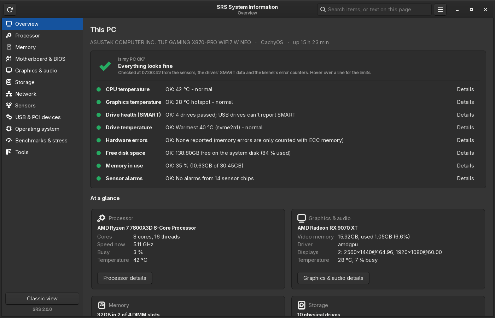

*The Overview in the dark theme: every check is green, and the cards under "At a glance" start below.*

| Light | Means |
|---|---|
| Green dot, "OK:" | Normal. |
| Yellow dot, "Check:" | Worth a look, not urgent. |
| Red dot, "Problem:" | Act on it (the text says what to do). |
| Hollow grey circle, "Unknown:" | SRS could not check it (for example no sensor, or no root data yet). |

| Check | Based on | OK / check / problem |
|---|---|---|
| **CPU temperature** | The hottest CPU sensor (k10temp, coretemp, zenpower), against the CPU's own maximum temperature (*limit*, see below) | below limit − 10 °C / up to limit − 3 °C / limit − 2 °C and up |
| **Graphics temperature** | The GPU's hotspot (junction) sensor, which runs hotter than the edge, against the card's own critical temperature (*crit*) | below crit − 15 °C / up to crit − 6 °C / crit − 5 °C and up |
| **Drive health (SMART)** | Each drive's own self-check, from srs-root's cache | all PASSED / - / any FAILED. "Not checked yet" until srs-root has run once. USB adapters usually cannot pass SMART on. |
| **Drive temperature** | Every drive, against its own warning temperature (*warn*) | below warn − 10 °C / up to warn − 1 °C / warn and up |
| **Hardware errors** | Kernel taint flag M (the CPU reported a machine check), EDAC counters (ECC memory), HardwareCorrupted in /proc/meminfo | none / corrected ECC errors / a machine check, uncorrected errors or faulty pages taken out of use |
| **Free disk space** | The file system mounted at / | below 90 % used / 90-96 % / 97 % and up |
| **Memory in use** | Memory used by programs (cache does not count) | below 90 % / 90-94 % / 95 % and up |
| **Sensor alarms** | Alarm flags of the hardware monitor chips | none / any flag set / - |
| **CPU throttling** | Thermal throttling counters (shown only on CPUs that count them, such as Intel) | never / slowed down at least once / - |

**Where the limits come from.** Each sensor's own limit wherever it publishes one:

- **CPU:** Intel processors report their maximum (coretemp). AMD's driver does not, so for AMD
  desktop Ryzen SRS uses AMD's specified maximum for the model, for example 89 °C for a Ryzen 7
  7800X3D and 95 °C for a Ryzen 9000.
- **Graphics:** the card's own critical temperature for the hotspot sensor, for example 110 °C on
  a Radeon RX 9070 XT.
- **Drives:** each NVMe or SATA drive's own warning temperature, for example 81.85 °C on a
  Samsung 980 PRO. Drives are compared one by one, so a cooler drive with a low limit is not
  hidden behind a warmer one. A drive that only publishes a critical temperature is judged against
  5 °C below it.

Where no limit is known, a general one is used: CPU 85 / 95 °C, graphics 95 / 105 °C, drives
60 / 70 °C. The tooltip says which one applies.

Hover over a line for its limits; **Details** opens the page and tab with the full readings. The
checks repeat every 3 seconds (drive data every 30 seconds); **F5** reads everything again now.
They only read what SRS already shows, and change nothing.

Below the checks, **At a glance** has a card for the processor, graphics, memory, storage, operating
system and motherboard, with the numbers people look for (model, cores, speed now, memory in use,
free space, kernel, BIOS version ...). The button on each card opens its page.

### 6.3 A page

Each page has three parts:

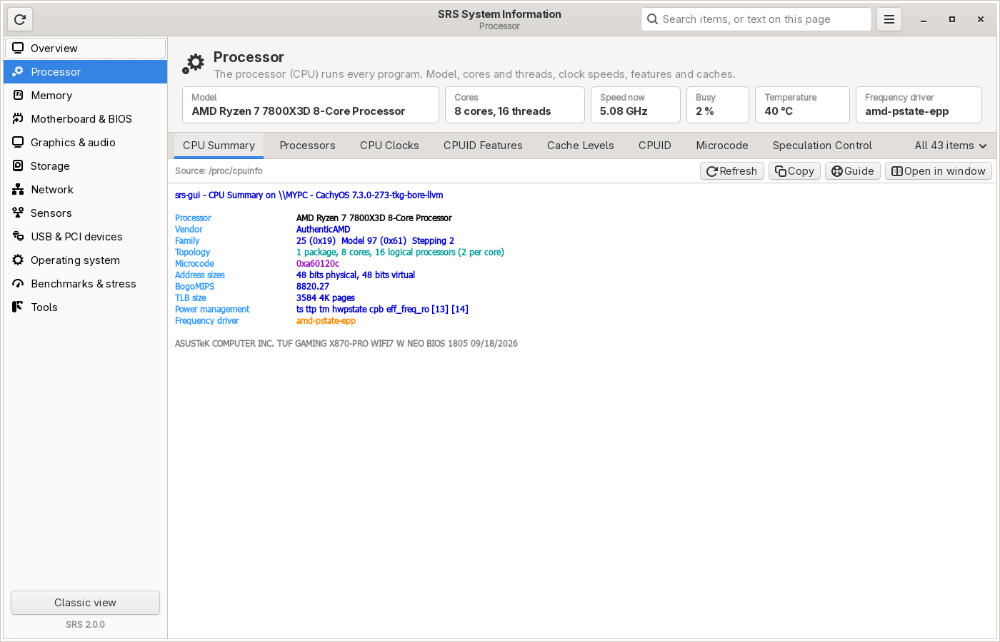

*The Processor page: the heading, the key facts as tiles, then the tabs. **+** adds a tab, and
**All 36 items** at the right end of the tab row lists every processor item that can show
something on this PC.*

1. **The heading:** the topic and one sentence about what it is.
2. **Key facts** as tiles (for example Model, Cores, Speed now, Busy, Temperature on the Processor
   page). They update while the page is open; hover over a tile for an explanation and the full
   value.
3. **The tabs** with the full items - the same text and colours as the classic panels, nothing
   left out. Above the text:

| Control | What it does |
|---|---|
| **Source:** | Where the data comes from (sysfs file, tool, srs-root cache). Hover for the item's id. |
| **Needs root data...** | Shown when part of the item can only be read as root and srs-root has not run yet. |
| **Live** switch | Live items (sensors, clocks, counters ...) refresh by themselves while shown. Turn it off to freeze this tab. **Options -> Update interval** sets the rate for all. |
| **Zero**, **Hide unused** | Sensor status only: start minimum / maximum again; hide sensors that read nothing. |
| **Refresh** | Read the item again (**F5**). |
| **Reset view** | Only on tabs with tables: puts the tables back in the item's own order ([6.8](#68-sortable-tables)). Greyed until you sort. |
| **Copy** | Copy all the text, in the item's own order even when a table is sorted. With **Options -> Redact** on, serials, UUIDs, MACs and the computer name are masked in the copy ([17](#17-privacy-before-you-share-a-report)). |
| **Guide** | This guide at the item's section (**F1**). |
| **Open in window** | The item as a classic panel with its SIV-style button row. |

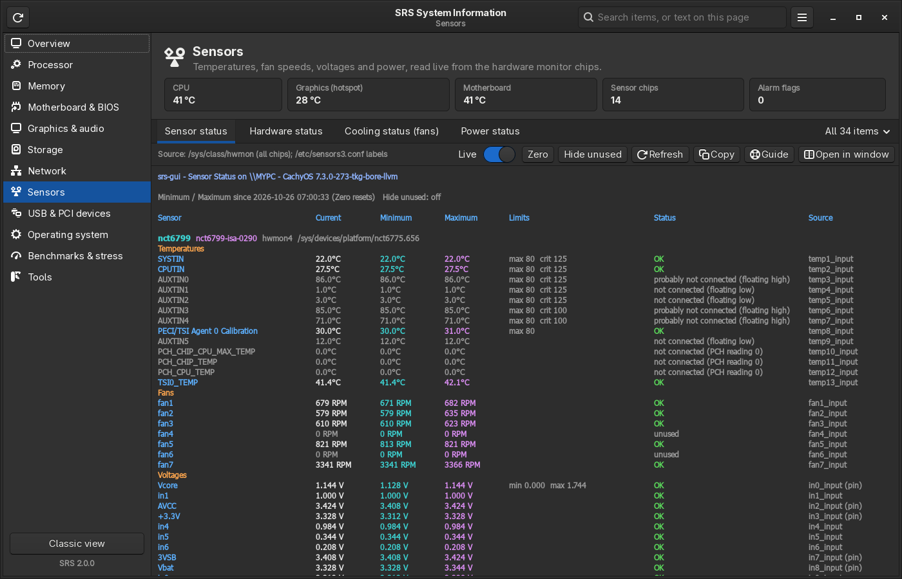

*The Sensors page in the dark theme, with the Sensor status tab: the same text and colours as the
classic Sensors panel, plus the Live switch and the Zero and Hide unused buttons.*

Double-click a line with a PCI or USB ID to look it up (it opens as a tab on the Tools page).
Right-click the text for Copy, Select All, the guide link and the Classic Menu. Click a column
heading in a table to sort it ([6.8](#68-sortable-tables)); right-click a tab for Keep, Replace
with..., Move and Close ([6.7](#67-arranging-the-tabs-and-lineups)).

The **Benchmarks & Stress** page has one tab per tool (2.3.1): Stress & Burnin (CPU and GPU), CPU
Benchmarks, Cache & Memory, Storage, OS latency, CPU compute, Everyday work, Network, GPU Benchmark,
GPU Compare, SRS Pi, Crypto, Prime Sieve, IPI delay and Memory latency, each with its controls and
live results, and compact sections at the top that jump to them ([9](#9-tools)); nothing runs until you press **Run** or
**Start** there. The **Tools** page opens Device ID Lookup, Find in
a system report, Save Report, Run as root and the Classic view.

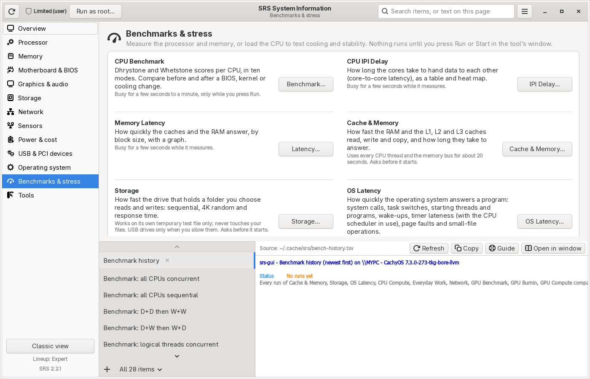

*The Benchmarks & Stress page (light theme): a button for each tool, with what it measures and how long it keeps the PC busy. Only the first launchers show here; scroll for the rest. The tabs below show the last results.*

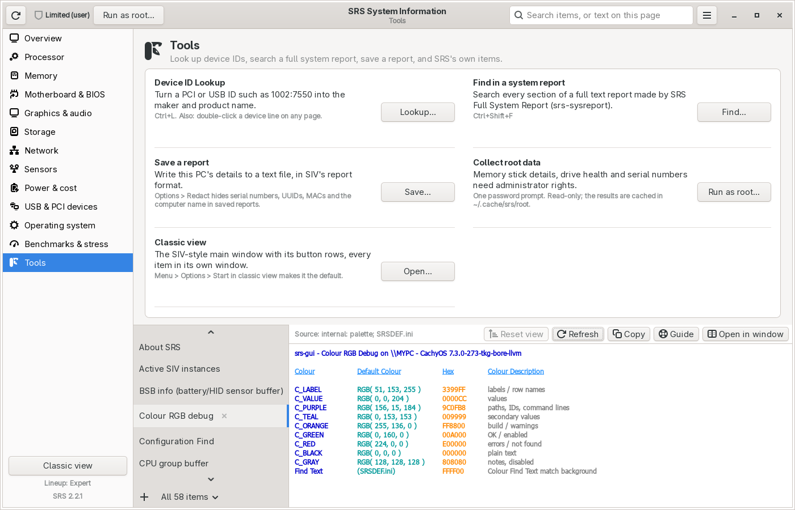

*The Tools page, here with the Colour RGB debug tab open below the launchers.*

### 6.4 Search

The search box in the title bar (**Ctrl+F**):

- **Find an item:** type part of a name or id, for example `temperature`, `smart`, `bios` or
  `usb`, and pick from the list (arrow keys + Enter, or click). The item opens on its page. Page
  names work too. Every word you type must match, so `cpu clock` finds CPU Clocks.
- **Find text on the current tab:** type the text and press **Enter**. All matches are
  highlighted and the first one is selected; **F3** / **Shift+F3** go to the next / previous one.
  The title bar shows how many there are.
- **Item ids with an argument:** type the id and press Enter, for example `processor:3` (CPU-3),
  `cache:0`, `volumes:/`.
- **Esc** clears the box and the highlights.

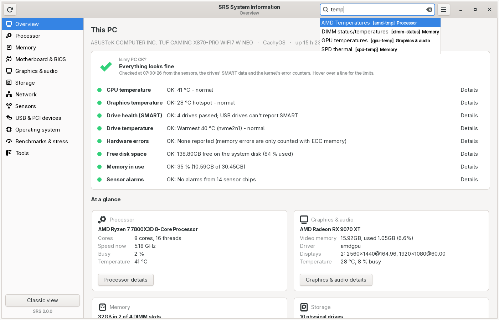

*Typing `temp` in the search box: each suggestion shows the item's name, its id in brackets and the
page it is on.*

To search a full text report on disk, use **Find in System Report** (**Ctrl+Shift+F**, see
[9.6](#96-find-search-a-full-system-report)).

### 6.5 The menu

| Entry | What it does |
|---|---|
| **Save Report...** (Ctrl+S) / **Save All Items...** | Save a text report ([13.1](#131-save-report-and-save-all-items-siv-format-text)). |
| **Copy This Tab** | Same as the tab's Copy button. |
| **Lineup** | Switch between tab lineups, save, export or import one ([6.7](#67-arranging-the-tabs-and-lineups)). |
| **Options** | See [10](#10-options). |
| **Run as root (srs-root)...** | Collect the root-only data ([5](#5-root-only-data-srs-root)). |
| **Find in System Report...** (Ctrl+Shift+F) / **Device ID Lookup...** (Ctrl+L) | The tools of [9.6](#96-find-search-a-full-system-report) and [9.5](#95-device-id-lookup). |
| **Classic View** | Opens the classic main window ([6.6](#66-classic-view-the-siv-style-windows)). |
| **Classic Menu** | The full menu of the classic view: every item by group and every tool ([8](#8-the-menu)). Items open as classic panels. |
| **User Guide** (F1) / **About SRS** | This guide; version, build and data files. |
| **Quit** (Ctrl+Q) | Exit SRS. |

### 6.6 Classic view (the SIV-style windows)

The classic view is SRS's SIV-style interface, exactly as in SRS 1.1: a main window with SIV's
button row, and every item in its own panel window with its own buttons ([7](#7-the-panels-and-their-buttons)).

- **Open it** from **Menu -> Classic View**, the **Classic view** button under the sidebar, or the
  Tools page. Closing it does not close SRS.
- **Start SRS in it:** `srs-gui --gui-classic`, the **Classic View** action of the SRS menu entry
  (right-click it in your application menu), or tick **Options -> Start in classic view** to make it
  the default. From the classic Menu, **Open the new main window** brings the sidebar window back;
  `srs-gui --gui-new` starts with it whatever the option says.


*The classic main window on the author's PC (Ryzen 7 7800X3D, ASUS TUF GAMING X870-PRO WIFI7, 2 x 16 GB DDR5-6000).*

The classic main window is SRS's version of SIV's main panel: **one screen that tells you what this
PC is and how busy it is**. From top to bottom:

| Line | Meaning |
|---|---|
| First line | Operating system and kernel (`CachyOS 7.3.0-...`), motherboard, `host::user`, locale, time zone, BIOS version and date. |
| Second line | Up-time (days, hours:minutes:seconds), current date and time, BIOS, power source (`Mains Power`) and battery charge (empty on a desktop). |
| **Resource Usage** | How much of the memory budget is in use, in percent. |
| **System Physical Memory** | RAM in use now, the total "committed" (promised to programs), and the RAM size. |
| **System Paging File (swap)** | Swap in use and swap size. |
| **Commit Charge (limit)** | Memory promised to programs vs. the kernel's limit (RAM + swap, depending on settings). |
| Kernel line | The running Linux kernel. |
| **CPUs / Cores / Chips / DIMMs** | Logical CPUs (threads), physical cores, CPU packages (sockets) and memory sticks. |
| CPU name | The processor model, as the CPU reports it. |
| DIMM lines | One per memory stick: slot, size, type, speed, maker and part number (needs srs-root data). |
| Last line (grey) | Board maker, model and BIOS. |

The classic main window refreshes every 2 seconds (see [Options -> Update interval](#10-options)).

The full meaning of every value is in the Section Reference: [srs-items.md](SECTIONS/srs-items.md)
and [machine.md](SECTIONS/machine.md).

#### The button row

| Button | Opens |
|---|---|
| **OK** | Closes the window. On the main window this exits SRS. (The window's own close button [X] hides SRS to the tray instead when "Close button hides to tray" is on, see [11](#11-system-tray).) |
| **Copy** | Copies the window's whole text to the clipboard. |
| **Linux** | The operating-system panel (SIV's "Windows" button). |
| **Machine** | Board, BIOS, SMBIOS and memory sticks. |
| **Sensors** | Temperatures, fans, voltages, power. |
| **USB Bus** | The USB tree. |
| **Processors** | CPUs, cores, threads, caches, clocks. |
| **Volumes** | Mounted file systems and disks. |
| **Adapters** | Network adapters. |
| **PCI Bus** | PCI / PCI Express devices. |
| **About** | Version, build, data files, credit and licence. |
| **Help** | Help text and command-line qualifiers. |
| **Menu** | The full menu of every item and tool ([section 8](#8-the-menu)). |

Every button label has an underlined letter: press **Alt + that letter** to click it.

### 6.7 Arranging the tabs and lineups

Each page's tabs are yours to arrange. Nothing you do here changes what SRS reads or shows inside
a tab; it only decides which items have a tab and in what order.

**On the fly:**

| To | Do |
|---|---|
| Add a tab that stays | **+** at the right end of the tab row (or **Ctrl+T**), then pick the item |
| Look at an item once | **All N items**: it opens as a temporary tab (*italic*), not kept |
| Keep a temporary tab | Right-click it > **Keep this tab** |
| Swap a tab for another item | Right-click it > **Replace with...** (same place in the row) |
| Move a tab | Drag it, or right-click > **Move left** / **Move right** |
| Close a tab | Its **x** (shown on the tab in view and on temporary tabs), **Ctrl+W**, a middle-click, or right-click > **Close tab**. The item stays in All N items. |
| Go back to the lineup's tabs for this page | Right-click a tab > **Reset this page's tabs to the lineup** |

SRS remembers each page's tabs and their order when it closes. Temporary tabs are not remembered.

**Navigating long tab lists (2.3.1).** With the tabs in a side list, the mouse wheel over the list goes
to the tab above or below (one notch per tab, no wrap-around), so you get from the top tab to the
bottom one quickly; the arrow keys, Home and End keep working as before ([12](#12-keyboard-shortcuts)).
The Benchmarks & Stress page always starts with its tools as tabs ([9.0](#90-use-at-your-own-risk)).

**Lined-up columns (2.3.1).** On every page with columns, each column is as wide as its longest
entry, so the columns line up on every row; an entry too long for a sensible width ends in "..." -
hover over it for the full text, and Copy, a copied selection and Save Report always give the full
text.

**Which tabs a page opens with:** **Options -> Tabs on each page...** (also right-click a tab >
**Tabs on this page...**). Pick the page, then one of:

- **The standard tabs only** - the tabs listed in [6.1](#61-the-pages-and-the-items-on-them);
- **The tabs ticked below** - tick any items of the page (the filter box finds them); new ones go
  at the end;
- **Every item of the page** - one tab per item that can show something here.

**Options -> Show every item as a tab (all pages)** does the last one for every page at once,
whatever each page is set to. With many tabs the **All N items** jump list is still there, and
the tab bar can take three shapes (**Options -> Tab bar**):

| Tab bar | Looks like |
|---|---|
| **One row that scrolls** | The default: one row with arrows when the tabs do not fit (**Ctrl+PageUp / Ctrl+PageDown** step through them) |
| **Wrapped rows** | Every tab visible, on as many rows as needed |
| **Side list** | The tabs in a column on the left of the page, with a scroll bar when needed |

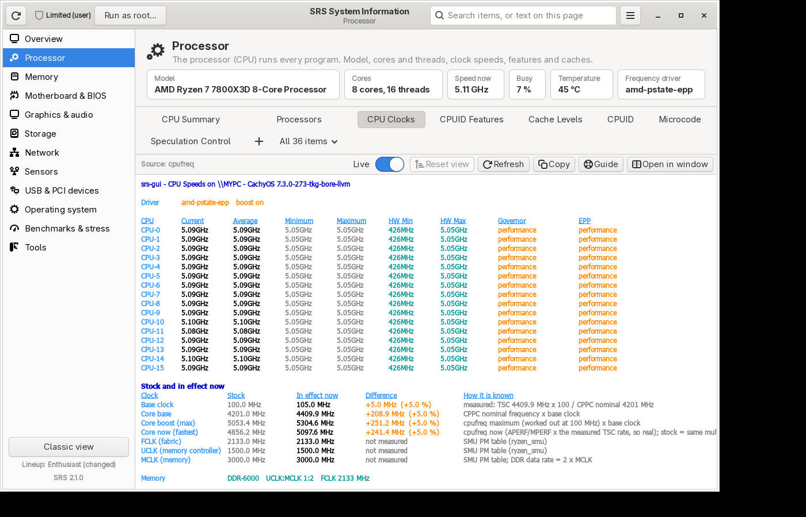

*The Processor page with wrapped tab rows: every tab visible, + and All N items at the end.*

**Lineups** are saved arrangements: which tabs each page has, their order and the tab bar.
**Menu -> Lineup** (also in Options and a tab's right-click menu):

| Lineup | Tabs |
|---|---|
| **Basic** | A few friendly tabs per page (for example Processor: CPU Summary, CPU Clocks, Cache Levels) |
| **Enthusiast** | The standard tabs of [6.1](#61-the-pages-and-the-items-on-them) (the tabs of SRS 2.0). |
| **Expert** | Every item of every page as a tab, in a side list. The default. |
| *Your own* | **Save as new lineup...** keeps the current tabs under a name you choose |

Changes on the fly are allowed at any time without saving: the sidebar then says
"Lineup: Expert (changed)". **Save to this lineup** stores them in your own lineup (the three
built-in ones stay as they are: use **Save as new lineup...**). **Export lineup...** writes a
`.srslineup` file you can share or keep, **Import lineup...** reads one (it gets a new name if one
of yours already has it), **Remove this lineup...** removes one of your own, and **Reset to the
default lineup** goes back to Expert.

The first time the main window opens it asks which lineup you want (Basic, Enthusiast or Expert)
and tells you where to change it later: the menu button (or **Ctrl+M**) -> **Lineup**. It asks only
once. (If you start in the classic view, the question waits until you first open the main window.)
If you used SRS before 2.2, your pages keep the standard tabs of 2.0 (the Enthusiast lineup,
preselected as "the standard tabs, kept") unless you pick another one.

### 6.8 Sortable tables

Tabs that show a table (a row of blue headings over rows of values, such as Processes, CPU Clocks,
Drivers or Installed software) can be sorted: **click a heading**. The first click sorts by that
column smallest or A first (**▲** after the heading), the second click largest or Z first (**▼**).
The headings are underlined and the mouse pointer becomes a hand over them; hover for a hint.

- Numbers sort by value with their units: 512MB comes before 1.5GB, 900 MHz before 4.41GHz,
  9 °C before 45 °C, and RPM, %, V, W and times the same way. Dates sort by date (2026-10-26,
  09/18/2026), `[1234]` process numbers by number, and names with numbers in them naturally
  (CPU-2 before CPU-10).
- Empty cells and `-` always go last.
- Tabs that update by themselves keep the order while they refresh.
- **Reset view** (above the text) puts the item's own order back.
- **Copy** and **Save Report** always give the item's own order, so reports look the same as
  before; only what you see on screen is sorted.
- **Options -> Sortable tables** turns sorting off (the tables are then plain text, as in 2.0).
  The classic panels never sort.

### 6.9 The Startup manager

**Operating system -> Startup programs** opens on **Report**: the Startup programs item as text,
read-only (what Copy and Save Report give). **Manage**, one click away next to it, is the manager:
everything that starts when you log in or when the PC boots, with a switch per item.

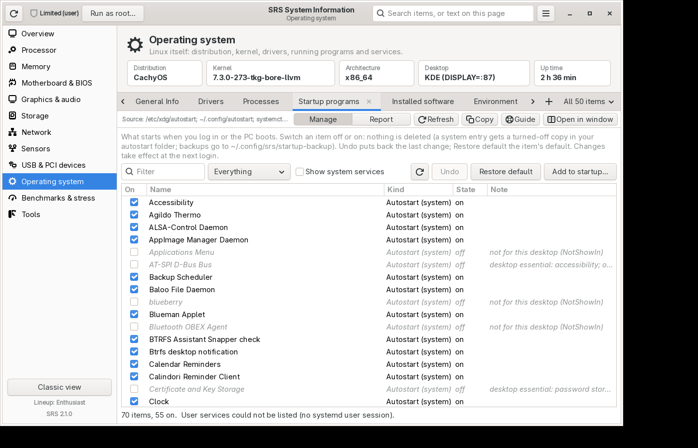

*The Startup manager: autostart entries with their switches, Undo, Restore default and Add to startup.*

| Column | Meaning |
|---|---|
| **On** | Ticked = it starts. Click to turn it off or on. Greyed = it cannot be switched here (see Note). |
| **Name** | The program's name. Hover for the file or unit and its command. |
| **Kind** | **Autostart (system)** - `/etc/xdg/autostart`, for every user; **Autostart (yours)** - `~/.config/autostart`; **Service (user)** - a systemd user unit; **Service (system)** - a system service (only with **Show system services** ticked). |
| **State** | on / off, or the unit's state (enabled, disabled, static, masked ...). |
| **Note** | Why it is off or greyed (for example "only for other desktops"), "turned off by SRS (your copy)", "added by SRS", "desktop essential: ...", a unit's default (preset). |

Click a column heading to sort; the filter box and the list next to it narrow the list down.

**Nothing is ever deleted:**

- A **system autostart entry** is turned off with a copy of it in your `~/.config/autostart` that
  says `Hidden=true` (the desktop uses your copy instead of the system one). Turning it back on
  moves that copy into `~/.config/srs/startup-backup`.
- **Your own autostart entries** get `Hidden=true` or `Hidden=false`. The first time SRS changes
  one, the original is kept in the backup folder.
- **Services:** `systemctl --user enable` / `disable` for user units. System services ask first,
  then use `pkexec systemctl enable` / `disable` (the administrator password); the change applies
  from the next boot.
- **Undo** puts back the last change made in this session (repeat it for earlier ones).
- **Restore default** puts the selected item back to its default: a system entry loses your copy
  (moved to the backup folder), your own entry gets its original file back, an entry SRS added is
  taken out of the list (moved to the backup folder), and a service gets the distribution's
  default (`systemctl preset`).
- **Add to startup...** starts an installed program (pick it from the list) or any command (run
  by `sh`) at every login, with an optional delay in seconds. It writes
  `~/.config/autostart/srs-NAME.desktop`; turn it off or take it out again in this list.

Parts of the desktop ask before they are turned off: Plasma, KWin, KWallet and other password
storage, PipeWire and WirePlumber (sound), the desktop portals (file dialogs, screen sharing), the
polkit agent (admin password prompts), D-Bus, accessibility and the login screen. You can still
turn them off; SRS just says what may stop working. Changes take effect at the next login (system
services at the next boot).

### 6.10 Full access or Limited: the badge

The badge left of the title says what SRS can read right now:

| Badge | Means |
|---|---|
| **Full access** (green shield) | SRS runs as root, or the root-only data has been collected by srs-root ([5](#5-root-only-data-srs-root)). Hover for when it was collected. |
| **Limited (user)** (grey shield) and a **Run as root...** button | SRS runs as you, without root data. Drive health (SMART), memory stick details (SPD), serial numbers and BIOS tables, ACPI tables, CPU registers (MSRs) and the kernel log need it; the tooltip lists them. **Run as root...** collects them once with one password prompt (read-only). |

With **Options -> Refresh root data at boot** the badge says Full access from the start.

### 6.11 Power & Cost

> **Estimates only. Please read.** SRS shows how much power your computer **probably** uses and
> what it **might** cost. These numbers are **estimates**, not a meter reading and not a bill.
> Only some parts of a PC report their own power (usually the processor and the graphics card),
> and even those reports can be off. Everything else (motherboard, memory, drives, fans, lights,
> the power supply's own losses, and your screens) is **guessed** from typical values: that is why
> SRS shows a range. Prices come from what you type or from public tables that may be out of date
> or not match your plan. CO₂ figures use grid averages. Alarms can be late, missed or wrong.
> **Do not use SRS for billing, for safety decisions, or as proof of energy use.** Always check
> your electricity bill and your supplier. SRS is free software provided "as is", without any
> warranty (GPL v2.0 or later, sections 11-12); Eugene Flanagin and the SRS contributors are not
> responsible for any errors, losses, costs or damage that come from using these estimates.

SRS shows this note in full the first time you open the page (press **I understand**), then as a
yellow banner at the top of the page (**Read the note** shows it again) and at the top of every
CSV export.

**In plain words:** the page answers "how much power does this PC use, and what does that cost
me?". The processor and the graphics card tell Linux how much power they use; SRS adds a low and a
high guess for every other part, then allows for the power supply's own losses. The result is a
centre figure with a likely range, for example **about 160 W, likely between 116 W and 205 W at the
wall**. Recording keeps one line per minute, so you can see days, weeks and months, with the cost
at your price.

The page is in the sidebar right under **Sensors** (**Power & Cost**, **Alt+9**). Open it from the
command line with `srs-gui --gui-open=power-cost`. The classic view has no Power & Cost page.

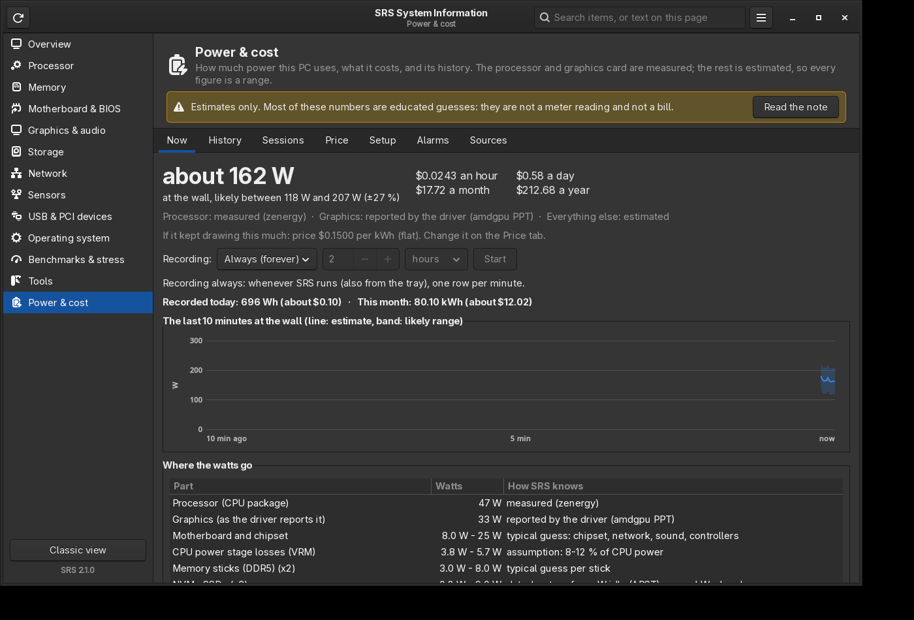

#### Now

- **The big number** is the estimate at the wall, with the likely range under it and the cost per
  hour, day, month and year **if the PC kept drawing this much** at your price.
- The line under it says how each part is known: **measured** (zenergy, RAPL), **reported by the
  driver** (amdgpu), or **estimated**.
- **Recording:** **Off** (nothing is saved; the live figure still works), **For a set time**
  (choose minutes, hours or days and press **Start**; it stops by itself), or **Always (forever)**
  (whenever SRS runs, also hidden in the tray; see the background recorder below for when SRS is
  closed).
- **The last 10 minutes:** the line is the estimate, the shaded band the likely range.
- **Where the watts go:** every part with its watts and where the figure comes from, the power
  supply's losses, and the total at the wall.

#### History

Pick a range (last 24 hours by hour; last 7 or 30 days by day; last 12 weeks by week; last 12
months or everything by month) and **Energy** or **Cost**. Bars are the estimate, the whiskers the
likely range. Hover over a bar for its numbers. The summary line gives the totals, how long SRS
recorded and how long the PC slept, the gaps that were not recorded, CO₂ if you turned it on, and
**busy vs idle**: the energy used while the processor or graphics card was busy (at or above the
Sessions tab's level, 50 % by default) against the rest.

- **Export CSV...** writes the history for a spreadsheet: one row per minute, hour, day, week,
  month or year, the shown range or everything, with a decimal point or a decimal comma (then
  columns are split by `;`). The file starts with `#` lines: the note above, your power supply,
  parts list and price. Columns: `period`, `start_utc`, `kwh_estimate`, `kwh_low`, `kwh_high`,
  `cpu_kwh_measured`, `gpu_kwh_measured`, `cost_<currency>`, `avg_w`, `max_w`, `hours_recorded`,
  `hours_asleep`, `hours_busy`, `kwh_busy`.
- **Re-price...** costs every recorded minute again with today's price settings. Normally each
  minute keeps the price that applied when it was recorded (so a time-of-use or tiered price is
  exact to the minute); use this after correcting a wrong price.

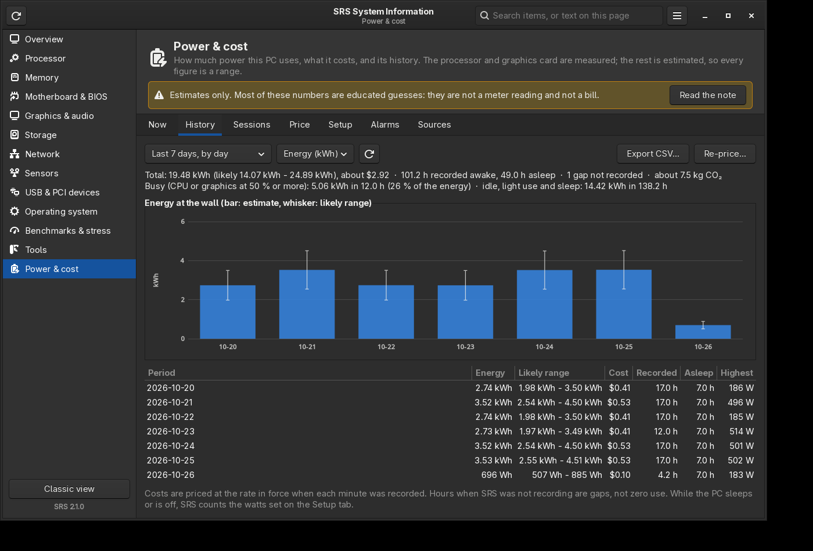

*The history picture uses made-up example data.*

#### Sessions

A **session** is a stretch of heavy use, such as a game or a long render: the processor or the
graphics card busy at or above a level (50 % by default) for 2 minutes, ending after 3 quiet
minutes (all three adjustable). A short pause stays inside the session. Each session shows when it
started, how long it lasted, its energy, cost, highest draw and CO₂. These are **the whole PC's**
figures while the session lasted: Linux cannot split power by program.

#### Price

- **Currency:** pick one (its usual symbol, placement and decimals follow), or **Custom** and
  type your own.
- **Your price:**
  - **Flat:** one price per kWh, from your bill.
  - **Tiered:** up to six tiers ("the first 500 kWh a month at A, then B"). Because the PC is only
    part of your home's use, you can say how much the rest of the home uses a month; SRS counts
    that first, so the PC lands in the tier it really adds to. 0 = count the PC first.
  - **Time of use:** four price levels (names and prices editable) and a grid of 24 hours for
    weekdays and weekends: click an hour to change its level. Each minute is priced at the level
    of its hour.
  - **Taxes and levies** (%) that are not in the price, and a **standing charge** per day. The
    standing charge is off in the totals by default, because the PC does not cause it.
- **Typical prices for your area (offline):** if you don't know your price, pick your country and
  region; SRS fills in an average **from tables built into SRS. Nothing is sent anywhere.** The
  country is pre-selected from your time zone. For the United States, type a five-digit **ZIP
  code** and press Enter: SRS picks the state and shows the utility that probably serves it with its
  average residential price. **Use this price** copies it into "Your price". These are averages for
  an area, not your plan, and they may be out of date; the date of each table is shown. Your own
  bill's price is always better.
- **What if:** the cost a year if the PC were left on 24/7 at today's draw and at this month's
  recorded average, and this month's forecast from the recorded days.
- **CO₂ estimate:** off, or a country's (or the world's) average grid emissions per kWh. Grid
  averages only; your supplier's mix may be very different.

#### Setup

- **Power supply (PSU):** pick yours or the nearest **80 PLUS** level at 115 V or 230 V, and type
  its rating in watts. **I don't know my power supply** uses a wide range. Experts can type an
  efficiency curve as `load %:efficiency %` pairs (for example from the PSU's Cybenetics report)
  and press **Use curve**. The line under it shows the load and efficiency right now.
  - The **Montech CENTURY II 1200W** preset is certified **80 PLUS Gold** and **Cybenetics
    Platinum** (two different test schemes). Its curve is **derived, not measured**: the 80 PLUS
    Gold minimums, lifted to the Cybenetics Platinum average that HWbusters' review found, and that
    review's note that efficiency falls **under 70 % at 2 % load** (about 24 W). The exact
    percentages are only in the review's charts, so the range is kept wide.
  - Below 20 % load (where most PCs idle) the 80 PLUS tests say nothing, so SRS widens the range
    there.
- **Parts that cannot be measured:** SRS starts from what it finds on this PC (memory sticks,
  NVMe drives, hard disks, spinning fans, monitors, the motherboard) with typical low and high
  watts. Double-click a value to change it, untick a row to leave it out, **Add a part...** for
  typical parts (case fans, AIO cooler and pump, fan hub with lighting, LED strips, monitors, ...),
  **Reset to SRS's guess...** to start again. **Counts as:**
  - *Watts each*: low and high watts, times the number.
  - *% of CPU power* / *% of GPU power*: the processor's power stage losses (8-12 %) and the rest
    of the graphics card (5-30 %: the driver's number leaves out fans, memory and power stages).
  - *CPU / Graphics card (if not measured)*: used only when SRS cannot read that part.
  - *Beside the PC (at the wall)*: monitors and speakers; added to the wall figure, not through the
    PSU. Monitors are off by default; the energy label's "on mode" power is the best figure.
  - A fan hub on one motherboard header can drive several fans: SRS only sees one header, so set
    the number of fans yourself.
- **Sleep, off and recording:** the watts the PC draws asleep (default 3 W) and switched off
  (default 1 W), counted while recording; how often to read the sensors (every 2 s by default; the
  energy counters keep exact totals, so 1-10 s is plenty); **Keep recording when SRS is closed**
  (below); where the files are; **Delete all history...**.

#### Alarms

**Add an alarm...** offers: power right now over a limit for some seconds, the average over some
minutes over a limit, energy or cost today or this month reaching a limit, and this month heading
over a budget (a forecast from the days so far). Limits can be in W, kW or BTU/h (power) or in Wh,
kWh, MWh, kJ or MJ (energy); the line under the settings shows the same limit in the other units.
An alarm fires **once**: power alarms again only after the power drops clearly (5 %) below the
limit, day and month alarms once per day or month. They show as desktop notifications (through the
desktop's notification service; no sound from SRS), and on the tab. Energy and cost alarms need
Recording on. **Test notification** shows what one looks like.

#### Sources

What SRS can measure on this PC, in plain words, and the raw readings. **SRS never changes who may
read these files.**

| Source | What it is | Who can read it |
|---|---|---|
| zenergy driver (`Esocket`) | AMD's RAPL energy counter for the CPU package | normal users, by design (the driver limits how often it updates) |
| amd_energy driver | the same counter (older driver) | normal users |
| powercap RAPL (`/sys/class/powercap/intel-rapl:*`) | the CPU package counter, Intel and AMD | **root only since Linux 5.10**: energy readings can leak secrets (PLATYPUS, CVE-2020-8694/8695/12912). SRS uses it only if it is readable. |
| amdgpu `power1_average` (PPT) | the graphics chip's power as the driver reports it | normal users |
| Intel i915 / xe `energy1_input`, nouveau `power1_input` | graphics card energy or power | normal users |
| NVIDIA (proprietary driver) | not read yet: the graphics card row of the parts list is used | |

If the CPU cannot be measured, install the **zenergy** driver (AMD), or run SRS as root for a quick
check; SRS does not ship a rule that opens RAPL to everyone. On AMD the counter is a model inside
the chip, not a meter: good for changes, and it may read lower than a wall meter.

#### Recording, sleep and restarts

- Recording writes one row per minute: seconds recorded, estimate with its low and high, the
  measured CPU and GPU energy, the cost at the price in force, the highest draw and the busy time.
  About 40 MB a year.
- Energy counters run round like an odometer (RAPL here after about 65 kJ: about 23 minutes at
  47 W). SRS reads them every few seconds and **unwraps** them; a reading after a gap too long to
  tell one wrap from two is skipped, not guessed. A counter that goes down without wrapping (a
  driver reload) starts a new baseline.
- **Sleep** is noticed from the clocks (Linux's boot-time clock keeps counting while asleep, the
  monotonic clock does not); the time asleep is counted at the "asleep" watts. **Shut-down to the
  next start** is noticed from the boot ID and counted at the "off" watts (up to 31 days). Time when
  SRS was not running is a **gap**, never made-up data.
- **Keep recording when SRS is closed** writes `~/.config/systemd/user/srs-power-recorder.service`
  and enables it: it runs `srs-gui --power-recorder` as you (not as root) and records only while
  Recording is **For a set time** or **Always**. Unticking it stops and removes the service. Only
  one SRS records at a time (a lock file next to the database); the other shows the same history.

#### Files

| Path | What |
|---|---|
| `~/.local/share/srs/power.db` | The history (SQLite; readable only by you). `power.db.lock` beside it. |
| `~/.config/srs/power.ini` | The page's settings: recording, power supply, parts, price, alarms, sessions. |
| `~/.config/systemd/user/srs-power-recorder.service` | Only when **Keep recording when SRS is closed** is on. |
| `/usr/share/srs-sysinfo/power-zip-rates.tsv` | The US ZIP code to utility table. |

#### Where the built-in figures come from

| Data | Source | Date in SRS 2.3.1 | Licence / terms |
|---|---|---|---|
| US average price by state | U.S. Energy Information Administration, *Electric Power Monthly*, Table 5.6.B (residential, year to date) | August 2026 YTD | U.S. government work (public domain); credit EIA |
| US utility by ZIP code, with its average residential price | NREL, *U.S. Electric Utility Companies and Rates: Look-up by Zip Code (2024)*, from EIA-861 data | 2024 | Creative Commons Attribution 4.0 (CC BY 4.0); reformatted by SRS |
| Europe, price by country | Eurostat, `nrg_pc_204` (households, 2 500-4 999 kWh a year, all taxes and levies) | 2026-S1 | Reuse with the source acknowledged (Eurostat copyright notice). SRS shows the figures unchanged. Eurostat is not responsible for SRS's use of them. |
| Great Britain, price cap | Ofgem, energy price cap (GB average, Direct Debit), unit rate and daily standing charge | 1 October to 31 December 2026 | Published figures, credited to Ofgem |
| CO₂ per kWh by country | Ember, *Yearly electricity data* (emissions intensity) | up to 2025 | CC BY 4.0 |
| 80 PLUS efficiency levels | Wikipedia, "80 Plus" (citing CLEAResult, the certifier) | | Facts, credited |
| Montech CENTURY II 1200W | HWbusters review (Cybenetics Platinum average, under 70 % at 2 % load); PCPartPicker (80 PLUS Gold) | 2026-10 | Facts, credited |

The tables are made by `tools/gen_power_rates.py` from the downloaded files (their addresses are in
the script); SRS itself never goes online for them. Australia (AER Default Market Offer) is not
included yet: type your price.

#### Words used on this page

| Word | Plain meaning |
|---|---|
| **W (watt)** | How fast power is being used *right now*. A 100 W PC uses 100 watts at this moment. |
| **kW (kilowatt)** | 1,000 W. |
| **Wh (watt-hour)** | Energy used *over time*: 100 W for one hour = 100 Wh. |
| **kWh (kilowatt-hour)** | 1,000 Wh: 1,000 W for an hour, or 100 W for ten hours. **Your bill counts kWh.** |
| **J, kJ, MJ (joule)** | Another energy unit: 3,600 J = 1 Wh, 3.6 MJ = 1 kWh. Linux counters count microjoules. |
| **BTU/h** | Heat per hour: 1 W ≈ 3.412 BTU/h. All the power a PC uses ends up as heat in the room. |
| **At the wall** | What the PC draws from the socket, including the power supply's losses. This is what you pay for. |
| **Inside the PC (DC)** | Power after the power supply, used by the parts. Always less than at the wall. |
| **PSU efficiency** | The share of the wall power that reaches the parts: 90 % means 10 % becomes heat in the PSU. |
| **80 PLUS / Cybenetics** | Two certifications of PSU efficiency. 80 PLUS tests at 20, 50 and 100 % load (Titanium also 10 %); Cybenetics tests many loads, light ones too. |
| **RAPL** | The processor's built-in energy counter ("Running Average Power Limit"). Intel measures; AMD models. |
| **PPT** | AMD's "Package Power Tracking": the chip's own power figure. For a graphics card it is not the whole card. |
| **Wrap-around** | A counter reaching its top and starting again from zero, like an old car's odometer. |
| **Tiered price** | The price per kWh changes after so many kWh a month. |
| **Time of use** | The price per kWh depends on the hour and the day. |
| **Standing charge** | What you pay per day whatever you use. |
| **Carbon intensity** | Grams of CO₂ released per kWh on your grid, on average. |


## 7. The panels and their buttons

In the classic view ([6.6](#66-classic-view-the-siv-style-windows)), and from **Open in window** on
any tab, each panel opens in its own window with its own button row, like SIV. Every panel has **OK**
(close) and **Copy** (copy all text). Live panels refresh on a timer; press **F5** to refresh now.

Every panel also has a **Guide** button (right end of the button row; also **F1**, and **Open guide
for this item** in the panel's right-click menu). It opens this guide at that panel's section of the
Section Reference: in the PDF viewer if it is Okular, Evince or Papers (they can jump to a section),
otherwise the HTML copy of the guide in your web browser. **Menu -> User Guide...** opens the start
of the guide. The guide files are `/usr/share/doc/srs-sysinfo/SRS-User-Guide.pdf` and
`/usr/share/doc/srs-sysinfo/html/SRS-User-Guide.html`; the menu entry **SRS User Guide (PDF)**
opens the PDF.

Below is what each panel's extra buttons do. For the meaning of every column and value, follow the
link to the Section Reference.

### 7.1 Linux (SIV's "Windows" panel)

The classic **Linux** button opens the **General Info** item (`windows`; called "Windows (OS)
panel" before SRS 2.0). In the main window it is the first tab of the **Operating system** page.
The operating system: distribution, kernel, boot, desktop session, directories, kernel command
line, per-CPU identification, time zone, up-time, user and locale, displays.
Buttons: Linux, Machine, Sensors, USB Bus, Processors, Volumes, PCI Bus, **ALL Dev** (every device),
**Graphics**.
Reference: [linux-os.md](SECTIONS/linux-os.md), [graphics.md](SECTIONS/graphics.md).

### 7.2 Machine

SMBIOS version, BIOS, system, chassis, board, CPU socket, boot status, memory array and every DIMM slot.


*Machine panel (serial number and UUID blanked out in this picture).*

Buttons: Linux, Machine, **DIMMs** (memory stick details), **Status** (DIMM temperatures and status),
USB Bus, Volumes, PCI Bus, ALL Dev.
Reference: [machine.md](SECTIONS/machine.md).

### 7.3 Sensors

Every hardware monitoring chip the kernel knows (Super-I/O, CPU, GPU, drives, memory, others):
current, minimum, maximum, limits and a plain status for each reading.


Buttons:

- **Zero** - resets the Minimum and Maximum columns to the current values (the "since" time on the
  second line resets too).
- **Status** - the hardware status summary.
- **Cooling** - fans and fan control.
- **Power** - power readings (CPU package, GPU, battery...).
- **Hide** - hides sensors that are unused or not connected; press again to show them.
- Linux, Sensors, Volumes.

Some motherboard inputs are not wired to anything and show nonsense values (for example 70-88 C,
or 0 C). SRS greys them out and labels them "not connected". The Section Reference explains why:
[sensors.md](SECTIONS/sensors.md).

### 7.4 USB Bus

The USB tree: each hub and port, device name, USB version, power draw (mA), class and speed.


Buttons: Linux, Machine, **Link Devices**, USB Bus, **USB Disks**, **HID Bus** (keyboards, mice,
game controllers...), PCI Bus, **USB Info**.
Reference: [buses-1.md](SECTIONS/buses-1.md), [buses-2.md](SECTIONS/buses-2.md).

### 7.5 Processors

Capabilities (packages, cores, threads), and for every logical CPU: IDs, APIC ID, affinity mask,
current clock, ACPI name.


Buttons: Linux, Processors, **Features** (CPU feature flags), **Hypervisor** (virtualisation),
**Groups** (CPU groups / scheduling), **CPU-0, CPU-1, CPU-4, CPU-8** (one CPU's full details),
**Cache-0 ... Cache-3** (cache levels), **CPU Stress** and **CPU Burnin** (both open Stress & Burnin), **Benchmark**.
Reference: [processors.md](SECTIONS/processors.md).

### 7.6 Volumes

Every mounted file system: label, format, free, total, used percent, cluster size, type and volume ID.
Buttons: Linux, Machine, Sensors, USB Bus, Volumes, **Drive /** (details of the root file system),
**FS** (file-system statistics), ALL Dev.
Reference: [storage.md](SECTIONS/storage.md).

### 7.7 Adapters

Network adapters: name, driver, link, speed, addresses.
Buttons: Linux, Adapters, **Counters** (traffic counters), **Interface**, **ARP** (neighbour table),
**Routing**, **TCP V4** / **TCP V6** (open ports and connections), **Wi-Fi**, **Bluetooth**,
**Show DNS**, **Ping** (pings your default gateway), **Main** (brings the main window to the front).
Reference: [network.md](SECTIONS/network.md).

### 7.8 PCI Bus

Every PCI / PCI Express device: location, vendor and device name, class, driver, and the current
PCIe link (width and speed).


Buttons: Linux, Machine, USB Bus, **Properties** (udev properties), **PnP Dev** (ACPI / Plug and
Play devices), Volumes, **Drives**, PCI Bus, **PCI Dev**, **UAA Dev** (audio devices), **ALL Dev**.
Reference: [buses-1.md](SECTIONS/buses-1.md), [buses-2.md](SECTIONS/buses-2.md).

**Tip:** in any panel, **double-click a line that contains a PCI ID** like `1002:7550` to open it in
Device ID Lookup. (USB IDs open on the PCI bus; switch the lookup to USB by hand.)

### 7.9 About and Help

**About** (the item **About SRS**) shows the program and version, build, the data files in use
(hwdata `pci.ids`, `usb.ids`, `pnp.ids` with their dates) and where settings live. Then who made SRS
("Created by Eugene Flanagin"), its licence ("Licensed under" GPL-2.0-or-later) and its home page
(<https://github.com/eugenesflanagin-spec/srs-sysinfo>), and last the statement of origin, credit
and disclaimer. In the main window: **Menu -> About SRS**, or the first tab of the **Tools** page.
**Help** shows help text and the command-line qualifiers.
Their buttons: Linux, DNS Names, Lookup (data files), USB Dev, About, Help; the Lookup panel adds
Signature, SRS DLLs and ID Lookup.
Reference: [srs-items.md](SECTIONS/srs-items.md).

### 7.10 Every other item

Every other item opens in a window with **OK, Copy, Refresh, Menu, Help**.

## 8. The Menu

This is the classic view's Menu. Press **Menu** on the classic main window, press **Ctrl+M** in any
classic window, right-click the text of any panel and choose **SRS Menu**, or use **Menu ->
Classic Menu** in the main window. It has:

1. **Benchmarks & Stress** (a submenu): Stress & Burnin (CPU / GPU)..., Benchmark..., IPI Delay...,
   Latency..., SRS Pi..., Crypto Benchmark..., Prime Sieve..., Cache & Memory..., Storage
   Benchmark..., OS Latency..., CPU Compute..., Everyday Work..., Network Benchmark..., GPU
   Benchmark... and GPU Comparison...; then **Device ID Lookup...**, **Find in
   Report...**, and **Classic view** (from the main window) or **Open the new main window** (when SRS
   started in the classic view). Every entry has its own underlined letter (Alt + letter).

   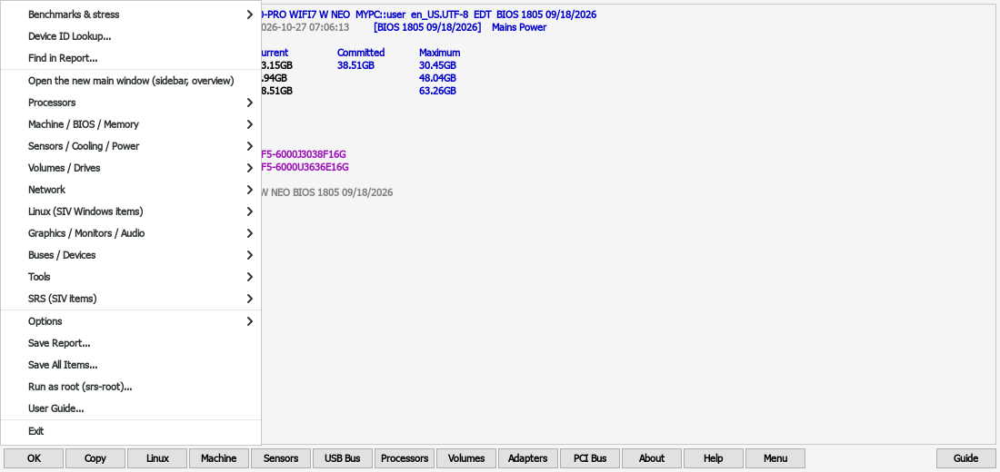

   *The classic Menu, opened with the Menu button on the classic main window.*

   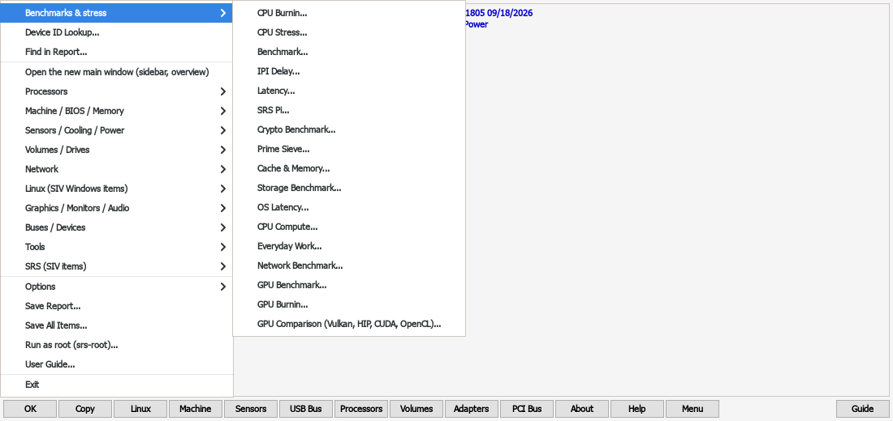

   *The Benchmarks & Stress submenu of the classic Menu.*

2. **Every item, grouped** (the same groups as the Section Reference):
   - Processors
   - Machine / BIOS / Memory
   - Sensors / Cooling / Power
   - Volumes / Drives
   - Network
   - Linux (SIV Windows items)
   - Graphics / Monitors / Audio
   - Buses / Devices
   - Tools
   - SRS (SIV items)

   Each entry shows the title and the item id in brackets, e.g. `Cache Levels [cache]`. Items for
   hardware most PCs lack are marked "(not present)"; Windows-only items are marked "(Windows-only)".
3. **Options** ([section 10](#10-options)).
4. **Save Report...**, **Save All Items...** ([section 13](#13-reports-and-exports)).
5. **Run as root (srs-root)...** ([section 5](#5-root-only-data-srs-root)).
6. **User Guide...**
7. **Exit.**

## 9. Tools

Nothing in this section ever starts by itself: not at launch, not from the menu, and not from a
saved report. You always press Start or Run, and **every benchmark asks before it starts**,
saying what it does, about how long it takes, how many CPU threads (or the GPU) it keeps busy and,
for SRS Pi, how much memory it needs. For GPU Burnin, the internet speed test and the heavy runs
of the CPU Benchmark, SRS Pi, Crypto and Prime Sieve (all CPU threads at once, SRS Pi from 8
million digits, Prime Sieve from 10 billion) **No** is the default answer, so pressing Enter does
not start them. On the command line the benchmarks ask the
same question (`Start now? [y/N]`); `--yes` starts them without asking, for scripts
([CLI reference](CLI-REFERENCE.md#load-and-benchmark-commands-make-the-cpu-busy)).

**What has and has not been tested.** I build and test SRS on one PC (a Ryzen 7 7800X3D with a
Radeon RX 9070 XT, on a wired connection), so anything that needs other hardware may have a bug or
two I haven't met yet. If you find one, please open an issue on
[GitHub](https://github.com/eugenesflanagin-spec/srs-sysinfo/issues) with your hardware and the
report SRS made, and I'll fix it. The release notes and the CHANGELOG (Known limits) say in detail
what was tried; in short, not tried on real hardware so far:

<!-- the list of untested areas: each benchmark adds its line; the GPU pass adds the GPU lines here -->
- GPU Benchmarks: Vulkan only on lavapipe (the Mesa software renderer, which runs on the CPU), with
  small sizes; ROCm/HIP, CUDA on NVIDIA and OpenCL only as far as loading their libraries and
  finding every function SRS needs - no HIP, NVIDIA CUDA or OpenCL work was run on a GPU. CUDA through
  ZLUDA: the GPU Compute comparison was run on the author's Radeon RX 9070 XT (2026-10-29), every CUDA
  row from the built-in kernels (PTX, new in 2.3) without NVRTC; only the cuBLAS FP64 row says "not
  available" (ZLUDA's cuBLAS has none). GPU Burnin with CUDA was not run on the real card. Untested:
  every other real GPU use (AMD, NVIDIA, Intel) and the temperature, power, clock and fan read-outs
  for NVIDIA and Intel. The built-in CUDA kernels were never run on NVIDIA hardware. The NVIDIA CUDA
  toolkit install (Options) was tested with fake package managers only.
- ARM (aarch64) and 32-bit (i686) builds: compile-checked and, where noted, self-tested, not used day to day.
- OS Latency: run on Linux 7.x with the scx_lavd scheduler only; other schedulers (BORE, EEVDF) are
  recognised from the kernel's settings but were not run here.
- CPU Compute: the AVX-512 code has only run on a Zen 4 CPU (Ryzen 7000); the SSE2, AVX2 and plain C
  code was checked by forcing each one on that same CPU, not on older CPUs.
- Everyday Work: run with the compression libraries of one Arch Linux system (zlib-ng in zlib
  mode, zstd 1.5, lz4 1.10, xz 5.8); other versions should work but give different speeds. The
  CRC32C row that uses the CPU's own instruction is in the 64-bit x86 build only.
- Network: run on one wired Ethernet connection only; Wi-Fi, VPN and metered or mobile
  connections are untested. The internet speed test was run once on that connection, against
  Cloudflare, with sensible results (download several hundred Mbit/s, upload about 60 Mbit/s; the
  report showed no IP address, host name or MAC address). It uses Cloudflare's public speed test
  server, which is not a documented API and may change.

**Things to know about the GPU tests:**

- A back end that is not installed shows as "not installed" with a one-line hint (for example
  "install ROCm"); the others still run.
- If your CUDA library is really ZLUDA (CUDA calls translated to an AMD GPU), the column is
  labelled "CUDA (ZLUDA)".
- Every OpenCL driver is its own column, for example "OpenCL (ROCm)" and "OpenCL (Rusticl)" on the
  same GPU; CPU drivers (PoCL) are marked CPU.
- Speeds are only comparable between alike SRS builds and the same GPU driver / runtime versions.
- GPU Burnin ends by itself on a driver error, a GPU that stops answering, a piece of work that
  takes far too long, or a temperature at the limit (default 100 °C). It never changes clocks,
  voltages or fans. It asks before it starts.
- Opening a GPU window's list of GPUs, or pressing Run, reads the list of GPUs through Vulkan, the
  way `vulkaninfo` does: the GPUs are named, but no work is sent to them until you answer Yes.
  ROCm / HIP, CUDA and OpenCL are started only after Yes.


### 9.0 Use at your own risk

Stress tests and benchmarks push the processor, the graphics card, the memory, the drives and the
power supply to their limits. That can bring out faults and cause crashes, freezes, lost or damaged
data, or overheating - more so with an overclock or undervolt. Save your work and close other
programs first.

SRS is provided as is, **without any warranty**, as its licence (the GNU General Public License)
says. The authors are not responsible for any damage, data loss or other harm that comes from using
these tools. This is a plain-English summary, not legal advice; the licence text is what counts.

- **The first time** you press Start or Run in any stress test or benchmark (new main window or
  Classic View), SRS shows these terms with **I Agree** and **I Disagree**. I Agree is remembered
  (`Accepted Load Test Terms=1` in `SRSDEF.ini`). I Disagree starts nothing, and every Start / Run
  asks again until you agree.
- A short notice with a **Terms...** link sits under every stress test and benchmark's controls.
- **Menu > Options > Load test terms (warranty)...** shows them again; I Disagree there withdraws an
  earlier agreement.
- **Command line:** the start question (`Start now (and agree)? [y/N]`) and `--help` of every load
  command carry the same notice. `--yes` starts without asking and counts as agreeing; `burn` starts
  at once (as before) and prints the notice.

**Tools as tabs (new main window, 2.3.1).** On the **Benchmarks & Stress** page every tool is a tab
of its own - Stress & Burnin, CPU Benchmarks, Cache & Memory, Storage, OS latency, CPU compute,
Everyday work, Network, GPU Benchmark, GPU Compare, SRS Pi, Crypto, Prime Sieve, IPI delay and
Memory latency - with its controls and live results in the page itself, no pop-up window. The small
sections at the top of the page (one line each) jump to a tool's tab. The controls are compact and
scroll sideways in a narrow window, so the results get most of the height. Only one test runs at a
time. Leaving a tab, the page or the window while a test runs asks: **Stop it** or **Keep running**
(and stay). Classic View keeps every tool in its own window.

### 9.1 Stress & Burnin (CPU and GPU)

**In plain words:** one place to make the processor, the graphics card or both work at 100% so you
can see whether the PC stays stable and how hot it gets. Use it after building a PC, changing
cooling, or changing BIOS or GPU settings such as overclocks, undervolts (Curve Optimizer) or power
limits. Since 2.3.1 this one window replaces the separate CPU Burnin, CPU Stress and GPU Burnin
windows.

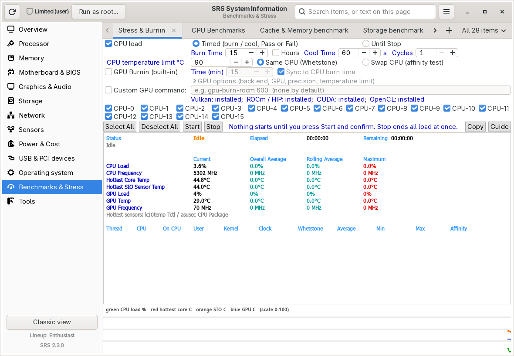

Open: the **Benchmarks & Stress** page -> the **Stress & Burnin** tab (or its section at the top of
the page), the menu entry "SRS Stress & Burnin", the tray menu, or in the classic view Processors ->
CPU Burnin / CPU Stress and Menu -> Benchmarks & Stress -> Stress & Burnin (CPU / GPU)... The old
entries still work: "CPU Burnin" opens it set to **Timed**, "CPU Stress" to **Until Stop**, "GPU
Burnin" with only the GPU ticked. In the new main window it is a tab of the page; Classic View
keeps it as its own window.

**Before the first run SRS asks once** whether you agree to use its stress tests and benchmarks at
your own risk ([9.0](#90-use-at-your-own-risk)). Until you click **I Agree**, Start asks again and
nothing starts.

The three parts, top to bottom:

| Control | Meaning | Default |
|---|---|---|
| **CPU load** | Make the ticked CPUs 100% busy. Untick it to test only the graphics card. | on |
| **Timed (burn / cool, Pass or Fail)** | CPU Burnin: run for the **Burn Time**, rest for the **Cool Time**, repeat for the **Cycles**, then Pass or Fail. | on |
| **Until Stop** | CPU Stress: keep the CPUs busy until you press Stop (safety cap 750 hours). | off |
| **Burn Time** + **Hours** | How long each burn lasts (minutes, or hours when Hours is ticked). | 15 minutes |
| **Cool Time** (s) / **Cycles** | Rest between burns, and how many burn + cool rounds. | 60 s / 1 |
| **CPU temperature limit C** | The run stops at once if the hottest CPU sensor reaches this. | 90 C |
| **Same CPU (Whetstone)** / **Swap CPU (affinity test)** | Workers stay on their CPU and give a Whetstone score each, or move between CPUs to check the system places them correctly. | Same CPU |
| **GPU Burnin (built-in)** | Load the graphics card too, with SRS's own GPU Burnin ([9.18](#918-gpu-burnin)): large matrix multiplications that count every wrong result. | off |
| **Time (min)** | How long the GPU part runs, from Start. It always ends with the CPU run at the latest. | 15 |
| **Sync to CPU stress time** / **Sync to CPU burn time** | Run the GPU exactly as long as the CPU load: with Until Stop until you press Stop; with Timed during each burn phase, pausing while the CPUs cool. The Time box is greyed while it is ticked. | on |
| **GPU options** (folded) | Back end (Auto = Vulkan, ROCm / HIP, CUDA, OpenCL), which GPU (the first, all, or one from the list), FP32 / FP64, and the GPU temperature limit (default 100 C). Closed by default; SRS remembers whether you opened it. | Auto, first GPU, FP32, 100 C |
| **Custom GPU command** | Instead of the built-in GPU Burnin, run your own GPU stress program (for example `gpu-burn-rocm 600`). SRS checks the program exists first. It pauses in each cool phase and stops with the run. Ticking it unticks GPU Burnin and the other way round. | empty |
| **CPU-0 ... CPU-n**, **Select All / Deselect All** | Which logical CPUs get a worker. | all |
| **Start / Stop** | Start (asks first) / stop everything at once. | |

The built-in GPU Burnin runs as its own small process (`srs-gui --gpu-burn-child`): if a GPU driver
hangs, the SRS window stays usable, Stop still works, and the GPU part ends when SRS ends. Its own
messages go to `~/.cache/srs/gpu-load.log`, its result to `~/.cache/srs/bench-gpuburn.txt`.

What you see while it runs, all in the results area under the controls:

- **Status** (Idle / Burning / Cooling / Pass / Fail / Stopped), **Elapsed**, **Remaining**.
- **Current, Overall Average, Rolling Average, Maximum** for CPU Load, CPU Frequency, Hottest Core
  Temp, Hottest SIO (motherboard) Sensor Temp, GPU Load, GPU Temp and GPU Frequency.
- The **GPU** line: GPU Burnin (built-in) running / finished / stopped / could not start, or the
  custom command's state (exit code, not found, killed).
- With GPU Burnin: its live page - per GPU the errors found, GFLOPS now and on average, edge /
  hotspot / memory temperature, power, clock and fan; when it ends, its full result.
- A table per worker thread (CPU, where it runs now, user / kernel time, clock, Whetstone score,
  **Affinity** ok / FAIL) and a graph: green CPU load %, red hottest core C, orange board sensor C,
  blue GPU C.

How to read the result:

- **Pass** - the run finished, no worker failed, no temperature limit was reached, and GPU Burnin
  (when it ran) found no compute errors.
- **Fail** - a CPU worker failed (affinity error), a temperature limit was hit, GPU Burnin found
  compute errors, or GPU Burnin ended early on a safety rule (GPU temperature, driver error, a GPU
  that stopped answering). A temperature stop means the cooling cannot keep up at this load. A
  worker failure, wrong GPU results, or a crash or freeze during the run point to instability
  (overclock, undervolt or memory settings too aggressive).
- Compare Whetstone scores per CPU: a CPU far below the others may be throttling or busy.

Leaving the tab, the page or the window while a run is on asks whether to **Stop it** or **Keep
running** (and stay); closing the tab or the classic window stops it.

**Saved results.** Every run that ends (Pass, Fail or Stopped) is saved to its own file,
`~/.cache/srs/burnin-YYYYMMDD-HHMMSS.txt` (the date and time it ended), the same text as **Copy**.
To compare two runs: `diff ~/.cache/srs/burnin-20261025-101500.txt ~/.cache/srs/burnin-20261025-113000.txt`
or open both in `meld`. SRS never deletes these files.

Full details of every column: [tools.md](SECTIONS/tools.md).

### 9.2 Benchmark (Dhrystone and Whetstone)

**In plain words:** two classic, small CPU tests. **Dhrystone** measures whole-number (integer)
work and reports **DMIPS** (Dhrystone millions of instructions per second). **Whetstone** measures
decimal (floating-point) work and reports **MWIPS** (millions of Whetstone instructions per second).
Higher is better. They are good for comparing the same PC before and after a change, less good for
comparing very different CPUs.


Open: the **Benchmarks & Stress** page -> **Benchmark...**, the menu entry "SRS Benchmark", or in
the classic view Processors -> Benchmark or Menu -> Benchmarks & Stress. The page's **CPU Benchmarks** tab shows
the last results.

Controls: **Mode**, **Seconds per measurement** (0.1-60, default 1), **Run** (asks first: the
mode, about how long it takes and how many CPU threads are busy; for the modes that load many
threads at once - `ac`, `pc`, `lc` - **No** is the default answer). Command line:
`sysreport-search bench ac` (asks first; `--yes` starts at once).
The modes, as in SIV:

| Mode | What runs |
|---|---|
| `ac` | All CPUs concurrently: Dhrystone then Whetstone on every logical CPU at once. |
| `as` | All CPUs sequentially: one logical CPU at a time. |
| `dd` | Per core D+D then W+W: both SMT threads of a core run Dhrystone, then both run Whetstone. |
| `dw` | Per core D+W then W+D: one thread runs Dhrystone while its sibling runs Whetstone, then swap. |
| `ec` / `ep` | Efficiency cores concurrently / one at a time (hybrid CPUs). |
| `lc` / `lp` | Logical (SMT sibling) threads concurrently / one at a time. |
| `pc` / `pp` | Performance (physical) cores concurrently (one thread per core) / one at a time. |

The window lists the last result of every mode. Results are kept between sessions.

### 9.2.1 What hyperthreading (SMT) really does - a worked example

**In plain words:** most modern CPUs run two "threads" on every core. AMD calls this SMT
(simultaneous multithreading), Intel calls it Hyper-Threading. Linux shows each thread as its own
CPU, so an 8-core CPU appears as 16 CPUs. The two threads of a core are **not** two cores: they
share the same core and take turns using its parts. The benchmark modes let you see exactly what
that sharing is worth. This page walks through one real set of results.

**The PC.** One Ryzen 7 7800X3D: 8 cores, 16 threads. Linux numbers its threads so that CPU-0 to
CPU-7 are the first thread of cores 0 to 7, and CPU-8 to CPU-15 are the second thread of the same
cores (CPU-0 and CPU-8 share core 0, CPU-1 and CPU-9 share core 1, and so on). Your PC may number
them differently; the benchmark uses Linux's own list of which threads share a core.

> These numbers are one PC's example, measured on one day. Your CPU, cooling, BIOS settings and
> kernel will give different numbers. Some modes ran 5 seconds per measurement and some 20, and
> differences of 1-2 % between runs are normal noise. What carries over to other PCs is the
> **pattern**, not the exact scores.

**The results** (Total of each mode; higher is better):

| Mode | What ran | Threads busy at once | Dhrystone (DMIPS) | Whetstone (MWIPS) |
|---|---|---|---|---|
| `pp` | first thread of each core, one core at a time | 1 | 1,018,068 | 119,397 |
| `lp` | second thread of each core, one at a time | 1 | 1,012,772 | 118,632 |
| `pc` | first thread of all 8 cores at once | 8 | 971,275 | 112,851 |
| `lc` | second thread of all 8 cores at once | 8 | 967,107 | 112,073 |
| `ac` | all 16 threads at once | 16 | 1,611,893 | 197,840 |
| `dd` | both threads of one core run the same test, one core at a time | 2 | 1,772,110 | 214,340 |
| `dw` | one thread runs Dhrystone while its partner runs Whetstone, one core at a time | 2 | 1,899,990 | 227,781 |

What the numbers show, step by step:

1. **The "physical" and the "logical" thread are equally fast.** `pp` and `lp` differ by about
   0.5 %, and `pc` and `lc` by less than 1 %. That is noise. When a thread has a core to itself,
   it does not matter whether Linux calls it the first or the second thread of that core: it is
   the same core. There is no "real" core and "fake" core.

2. **Loading every core at once costs a few percent.** `pc` (8 cores busy) is about 5 % below
   `pp` (one core busy at a time): Dhrystone -4.6 %, Whetstone -5.5 %. That is not SMT at all. It
   is boost: a CPU runs its highest clock when only one or two cores are busy, and drops the clock a
   little when all of them are, to stay inside its power and temperature limits.

3. **The second thread adds a lot of work.** `ac` (all 16 threads) against `pc` (one thread per
   core, same 8 cores): **+66 % Dhrystone, +75 % Whetstone**. So a second thread did not double
   the work, but it added two thirds or more. Each thread in `ac` kept about 83 % (Dhrystone) and
   88 % (Whetstone) of the speed it had with the core to itself. This happens because one thread
   alone rarely keeps every part of a core busy; the second thread fills the gaps.

4. **The same gain shows on a single core.** `dd` (both threads of one core, one core at a time)
   against `pp` (one thread, one core at a time): **+74 % Dhrystone, +80 % Whetstone**. This is a
   little more than in step 3 because only one core is busy, so it keeps its highest boost clock
   (`dd` is about 10 % above `ac` for that reason).

5. **Mixed work shares a core better than identical work.** `dw` against `dd`: **+7 % Dhrystone,
   +6 % Whetstone**. In `dd` both threads want the same parts of the core (both doing whole-number
   work, then both doing decimal work). In `dw` one thread does whole-number (integer) work while
   its partner does decimal (floating-point) work. Those use mostly different parts of the core, so
   they get in each other's way less: each thread kept about 93-95 % of its solo speed.

6. **One core scores a little lower than the rest.** In the `pp`, `pc`, `ac` and `dd` runs, core 1
   (CPU-1, and its partner CPU-9) was the slowest, a few percent below the others. On this PC that
   core handles most of the hardware interrupts (network, disk and USB events), and every interrupt
   takes a little time away from the benchmark. It is not a faulty core. To see where interrupts land
   on your PC, look at the counts per CPU in `/proc/interrupts`.

**What this means for you:**

- Leave SMT on for work that uses many threads at once (compiling, video encoding, rendering,
  compression): here it gave 66-75 % more total work from the same 8 cores.
- A single thread gains nothing from SMT, and loses nothing either: one thread alone on a core runs
  at full speed.
- Turning SMT off in the BIOS mostly helps in special cases (some games that are sensitive to
  timing, or security settings that ask for it). Measure before and after: run `ac` and `pc` with
  SMT on, then `ac` with SMT off. With SMT off, `ac` should land close to the SMT-on `pc` result.
- To check your own PC, run `pp`, `pc`, `ac`, `dd` and `dw` back to back on an idle PC, two or
  three times, and compare the same steps as above. The [Tools reference](SECTIONS/tools.md)
  explains each mode in detail.

### 9.2.2 Reading the CPU IPI Delay table - a worked example

**In plain words:** the IPI Delay tool (Benchmarks & Stress > IPI Delay, section 9.3) times how long one
CPU takes to hand a small piece of data to another CPU, for every pair of CPUs. When two threads of
a program share data (a lock, a queue, a game engine's job list), this is the delay they pay each
time. The result is a big grid of numbers. This page shows how to read it, using one real result.

**The PC.** One Ryzen 7 7800X3D: one CCD (core complex die, the chip that holds the cores), 8 cores,
16 threads. As in 9.2.1, CPU-0 to CPU-7 are the first thread of cores 0 to 7, and CPU-8 to CPU-15
are the second thread of the same cores (CPU-0 and CPU-8 share core 0, and so on). The test ran
100,000 rounds per pair. Each number is in nanoseconds (ns, billionths of a second): the time for
one cache line (a 64-byte block of memory) to go there and back, divided by 2, so it is the one-way
time.

> These numbers are one PC's example. Other CPUs, BIOS settings and kernels give different numbers,
> and a difference of 1-2 ns between runs is normal noise. What carries over is the **pattern**.

**The result:**

```
From\To 0  1  2  3  4  5  6  7  8  9  10 11 12 13 14 15
CPU-0   -  28 30 29 30 32 34 33 25 28 30 29 30 31 34 33
CPU-1   28 -  30 28 31 28 33 34 28 23 30 27 31 28 32 31
CPU-2   30 30 -  31 29 31 29 31 29 30 23 31 29 32 29 31
CPU-3   29 28 31 -  31 27 30 29 28 28 31 23 31 27 30 29
CPU-4   30 31 29 31 -  29 29 29 29 31 29 32 23 30 29 29
CPU-5   32 28 31 27 29 -  31 27 29 28 31 27 30 23 32 28
CPU-6   34 33 29 30 29 31 -  31 32 32 30 31 28 32 23 30
CPU-7   33 34 31 29 29 27 31 -  33 31 33 29 29 27 31 24
CPU-8   25 28 29 28 29 29 32 33 -  27 29 29 29 30 32 32
CPU-9   28 23 30 28 31 28 32 31 27 -  31 28 31 28 32 30
CPU-10  30 30 23 31 29 31 30 33 29 31 -  31 29 31 29 32
CPU-11  29 27 31 23 32 27 31 29 29 28 31 -  32 27 30 28
CPU-12  30 31 29 31 23 30 28 29 29 31 29 32 -  28 29 29
CPU-13  31 28 32 27 30 23 32 27 30 28 31 27 28 -  32 27
CPU-14  34 32 29 30 29 32 23 31 32 32 29 30 29 32 -  30
CPU-15  33 31 31 29 29 28 30 24 32 30 32 28 29 27 30 -
```

**How to read it:**

- Each **row** is the CPU that sends, each **column** is the CPU that receives. Find the row of one
  CPU and the column of the other: the number where they cross is the delay in ns. Lower is faster.
- The `-` on the diagonal is a CPU paired with itself. That is not measured.
- Each pair is measured once, so the table is a mirror: CPU-3 to CPU-5 is the same number as
  CPU-5 to CPU-3.

What the numbers show, step by step:

1. **The two threads of one core are the fastest pair in every row: 23-25 ns.** CPU-0 and CPU-8
   (25), CPU-1 and CPU-9 (23), and so on up to CPU-7 and CPU-15 (24). Every row has its smallest
   number in the column of its partner thread (CPU n and CPU n+8). These two threads live on the
   same core and share its L1 and L2 caches, so the data never has to leave the core.

2. **Every other pair is 27-34 ns.** Two different cores do not share L1 or L2. The data travels
   through the L3 cache, which all 8 cores on the CCD share. That costs a few nanoseconds more.

3. **Distance on the chip still shows a little.** The highest numbers are core 0 to cores 6 and 7
   (CPU-0 to CPU-6: 34, CPU-0 to CPU-7: 33, and the same for their partner threads), and core 1 to
   cores 6 and 7 (33-34). The cores reach the L3 over a ring, and cores that sit farther apart on
   that ring take a little longer. The whole spread is only about 7 ns.

4. **The table is even.** Apart from the partner threads, no block of the table stands out. That is
   what a one-CCD CPU looks like: all cores are on the same die and share one L3.

**On a CPU with two CCDs** (for example a Ryzen 9 7950X or 9950X) the table typically looks
different. Pairs on the same CCD look like the table above, but pairs where one CPU is on the first
CCD and the other is on the second CCD show a second block of much higher numbers, typically around
70-80 ns. Those pairs do not share an L3: the data has to cross the Infinity Fabric link between
the two dies. The exact numbers depend on the CPU, the memory and fabric clocks, and the BIOS.

**What this means for you:**

- **Find partner threads.** The smallest number in each row tells you which two CPUs share one
  core, whatever numbering your PC uses.
- **See the CCD layout.** A block of much higher numbers shows where one CCD ends and the next
  begins, and which CPUs belong to which CCD.
- **Pin threads that talk to each other a lot.** Games, audio work (a DAW and its plug-ins) and other
  timing-sensitive programs run smoother when their busy threads stay on one CCD, and the lowest
  delay is on one core's two threads. Tools such as `taskset` can keep a program on chosen CPUs.
- **Do not expect it to change with tuning.** Curve Optimizer and voltage changes move the clock
  speed and temperature, but the delay mostly depends on how the chip is built, so this table stays
  about the same. Run it to learn your CPU's layout, not to measure a tweak.

### 9.3 IPI Delay

**In plain words:** measures how long it takes one CPU core to "ping" another and get an answer,
for every pair of CPUs. Shows as a table in nanoseconds and a colour heat map (green = fast,
red = slow). Cores that share a cache or a chip answer faster; cores on different chips
(for example two CCDs on a Ryzen 9) answer slower.
Open: the **Benchmarks & Stress** page -> **IPI Delay...**, or Menu -> Benchmarks & Stress -> IPI Delay... in
the classic view.
Controls: **CPUs** (how many to test), **Rounds per pair** (default 20,000), **Run** (asks first;
two CPU threads are busy at a time, for about a second at the defaults). With **CPUs** at 1 there is
no pair to measure: nothing runs, the window says "Not started" and the last result is kept.
Command line: `sysreport-search ipi` (asks first; `--yes` starts at once; `--cpus 1` exits with 2
and keeps the last result).
For a step-by-step reading of one real result (partner threads, the L3, what a two-CCD CPU
looks like), see [9.2.2 Reading the CPU IPI Delay table - a worked example](#922-reading-the-cpu-ipi-delay-table---a-worked-example).

### 9.4 Latency

**In plain words:** measures how long one memory read takes, for blocks from tiny to large. Small
blocks fit in L1 and answer in about 1 ns; as the block grows past each cache, the time steps up:
L2, L3, then RAM. The steps in the graph show you your cache sizes.
Open: the **Benchmarks & Stress** page -> **Latency...**, or Menu -> Benchmarks & Stress -> Latency... in the
classic view.
Controls: **Largest block (MB)** (1-4096, default 256), **Run** (asks first; one CPU thread and
that much memory, about 3 seconds at the default). Command line: `sysreport-search latency` (asks
first; `--yes` starts at once). Results: a table (block size, time in ns, level) and a curve.

For the **bandwidth** of the RAM and the caches, see [9.11 Cache & Memory](#911-cache--memory).
The newer benchmarks - SRS Pi, Crypto, Prime Sieve, the Benchmark History, Cache & Memory,
Storage, OS Latency, CPU Compute, Everyday Work, Network and the three GPU tests - are in
[9.7](#97-srs-pi) to [9.19](#919-gpu-compute-vulkan-vs-hip-vs-cuda-vs-opencl); the optional NVIDIA
CUDA toolkit is [9.20](#920-the-nvidia-cuda-toolkit-optional).

### 9.5 Device ID Lookup

**In plain words:** every PCI and USB device has a number pair: **vendor ID : device ID**
(for example `1002:7550` = AMD : Radeon RX 9070 series). This tool turns the numbers into names.


Open: **Ctrl+L**, **Menu -> Device ID Lookup...**, the **Tools** page -> **Lookup...**, or
double-click an ID on any tab or panel. In the classic view also the Lookup
panel's ID Lookup button.

Controls:

- **ID** - type the ID and press Enter or **Lookup**. Formats:
  `VVVV`, `VVVV:DDDD`, `VVVV:DDDD:SSSS:ssss` (with subsystem vendor and device), and an optional
  `:RR` revision at the end, e.g. `1002:7550:1EAE:7550:C0`.
- **PCI / USB** - which list to search.
- **Mode** tick box - cycles through three modes, like SIV:
  - **Tree** - "bsearch() of a sorted table": loads the whole hwdata list once, then finds the ID
    instantly. Tries the most specific key first and falls back step by step.
  - **Scan** - reads the `.ids` file line by line. Slower, same answer; useful to check.
  - **Info** - asks the operating system's own device database (systemd-hwdb) instead of the file.

Output: each key tried (the matching one is marked `<`), then **Vendor**, **Subsystem** (if any),
**Stock** (the plain device name) and **Resolved** (the best name found), and how long it took.

### 9.6 Find (search a full system report)

**In plain words:** search a saved full system report (made by **SRS Full System Report**,
[13.3](#133-full-system-report-srs-sysreport)) for any text, like `grep`, with highlighting.


Open: **Ctrl+Shift+F** or **Menu -> Find in System Report...** in the main window, the **Tools**
page -> **Find...**, or the menu entry's "Find in System Report" action. In the classic view:
**Ctrl+F** or Menu -> Find in Report....

Controls:

| Control | Meaning |
|---|---|
| **Match** | What to search for. A regular expression (Python-style) unless Literal is ticked. Press Enter or **Find**. |
| **Ignore case** | Upper and lower case count as the same. |
| **Literal** | Search for the exact text; characters like `.` `[` `(` have no special meaning. |
| **Highlight Matches** | Colour each match (also **Ctrl+H** or the **Highlight** button). |
| **Max** | Show at most this many matches per report file (default 20). |
| **Report** | The report folder to search. Filled with the newest one in `~/sysreports`. |
| **Browse...** / **Latest** | Pick another folder / go back to the newest. |
| **Next / Prev** (or **F3 / Shift+F3**) | Jump between matches. |
| **Colour** | Choose the highlight colour (saved). |
| **Lookup** | Open Device ID Lookup. |

If there is no report yet, Find tells you to run SRS Full System Report first.

### 9.7 SRS Pi

**In plain words:** SRS works out pi to many decimal places and checks every digit. The time shows
how fast one core does heavy number work; a wrong digit means the PC made a mistake (often an
unstable overclock or memory).
Open: the **Benchmarks & Stress** page -> **SRS Pi...**, or Menu -> Benchmarks & Stress -> SRS Pi... in the
classic view. On the command line: `sysreport-search pi --digits 1m`.
Controls: **Digits** (128 thousand to 32 million; each choice shows the time it took on the
author's PC), **SuperPi sizes** (tick for SuperPi's power-of-two digit counts: 16K = 16,384 ...
1M = 1,048,576 ... 32M = 33,554,432), **Method** (Chudnovsky = fast, can use threads; Gauss-Legendre / AGM = the method
SuperPi uses, one thread), **Threads** (default 1, for a single-thread score), **Run** and **Stop**.
**Run asks first**, with the expected time, the threads and the memory it needs; from 8 million
digits, or with all threads, it warns about unstable overclocks and **No** is the default answer.
On the command line it asks the same; `--yes` starts at once.
While it runs the status line shows the time so far and the current step (series, division, square
root). Closing the window also stops it.

Times are **SRS Pi** times, not SuperPi times. SuperPi's "1M" is 1,048,576 digits; SRS's 1 million
is 1,000,000 - tick **SuperPi sizes** for the same digit counts as SuperPi. 32 million digits takes several minutes and 1-2 GB of memory.

### 9.8 Crypto

**In plain words:** how fast the CPU encrypts (AES-128) and fingerprints (SHA-256) data, with and
without its built-in crypto instructions (AES-NI, SHA-NI).
Open: the **Benchmarks & Stress** page -> **Crypto...**. Command line: `sysreport-search crypto`.
Controls: **Threads** (right-hand column; the left column is always one thread), **Seconds per
measurement** (default 1; about 8 seconds in all), **Run** (asks first; with all threads - the
default - every CPU thread is 100% busy, so **No** is the default answer). The official FIPS test
vectors are checked before every run. On the command line it asks the same; `--yes` starts at once.

### 9.9 Prime Sieve

**In plain words:** counts the prime numbers up to 100 million, 1 billion, 10 billion or
100 billion and checks the count. Simple integer and cache work that scales with threads.
Open: the **Benchmarks & Stress** page -> **Prime Sieve...**. Command line:
`sysreport-search prime --limit 1e10`.
Controls: **Count primes up to**, **Threads** (default all), **Run** (asks first; from 10 billion
or with all threads - the defaults - it warns about unstable overclocks and **No** is the default
answer), **Stop**. On the command line it asks the same; `--yes` starts at once.

### 9.10 Benchmark History

Every SRS Pi, Crypto, Prime Sieve, Cache & Memory, Storage, OS Latency, CPU Compute, Everyday Work, Network, GPU Benchmark, GPU Burnin and GPU Compute comparison run adds a line to
`~/.cache/srs/bench-history.tsv`
(time, test, settings, result, build). The **Benchmark History** tab on the Benchmarks & Stress
page shows it, newest first. Compare only lines with the same settings and the same **Build**: a
package built for any x86-64 CPU (`-march=x86-64 -O2`) can score well below a build made for your
own CPU (`-march=native -O3`) - for example SRS Pi 1 million digits 3.1 s vs 2.1 s on a 7800X3D.

### 9.11 Cache & Memory

**In plain words:** how fast the RAM and the L1, L2 and L3 caches read, write and copy, and how long
they take to answer. Use it after a BIOS, EXPO/XMP or memory-timing change.
Open: the **Benchmarks & Stress** page -> **Cache & Memory...**, or Menu -> Benchmarks & Stress -> Cache &
Memory... in the classic view. Command line: `sysreport-search cachemem`.
Controls: **Threads** (default all; the bandwidth results need all of them), **Seconds per test**
(default 1), **Run** (asks first: every thread and the memory bus are busy for about 20 seconds),
**Stop**. The status line names the value being measured. A stopped run shows the values it
finished and says so.

Close other programs first and **never run another benchmark at the same time** (SRS lets only one
run; it cannot stop other programs). The base clock is measured, so boards with a raised reference
clock (for example 105 MHz) show the real value; the Infinity Fabric clock needs the `ryzen_smu`
driver (Ryzen 7000 desktop); memory speed and type need root data (Tools > Collect root data). The
engine is the one from Linux System Audit (LSA) 0.2.0, which is now part of SRS. x86-64 CPUs only.

### 9.12 Storage

**In plain words:** how fast the drive that holds a folder you choose reads and writes - big files,
many small pieces at once, and one small piece at a time (how snappy it feels) - plus the response
time of single reads and writes. It uses its **own temporary test file only**; your files are never
touched, and nothing is left behind, even if SRS is stopped or crashes.
Open: the **Benchmarks & Stress** page -> **Storage...**, or Menu -> Benchmarks & Stress -> Storage Benchmark...
in the classic view. Command line: `sysreport-search storage --dir FOLDER`.
Controls: **Folder** (the line below it names the drive, its connection, the file system and the
free space - never the serial number), **Test file** (256 MB, 1 GB, 4 GB, 16 GB), **Seconds per
test** (default 5), **Standard / Light** (Light uses at most 4 threads), **Allow USB drives** (off
by default), **Run** (asks first), **Stop**.

Folders in RAM (`/tmp` on many systems is RAM, not a drive), on the network or on FUSE are refused,
as is a drive with too little free space. Drive health (SMART) is on the **Storage** page.

### 9.13 OS Latency

**In plain words:** how quickly the operating system answers a program: how long a basic request
to the kernel takes (a *system call*), how fast it switches between two programs (a *context
switch*), how long it takes to start a thread or a program, how soon a sleeping program wakes up,
how late a timer fires, and what a new page of memory or a small file costs. **Lower is better.**
Steady numbers (95% and 99% close to the median) mean a smooth, responsive desktop.
Open: the **Benchmarks & Stress** page -> **OS Latency...**, or Menu -> Benchmarks & Stress -> OS Latency... in
the classic view. Command line: `sysreport-search os-latency`.
Controls: **Samples** (1,000-200,000, default 20,000; the slower tests use a tenth or less),
**Tick test (s)** (1-30, default 3: how long a 1 ms timer is watched), **Run** (asks first),
**Stop**. It takes about 6 seconds at the defaults and keeps only **one or two CPUs** busy, never
all of them.

**What the numbers mean.** Each row is one test, measured many times: **Median** is the typical
time, **95%** and **99%** mean 19 in 20 and 99 in 100 tries were this fast or faster, **Worst** and
**Best** are the extremes, and the sample count is shown. Times are in ns (billionths of a second),
µs (millionths) and ms (thousandths). Below the table SRS names the **CPU scheduler** in use (for
example scx_lavd under sched_ext, BORE or EEVDF), the preemption mode, the timer tick (CONFIG_HZ),
the clock source, the timer slack, transparent huge pages, the CPUs used and the file system of
the test folder (with its mount point; a mount inside your home folder is shown as "your home
folder", so your user name is not in the result). Typical values on a current desktop: a system call 35-70 ns, a switch between
two programs 1-2 µs, starting a thread about 10 µs, starting a program about 150 µs, a wake-up
about 2 µs. Sleeps and the 1 ms tick run about 50 µs late, which is Linux's default timer slack.
Hundreds of µs or missed ticks point to deep power-saving states, heavy background work or a busy
scheduler.

**Safety:** it only reads system settings - no root, and no scheduler, priority or timer change.
The file test works in its own temporary folder in `~/.cache/srs`, which is removed at the end,
after Stop, and (if SRS was killed) on the next run. The result is saved to
`~/.cache/srs/bench-os-latency.txt` and added to the [Benchmark History](#910-benchmark-history).
Tested on one PC only - see the note at the start of this chapter.

### 9.14 CPU Compute

**In plain words:** how fast the processor does floating-point number crunching - the kind of
maths in 3D, video, science and AI programs. Six kinds of work: **matrix multiply** (SGEMM in
single and DGEMM in double precision), **peak multiply-add** (the most sums the CPU can do),
**FFT** (splitting a signal into frequencies), **N-body** (gravity between 1,024 stars),
**Mandelbrot** (a fractal picture) and a small **ray tracer** (a picture with shadows and
reflections). Each runs on one thread and then on all threads at once. **Higher is better.**
Every answer is checked against a known result: a wrong answer is shown as **WRONG** in red
instead of a score, which points to an unstable overclock or undervolt.
Open: the **Benchmarks & Stress** page -> **CPU Compute...**, or Menu -> Benchmarks & Stress -> CPU Compute...
in the classic view. Command line: `sysreport-search compute`.
Controls: **Threads** (default all), **Seconds per test** (default 0.5), **Code** (the best
instruction set the CPU has - SSE2, AVX2 or AVX-512 - or a chosen one), **1 thread only** (skips
the all-threads column: light load, half the time), **Run** (asks first), **Stop**. It takes about
10 seconds at the defaults.

**What the numbers mean.** **GFLOPS** = billions of floating-point operations per second (matrix
multiply, multiply-add, FFT, N-body); **Mpixels/s** = millions of picture points per second
(Mandelbrot, ray tracer). The left column is one thread, the right column all the chosen threads;
the **Code** column says which instruction set was used. FFT and the ray tracer are plain C. The
numbers compare PCs and settings with each other; they are lower than a tuned maths library
(BLAS) would reach.

**Safety:** with all threads, every CPU is 100% busy and gets hot, and AVX-512 draws a lot of
power: **an unstable overclock or undervolt can crash the PC** under this load. Tick **1 thread
only** (command line `--single`) to keep it light. It will not start while CPU Burnin or Stress
runs. The result is saved to `~/.cache/srs/bench-compute.txt` and added to the
[Benchmark History](#910-benchmark-history). Tested on one PC only - see the note at the start of
this chapter.

### 9.15 Everyday Work

**In plain words:** how fast the PC does the work it does all day: **compressing and unpacking
files** (with the zlib, zstd, lz4 and xz libraries your system has), **sorting** numbers and
words, **checksums and hashes** (CRC32, CRC32C, xxHash64, FNV-1a - the fingerprints used to spot
damaged files), **searching and checking text** (finding words, checking JSON and UTF-8 text) and
**running a small program in an interpreter** (like a script language does). Each test runs on
one thread and on all threads. **Higher is better.** Every result is checked (unpacked data must
equal the original, sorted lists must be in order and complete, checksums must match known
values), so a wrong answer is reported instead of a fast number.
Open: the **Benchmarks & Stress** page -> **Everyday Work...**, or Menu -> Benchmarks & Stress -> Everyday
Work... in the classic view. Command line: `sysreport-search work`.
Controls: **Threads** (default all), **Seconds per test** (default 0.5), **1 thread only**, the
test groups (Compression, Sorting, Checksums and hashes, Text processing, Bytecode interpreter)
and the compression libraries (zlib, zstd, lz4, xz) as tick boxes, **Run** (asks first, with the
expected time - about half a minute at the defaults), **Stop**.

**What the numbers mean.** **MB/s** for compression (million bytes of original data per second,
1 MB = 1,000,000 bytes) with the **ratio** (2.5 = the data became 2.5 times smaller) on text-like,
record-like and random data; **Mkeys/s** for sorting (million items per second); **GB/s** for
checksums and text (billion bytes per second); **Mops/s** for the interpreter (million
instructions per second). A library that is not installed shows "not installed"; the rest still
runs. The CRC32C row that uses the CPU's own CRC32 instruction (SSE4.2) is built into the 64-bit
x86 version only; the 32-bit (i686) and ARM (aarch64) versions show it as "not built into this
image", and a CPU without SSE4.2 as "the CPU has no CRC32C instruction".

**Safety:** the test data is generated by SRS from fixed seeds (every run and every PC does the
same work); none of your files are read or written, only the result is saved. With all threads
every CPU is 100% busy, and xz -6 and zstd -19 use about 100 MB of memory per thread (fewer
threads are used, with a note, when memory is short). **Stop** is checked between passes: with
the largest part size (`--part-kib 16384`) one xz -6 pass can take 10-20 seconds, so "Stopping..."
may show for that long (at the default size it is under a second). The result is saved to
`~/.cache/srs/bench-work.txt`, and each test group adds a line to the
[Benchmark History](#910-benchmark-history). Tested on one PC only - see the note at the start of
this chapter.

### 9.16 Network

**In plain words:** two separate tests. **On this computer** sends data between two programs on
your own PC through the loopback connection (127.0.0.1): it shows how fast Linux and the CPU can
move network data, and how long a message takes to go there and back. Nothing leaves the
computer, and the network card is not involved. **Internet speed test** (optional) measures your
real connection with Cloudflare's public speed test server (speed.cloudflare.com): how long a name
lookup takes (DNS), how long it takes to connect, and your download and upload speed with one and
with several connections at once.
Open: the **Benchmarks & Stress** page -> **Network...**, or Menu -> Benchmarks & Stress -> Network Benchmark...
in the classic view. Command line: `sysreport-search net` (loopback) and `sysreport-search net
--internet`.
Controls: **On this computer (loopback)** (ticked), **Internet speed test (asks first)** (not
ticked), **Streams** (connections at once for the "N streams" tests, default 4), **Seconds per
test** (default 5), **IPv4 or IPv6 / IPv4 only / IPv6 only** (internet test), **Run**, **Stop**.
The line under the controls names the connection (wired, Wi-Fi, VPN ...), its link speed and
whether libcurl is installed - never an address.

**Asking first.** Run asks before the loopback test (about 20 seconds, a few CPUs busy). The
internet test **asks separately**, with No as the default answer, and says which server it
contacts, what it measures, how long it takes and **how much data it may use - up to about
1000 MB** with the standard settings (each of the four speed tests stops after 5 seconds or
250 MB; about 250 MB on a 100 Mbit/s line). **Do not run it on a metered or mobile connection.**
The server sees your public IP address, as with any web page; SRS does not show or save it. It
never runs without that Yes. The speed rows need libcurl (installed on almost every Linux system);
without it only the lookup and connect times are measured.

**What the numbers mean.** **Mbit/s** = million bits per second (internet speeds are sold in
Mbit/s; divide by 8 for MB/s). **Average** counts from the first byte received; **peak** is the
best half second. **ms** = thousandths of a second, **µs** = millionths. **Median** = the middle
value, **99% under** = all but the slowest 1%, **jitter** = how much the time changes from one try
to the next, **lost** = UDP packets that never arrived. Internet results vary with the time of
day, Wi-Fi, other traffic and the server.

**Safety and privacy:** no IP address, MAC address, Wi-Fi network name or host name is shown or
saved; only the IP version used. Extra hosts for the connect-time test (`--hosts` on the command
line) are shown by name; one typed as a numeric address is shown as "host N (a numeric address)",
so it never lands in the saved result. A speed test server given with a port
(`https://host:8443`) is timed on that port too. The result is saved to `~/.cache/srs/bench-net.txt` and added to
the [Benchmark History](#910-benchmark-history). Tested on one PC on a wired connection only - see
the note at the start of this chapter.

### 9.17 GPU Benchmark

**In plain words:** how fast your graphics card (GPU) does sums and moves data. It runs short
pieces of work on the GPU through **Vulkan** (the graphics and compute interface that every modern
Linux GPU driver offers - the same one many games use) and checks every answer, so a wrong answer
is reported instead of a fast number. **Higher is better**, except for the latency row, where
lower is better.
Open: the **Benchmarks & Stress** page -> **GPU Benchmark...**, or Menu -> Benchmarks & Stress ->
GPU Benchmark... in the classic view. Command line: `sysreport-search gpu`.
Controls: **GPU** (Default = the first discrete graphics card; open the list to pick another - SRS
reads the list only when you open it: like `vulkaninfo`, opening the list names your GPUs through
Vulkan, and no work is sent to a GPU until you answer Yes), **Seconds per test** (default 1),
**Memory test size** (0 = auto, 256 MiB on most cards; a bigger size is lowered to a quarter of the
video memory and of the PC's memory, and the result says so), **Run** (asks first), **Stop**. The line under the controls
says whether Vulkan is installed.

**What it measures.**

- **FP32, FP16, FP64 multiply-add** - floating-point maths (numbers with a decimal point) at
  three precisions: FP32 (single precision) is what games and most GPU programs use, FP16 (half
  precision) is used by AI and some effects, FP64 (double precision) by science programs. In
  **GFLOPS** - billions of operations per second. Most gaming cards do FP64 at only a small
  fraction of their FP32 speed; that is normal. A card or driver without FP16 or FP64 says "not
  supported".
- **INT32 multiply-add** - whole-number maths, in **GIOPS** (billions per second).
- **Video memory read, write and copy** - how fast the GPU uses its own memory, in **GB/s**
  (1 GB = 1,000,000,000 bytes).
- **Upload and Download** - how fast data moves between the system memory and the graphics card,
  over the PCIe slot, in GB/s.
- **Dispatch latency** - how long the GPU takes to answer an empty piece of work, in **µs**
  (millionths of a second); lower is better.

On a GPU built into the processor (integrated graphics) the memory rows measure the system RAM it
shares, and the page says so.

**Reading the result.** Compare runs on the same PC, with alike SRS builds and the same graphics
driver version: a driver update alone can change the numbers, and the page says which driver ran.
Much lower numbers than last time usually mean heat, a power-saving setting or another program
using the GPU. Upload / download well below what the slot should give can mean the card sits in a
slot with fewer lanes or its link has dropped to a slower speed. A **WRONG RESULT** means the GPU
computed something wrong - usually too much overclock or undervolt, too much heat, or a faulty
card; run [GPU Burnin](#918-gpu-burnin) to check.

**Safety:** Run **asks first**, naming the GPU and the time (about 15 seconds at the defaults),
and says that the GPU works at full load and that an unstable GPU overclock or undervolt can crash
the PC or the display driver under that load. The work is cut into pieces of about 25 ms, one at a
time, so the desktop stays usable; a GPU that stops answering ends the run cleanly with the results
so far; Stop ends it at once. SRS never changes clocks, voltages or fans, and keeps Vulkan overlays
such as MangoHud out of the run. Vulkan is loaded when needed: without it the window says "not
available" and the rest of SRS works as before. The result is saved to
`~/.cache/srs/bench-gpu.txt` and added to the [Benchmark History](#910-benchmark-history). Tested
on a software GPU only - see the note at the start of this chapter.

### 9.18 GPU Burnin

**In plain words:** a stress test for the graphics card, like the CPU part of Stress & Burnin is for the processor. It
keeps the GPU as busy as it can be with large matrix multiplications (big blocks of sums) for as
long as you choose, and checks every single result. A healthy card gets the same answer every
time; a card that is pushed too far (overclocked, undervolted, too hot, short of power) sooner or
later gets one wrong. **0 errors = PASS.** While it runs you see the temperatures, power, clock
and fan speed live.
Open: since 2.3.1 GPU Burnin is part of **Stress & Burnin** ([9.1](#91-stress--burnin-cpu-and-gpu)):
tick **GPU Burnin (built-in)**, untick **CPU load** to test only the GPU, and set its time or **Sync to
CPU stress time**; the old "GPU Burnin" entries open it that way. Command line (unchanged):
`sysreport-search gpu-burn`.
Controls (under **GPU options** in Stress & Burnin): **Back end** (see below; Auto = Vulkan), **GPU** (the first GPU, All GPUs, or one from
the list; the list always comes from Vulkan, like `vulkaninfo`: it names your GPUs and sends them no
work. With ROCm / HIP, CUDA or OpenCL as the back end, SRS starts that runtime only after you
answer Yes and then finds the GPU you picked in its own list by its PCI address), **Precision** (FP32, or FP64 for the double-precision units), **Seconds** (default 60;
600-1800 s, 10-30 minutes, checks an overclock or undervolt properly), **Stop at °C** (default
100), **Run** (asks first), **Stop**. The line under the controls says which back ends are
installed.

**The four back ends, in plain words.** A program can talk to a GPU in several "languages". SRS
can use four of them, and you choose which:

- **Vulkan** - the modern graphics and compute interface that every current GPU driver on Linux
  speaks (AMD, Intel and NVIDIA). Nothing extra to install. The default, and the right choice for
  most people.
- **ROCm / HIP** - AMD's own compute platform, used by AI and science programs on AMD cards. Only
  there if you installed ROCm.
- **CUDA** - NVIDIA's compute platform, used by most AI programs. Needs the NVIDIA driver. If your
  "CUDA" is really **ZLUDA** (a translation layer that runs CUDA programs on an AMD card), SRS
  notices and calls it **CUDA (ZLUDA)**. SRS's CUDA tests are built in, so the NVIDIA CUDA toolkit
  is not needed ([9.20](#920-the-nvidia-cuda-toolkit-optional)).
- **OpenCL** - the older compute interface that works across makers. Every OpenCL driver you have
  (ROCm, Mesa Rusticl, NVIDIA, PoCL on the CPU ...) shows as its own choice.

A back end that is not installed says "not installed" with a hint about what to install; the
others still work (the window checks which are installed in the background when it opens, since
ROCm's libraries are large). Testing through more than one back end tells you whether a problem is
the card or one particular driver. A software renderer such as **llvmpipe** (Mesa's Vulkan driver
that runs on the CPU, installed on many desktops) is never burned as if it were a GPU: Auto, The
first GPU and All GPUs skip it, and picking it says it is not a GPU. On the command line,
`sysreport-search gpu-burn --list` lists the devices of every back end - that starts each runtime
(ROCm / HIP, CUDA, OpenCL) but runs no work on a GPU; `--list --backend vulkan` reads only Vulkan's
list.

**Reading the result.** **PASS** = no wrong result in the whole run. **FAIL** = at least one
wrong result: errors usually mean too much overclock or undervolt, too high a temperature, a weak
power supply, or a faulty card or video memory - undo the overclock or undervolt and run it again.
**Ended early** = a safety rule stopped it (see below); the page says which. **Stopped** = you
pressed Stop (no errors so far). The page also shows the highest edge, hotspot / junction and
memory temperatures, power, clock and fan speed, the average speed in GFLOPS, the number of
multiplications, the matrix size, the back end and the driver version. "not available" means the
card or driver does not report that sensor (for example NVIDIA's own driver gives Linux no
temperature). When the card reports **no temperature at all**, the temperature limit cannot work:
the live readout says "no temperature sensor: limit not active" and the result says the same, so
watch the card yourself (or use a back end and driver that report it).

**Safety - what stops it by itself.** Run asks first, and **No** is the default answer. The
question says that the GPU will draw a lot of power and get hot, that a bad overclock or undervolt
can crash the PC or the display driver, and that a weak power supply or poor cooling can make the
PC shut down. GPU Burnin then ends by itself when:

- the GPU reaches the **temperature limit** (default 100 °C; the hotspot / junction temperature
  when the card reports one, else the edge temperature);
- the driver reports **any error**, or the GPU **stops answering** (device lost);
- one piece of work takes **more than 2 seconds** (each should take about 20 ms);
- you press **Stop**.

If a GPU driver call never comes back at all (a hung driver), SRS waits 15 seconds after the end,
then ends the run with "the GPU driver did not come back" and leaves the GPU alone; restart SRS
(or the PC) before the next GPU test; until then the next GPU test, and CPU Burnin, say so ("a GPU
call did not return earlier; restart SRS"). With **All GPUs**, a card that cannot start (for example
it cannot do FP64) is marked **COULD NOT START** in the table and the others go on; the verdict
(PASS / FAIL) comes from the cards that ran, with a note saying how many could not start (if none
could start, the run says that); a bigger matrix that does not fit in a small card's
memory just keeps the size that worked.

**SRS never changes clocks, voltages or fans** - it only reads them. GPU Burnin does not start
while Stress & Burnin or another benchmark runs, and Stress & Burnin waits until it has finished (its status line says "not started" and why).
The result is saved to `~/.cache/srs/bench-gpuburn.txt` and added to the
[Benchmark History](#910-benchmark-history). The idea of comparing every result with the first
one comes from gpu-burn by Ville Timonen; the code is SRS's own. Tested on a software GPU only -
see the note at the start of this chapter.

### 9.19 GPU Compute: Vulkan vs HIP vs CUDA vs OpenCL

**In plain words:** the same GPU work, run through every way of programming your graphics card
that you have installed (the four back ends explained in [9.18](#918-gpu-burnin)), on the same
card, and shown side by side. It tells you which one is fastest on your PC, and how much faster
the maker's own tuned library is than a plain program.
Open: the **Benchmarks & Stress** page -> **GPU Comparison...**, or Menu -> Benchmarks & Stress ->
GPU Comparison (Vulkan, HIP, CUDA, OpenCL)... in the classic view. Command line:
`sysreport-search gpu-compare`.
Controls: **GPU** (the card, picked by its Vulkan device; the other back ends find the same card
by its PCI address), a tick box per back end (only installed ones can be ticked; the tooltip of a
greyed one says what to install), **Seconds per test** (default 1), **Run** (asks first),
**Stop**.

**Reading the table.** Each row is a test, each column a back end:

- **Own kernel** rows: SRS's own plain matrix multiplication - the same work on every back end,
  so these rows compare the back ends fairly.
- **Vendor library** rows: the maker's tuned library - hipBLAS for ROCm, cuBLAS for CUDA, CLBlast
  for OpenCL. Vulkan has none, so it says "not available". These rows show what real programs
  that use the libraries can get.
- **Multiply-add chain**, **video memory copy**, **upload / download** and **kernel launch round
  trip** (lower is better) work as in the [GPU Benchmark](#917-gpu-benchmark).
- `*` marks the fastest in each row. **(85%)** after a number means that column reached 85% of
  Vulkan's speed in that row (above 100% = faster than Vulkan).
- **CUDA (ZLUDA)**: your CUDA library is really ZLUDA, which runs CUDA programs on an AMD card.
  Since 2.3 SRS's CUDA kernels are **built in** (pre-compiled as PTX), so every CUDA row runs
  without the NVIDIA runtime compiler (NVRTC), which ZLUDA does not have. The CUDA column's
  **software** line says "own kernels built in (PTX)". Only when the graphics driver refuses the
  built-in kernels do the CUDA rows say "not available" and point to
  [Options -> NVIDIA CUDA toolkit](#920-the-nvidia-cuda-toolkit-optional) (then please report your
  driver or ZLUDA version). ZLUDA's cuBLAS has no FP64 matrix multiply, so with ZLUDA the **FP64
  matrix multiply, vendor library** row says "not available: cuBLAS on this driver does not support
  FP64 matrix multiply" - expected, not a fault. On the author's Radeon RX 9070 XT with ZLUDA every
  other CUDA row ran (2026-10-29: own-kernel FP32 matrix multiply 5377 GFLOPS, cuBLAS FP32 16392, cuBLAS FP16 77046, own-kernel FP64 860 GFLOPS).
- **ROCm / HIP** still needs its runtime compiler (hipRTC, part of ROCm) for its own-kernel rows
  and, for the error check, its library rows; without it they say so and are not run.
- **FP64 on OpenCL**: some OpenCL drivers (often Mesa's Rusticl) have no double precision. The
  FP64 rows then say "not available: this OpenCL driver has no FP64 (double precision)".
- Every **OpenCL driver** is its own column, for example "OpenCL (ROCm)" and "OpenCL (Rusticl)" on
  the same card. Drivers that run on the CPU (PoCL) are marked CPU.
- **not installed** means that back end is not on this PC; the line under the table says what to
  install. The other columns still run.
- **not run** means that test did not run because the GPU hung or stopped answering earlier in
  the run: after that, SRS does not touch the GPU again through any back end (a GPU that is having
  trouble should be left alone), and the line under the table says what happened.

Compare results only between alike SRS builds and the same driver and runtime versions; the page
lists each column's version.

**Safety:** Run asks first, naming the back ends, the GPU and the time (about 20 seconds per back
end at the defaults) and that the GPU works at full load; an unstable GPU overclock or undervolt
can crash the PC under that load. ROCm / HIP, CUDA and OpenCL start only after your Yes. The work
is cut into short pieces, a GPU that fails ends its column cleanly, Stop ends the run at once, and
SRS never changes clocks, voltages or fans. The result is saved to
`~/.cache/srs/bench-gpucompare.txt` and added to the [Benchmark History](#910-benchmark-history).
HIP, CUDA on NVIDIA and OpenCL were not run on real hardware by the author (CUDA through ZLUDA was,
on one card) - see the note at the start of this chapter.

### 9.20 The NVIDIA CUDA toolkit (optional)

**In plain words:** the NVIDIA CUDA toolkit is NVIDIA's free set of developer tools for running
programs on NVIDIA graphics cards. SRS only needs one small part of it: the **runtime compiler
(NVRTC)**, which turns SRS's test code into instructions the graphics card understands while SRS
is running. Since SRS 2.3 the CUDA tests come **pre-built**, so most people do not need the
toolkit: GPU Burnin and every CUDA row of the GPU Compute comparison run without it. SRS only
uses the compiler when the graphics driver refuses the pre-built tests. The toolkit can be large
(on Arch Linux about 2.4 GB to download and 5.2 GB on disk), and on AMD computers that use ZLUDA,
installing it can break or remove ZLUDA.

**When SRS asks.** The first time you press **Run** in GPU Burnin (back end CUDA) or the GPU
Compute comparison (CUDA ticked) - and only when it matters: there is an NVIDIA card or a CUDA
library (also ZLUDA) and NVRTC is not installed. The question explains the above, shows what was
found, the exact install command and its size, and has three buttons:

- **Install...** - see "Installing" below. The question still counts as asked: if you then cancel,
  SRS does not ask again until it is restarted.
- **Not now** - not asked again until SRS is restarted. The run goes on with the built-in tests.
- **Don't ask again** - never asked again (stored as `Ask CUDA Toolkit=0` in SRSDEF.ini).

After **Not now** or **Don't ask again** SRS says once: *You can install it later from Options >
NVIDIA CUDA toolkit for GPU tests...*. With ZLUDA the question says the toolkit is **not
recommended**, shows the warning in red, and the button reads **Install anyway...**.

**Options -> NVIDIA CUDA toolkit for GPU tests...** shows the same explanation and the state:
NVIDIA card found or not, the CUDA library (NVIDIA's, ZLUDA, or none), NVRTC installed (with its
version and file) or not, and the install command for your Linux. Buttons: **Install...** (greyed
when NVRTC is already there or your Linux has no command), **Ask me again** (undoes "Don't ask
again") and **Close**. After an install the window checks again at once; no restart is needed.

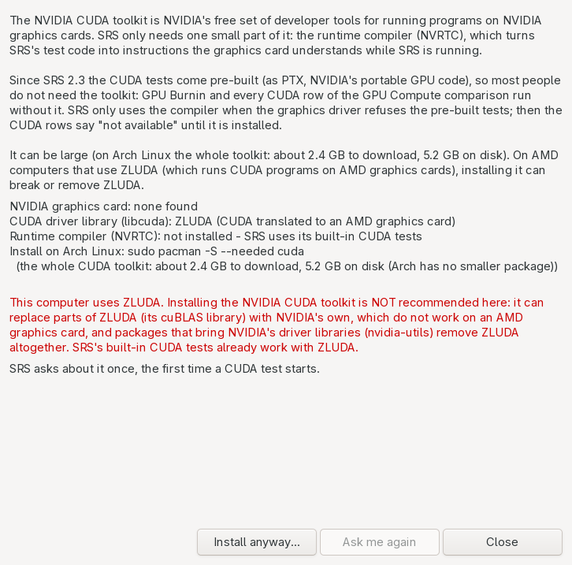

**Installing.** Nothing is installed without your click, and SRS shows the exact command first:

| Linux | Command SRS offers | Size |
|---|---|---|
| Arch Linux and Arch-based (CachyOS, EndeavourOS, Manjaro ...) | `sudo pacman -S --needed cuda` (the whole toolkit; Arch has no smaller package) | about 2.4 GB download, 5.2 GB on disk |
| Debian 13, Ubuntu 24.04 | `sudo apt-get install libnvrtc12` (only the compiler library) | about 20 MB download, 70 MB on disk |
| Debian 12, Ubuntu 22.04 | `sudo apt-get install libnvrtc11.2` | similar |
| Debian / Ubuntu without those | `nvidia-cuda-toolkit` if apt knows it; otherwise instructions: turn on Debian's contrib / non-free or Ubuntu's multiverse, then `sudo apt-get update` | several GB |
| Fedora, openSUSE, others | no command: instructions to add NVIDIA's CUDA repository from <https://developer.nvidia.com/cuda-downloads> and install only its `cuda-nvrtc` package | |

The Debian package names come from Debian's package archive; the Ubuntu ones are inferred from the
CUDA version of Ubuntu's `nvidia-cuda-toolkit` source and were not looked up one by one. That is why
SRS first asks apt (`apt-cache show`, read-only) which of them exists, and offers only that one.

SRS opens a **terminal window** (Konsole, GNOME Terminal, Xfce Terminal, kitty, Alacritty, foot,
xterm ...) and runs the command there with `sudo`, so you type your password and answer the
package manager's questions yourself. Without a terminal program it uses `pkexec` (the system's
password window) and the package manager's "no questions" switch. Then nobody answers the
questions, so they get their default answers: with pacman's `--noconfirm` that is yes to "Proceed
with installation?", the first package where it offers a choice, yes to "Replace X with Y?" and
**no** to "remove the conflicting package?" - so a conflict stops the install and nothing is removed
without you; apt-get's `-y` answers yes (apt still stops for a held or essential package). With
ZLUDA SRS never uses `pkexec`: it needs a terminal window. SRS waits for the result (**Stop
waiting** lets you go on), then says whether it worked and checks for NVRTC again.

**Only system programs.** SRS runs the package manager, `sudo` and `pkexec` only from `/usr/bin`,
`/usr/sbin`, `/bin` or `/sbin`, by their full path (the confirmation shows them as *Programs used*).
A program of the same name anywhere else - for example in `~/.local/bin`, which is often first in
`PATH`, or the current folder - is never used: it could be anything, and it would run as
administrator after your password. If they are not in those folders, SRS does not start the install
and shows the command to type yourself.

It refuses, with the reason, when: a benchmark or burn-in is running; the package database is
locked by another update (pacman's `db.lck`); the computer has no network connection; there is no
`sudo` or `pkexec` in a system folder to ask for the password. Afterwards it explains a cancelled password prompt,
a refused one, or an error of the package manager (no internet, a locked database, a conflict with
an installed package, a "no" answer).

**ZLUDA (AMD cards).** Installing NVIDIA's toolkit is **not recommended** with ZLUDA: on Arch the
`cuda` package puts NVIDIA's own cuBLAS on the library path, where it can take the place of
ZLUDA's (and NVIDIA's cuBLAS does not work on an AMD card), and anything that brings NVIDIA's
driver libraries (`nvidia-utils`) removes ZLUDA, which conflicts with them. SRS's built-in CUDA
tests already work with ZLUDA. If you still go on, SRS asks twice (Cancel is the default) and
always uses a terminal window, so you can answer **no** if the package manager offers to remove
ZLUDA.

**Command line:** `sysreport-search cuda-toolkit` shows the same explanation, state and command;
`--install` runs it after you type `yes` (in a terminal only; twice with ZLUDA);
`--never-ask` / `--ask-again` set the "Don't ask again" choice. The command line never asks on its
own: after a CUDA run without NVRTC it prints a one-line note with the menu path and the command
(not after "Don't ask again").

**GPU words used in 9.17-9.20.**

- **GPU** - graphics processing unit: the graphics card, or the graphics part of the processor.
- **Back end** - the "language" a program uses to talk to the GPU: Vulkan, ROCm / HIP, CUDA or OpenCL.
- **Kernel** - a small program that runs on the GPU, many copies at once.
- **Matrix multiplication (GEMM)** - multiplying two big tables of numbers; the core of AI and
  many science programs, and a hard, steady load for a GPU.
- **FP32 / FP16 / FP64** - numbers with a decimal point stored in 32, 16 or 64 bits (single, half,
  double precision). **INT32** - 32-bit whole numbers.
- **GFLOPS** - billions of floating-point operations per second; a multiply-add counts as two.
- **Hotspot / junction temperature** - the hottest point measured on the GPU chip, usually 10-20 °C
  above the **edge** temperature.
- **ZLUDA** - a layer that lets CUDA programs run on AMD graphics cards.
- **CUDA toolkit** - NVIDIA's free developer tools for NVIDIA graphics cards. SRS can use one part
  of it, NVRTC; optional since 2.3 ([9.20](#920-the-nvidia-cuda-toolkit-optional)).
- **NVRTC** - NVIDIA's runtime compiler: it turns GPU program text into GPU code while a program
  runs. SRS used it for its CUDA tests before 2.3; now only as a fallback.
- **PTX** - NVIDIA's portable GPU code. SRS 2.3 carries its CUDA tests as PTX, and the graphics
  driver (or ZLUDA) finishes it for the card when the test starts.
- **Lavapipe** - Mesa's software Vulkan driver that runs on the CPU; used to test SRS without a
  real GPU.
- **Device lost** - the GPU stopped answering and the driver reset it.

## 10. Options

**Menu -> Options** (in the main window's menu, the classic Menu and the tray's SRS Menu). All are
saved in `~/.config/srs/SRSDEF.ini` and apply at once to every open window.

| Option | What it does | Default |
|---|---|---|
| **Theme -> Light (SIV classic)** | SIV's light look and colours. | classic view |
| **Theme -> Dark** | Dark panels, SIV's colours brightened so they stay readable, dark graphs. | |
| **Theme -> Follow desktop** | Uses your desktop's light/dark setting (via xdg-desktop-portal, set by KDE Plasma and GNOME) and switches live when you change it. Without a portal, it reads `GTK_THEME` or `~/.config/gtk-3.0/settings.ini`. | main window |
| **Update interval** | How often live panels refresh: **Default** (each panel's own rate; the classic main window every 2 s; the Overview checks and the key-fact tiles always every 3 s), 0.5, 1, 2, 3, 5 or 10 seconds, or **Paused** (press F5 to refresh by hand). Stress & Burnin always updates every second. | Default |
| **System tray icon** | Show the tray icon. | on |
| **Close button hides to tray** | Closing the main window hides it instead of exiting. The first time, a notice says SRS is still running in the tray and how to quit (right-click the tray icon > Exit, or Menu > Quit / Ctrl+Q), with **Don't show this again**. | off |
| **Minimize hides to tray (X11 / XWayland)** | Minimising hides it to the tray. Native Wayland apps are not told when they are minimised, so this works only on X11 / XWayland. | off |
| **Start hidden in tray** | Start with no window, just the tray icon. | off |
| **Start with the desktop (autostart)** | Writes `~/.config/autostart/srs-gui.desktop`, which runs `srs-gui --gui-tray` at login. Untick to remove it. | off |
| **Refresh root data at boot** | See [5.3](#53-refresh-root-data-at-boot). | off |
| **Redact identifiers in saved reports and copied text** | Save Report / Save All Items, the **Copy** button and right-click **Copy** / Ctrl+C mask serial numbers, UUIDs, MAC addresses (vendor half kept), boot / machine IDs and the host name - see [17](#17-privacy-before-you-share-a-report). The panels still show everything. | off |
| **Start in classic view** | Start SRS in the SIV-style main window instead of the window with the sidebar ([6.6](#66-classic-view-the-siv-style-windows)). | off |
| **Sortable tables in the main window** | Click a column heading to sort a table ([6.8](#68-sortable-tables)). Off: tables are plain text as in 2.0. | on |
| **Tab bar** | **One row that scrolls**, **Wrapped rows** or **Side list** ([6.7](#67-arranging-the-tabs-and-lineups)). Main window only, like the next five. | One row |
| **Lineup** | Basic, Enthusiast, Expert or your own; save, export, import ([6.7](#67-arranging-the-tabs-and-lineups)). | Expert |
| **Tabs on each page...** | Per page: the standard tabs, the ticked ones, or every item. | standard |
| **Show every item as a tab (all pages)** | Every item that can show something here gets a tab on its page. | off |
| **Show hidden items** | List the items that cannot show anything on this PC (Windows-only, not present, empty), greyed, in All N items, and do not hide their tabs. | off |
| **Check daily which items have nothing to show** | On: once a day, in the background, SRS reads every item to find the ones with nothing to show on this PC and hides them. Off: only when you choose **Check now**. Windows-only items and hardware that is not present are hidden either way. The network items and Ping are never part of the check. | off |
| **Check now which items have nothing to show** | Does that check once, now, in the background. | |
| **NVIDIA CUDA toolkit for GPU tests...** | What the optional NVIDIA CUDA toolkit is for, whether it (its runtime compiler, NVRTC) is installed, the install command for your Linux, **Install...** and **Ask me again** - see [9.20](#920-the-nvidia-cuda-toolkit-optional). | |
| **Load test terms (warranty)...** | The "use at your own risk" terms of the stress tests and benchmarks: read them again, agree, or withdraw your agreement - see [9.0](#90-use-at-your-own-risk). | |
| **Hide to Tray** | Hide all SRS windows now. | |

Until you pick a Theme, the main window follows the desktop and the classic view starts light.

The tray options are greyed out if the tray library is not installed (the menu then says
"(tray needs libayatana-appindicator)").

## 11. System tray

Like SIV's Icon Tray, SRS can live in the system tray (needs `libayatana-appindicator`; works on
KDE Plasma, XFCE, and GNOME with the AppIndicator extension).

- **Tooltip:** CPU temperature and load, GPU temperature and load, updated every 2 seconds.
- **Middle-click:** show / hide SRS.
- **Tray menu:** Show SRS / Hide to Tray, Sensors, Processors, Stress & Burnin (CPU / GPU)...,
  Benchmark..., Find..., **SRS Menu** (the full menu), Exit. Exit really ends SRS (it asks first
  while a stress test or benchmark runs). Sensors and Processors open their
  page in the main window (or their panel in the classic view).
- `srs-gui --gui-tray` starts hidden in the tray.
- Safety: SRS only hides its windows if a tray icon really exists, so it cannot get lost.

## 12. Keyboard shortcuts

In the main window:

| Keys | Action |
|---|---|
| **Alt+1** ... **Alt+9**, **Alt+0**, **Alt+-**, **Alt+=**, **Alt+Backspace** | Go to page 1 to 13, in sidebar order: Overview (Alt+1) ... Sensors (Alt+8), Power & Cost (Alt+9), USB & PCI devices (Alt+0), Operating system (Alt+-), Benchmarks & Stress (Alt+=), Tools (Alt+Backspace) |
| **Ctrl+F** | Search box ([6.4](#64-search)) |
| **Enter** in the search box | Find the text on the current tab |
| **F3 / Shift+F3** | Next / previous match on the tab |
| **Esc** in the search box | Clear it and the highlights |
| **Ctrl+Shift+F** | Find in System Report |
| **Ctrl+H** | Highlight matches on / off (Find) |
| **Ctrl+L** | Device ID Lookup |
| **Ctrl+D** | ALL Devices tab |
| **Ctrl+S** | Save Report |
| **Ctrl+M** | Open the menu |
| **Ctrl+T** | Add a tab to this page (the **+** button) |
| **Ctrl+W** | Close the tab in view (also a middle-click on a tab) |
| **Ctrl+PageUp / Ctrl+PageDown** | Previous / next tab, in every tab-bar layout |
| **Mouse wheel over a side tab list** | Tabs in a side list (Layout: side): the tab above / below, one notch per tab, stopping at the first and last tab (no wrap-around). Over the page itself the wheel scrolls the page; with tabs on top it does not change tabs. It never starts or stops a test: leaving a running tool's tab still asks first (2.3.1) |
| **Up / Down, Home / End** in a tab list or list | GTK's own keys, unchanged: step through the list, first / last. Inside a tool's controls (a spin button, a list box) the arrows change that control, not the tab |
| **Page Up / Page Down** in a tab list | 10 tabs back / on, stopping at the first / last tab (in a list: a page up / down) |
| **Right-click a tab** | Keep, Replace with..., Move, Close, Tabs on this page, Lineup |
| **Click a table heading** | Sort by that column (again: the other way) |
| **F5** | Read the page again |
| **F1** | User guide at the current tab's item (the Overview opens the start) |
| **Shift+F1** | Help item |
| **Ctrl+Q** | Quit (Menu > Quit). It really ends SRS, also with Close to tray on; a stress test or benchmark still running asks first |
| **Alt + underlined letter** | Press that button |
| **Double-click a PCI or USB ID** | Look it up |

In the classic view:

| Keys | Action |
|---|---|
| **Ctrl+M** | Open the Menu |
| **Ctrl+F** | Find |
| **Ctrl+L** | Device ID Lookup |
| **Ctrl+D** | ALL Dev (every device) |
| **Ctrl+S** | Save Report |
| **Ctrl+H** | Highlight matches on / off (Find) |
| **F3 / Shift+F3** | Next / previous Find match |
| **F5** | Refresh this panel now |
| **F1** | Open the user guide at this panel's section |
| **Shift+F1** | Help panel |
| **Esc** | Close this panel (not the main window) |
| **Alt + underlined letter** | Press that button |
| **Double-click a PCI or USB ID** | Look it up (USB IDs from USB items, `VID_xxxx PID_xxxx` and HID names such as `0003:046D:C52B.0001` open a USB lookup) |
| **Right-click panel text** | Copy / Select All, plus the SRS Menu |

## 13. Reports and exports

### 13.1 Save Report and Save All Items (SIV-format text)

- **Menu -> Save Report...** (or **Ctrl+S**) saves SIV's default set of items as text.
  Default file name: `srs-<hostname>.txt` (`srs-report.txt` when **Options -> Redact identifiers in
  saved reports** is on).
- **Menu -> Save All Items...** saves every one of the 558 items. Default name: `srs-<hostname>-all.txt`.
  On the author's PC this is about 52,000 lines and takes about 12 seconds.

The same from the command line ([CLI-REFERENCE.md](CLI-REFERENCE.md)):

```
sysreport-search -save                         # default items to the screen
sysreport-search -save=report.txt              # ... to a file
sysreport-search '-save=[cpuid][sensors]'      # chosen items
sysreport-search '-save=[all]=everything.txt'  # every item to a file
sysreport-search '-save=[all]=share.txt' --redact   # every item, identifiers masked
```

File layout: a header line with program, version, host, date and the item list, then each item
starting with a line `[id]  [category]`:

```
srs-gui - System Report Search V2.3.1 MYPC 2026-10-26 08:18:54  [[cache][sensors]]

[cache]  [hardware]

srs-gui - Cache Levels of CPU-0 on \\MYPC - CachyOS 7.3.0-273-tkg-bore-llvm

Cache                 Size      Ways      Line        Sets       Shared by      CPUs
L1 Data Cache         32K       8         64          64         2              0,8
...
```

Saving a report **never** starts the burner or a benchmark; benchmark items show their last stored
result.

### 13.2 Copy

**Copy** on any window puts its whole text on the clipboard, ready to paste into a forum post or chat.

### 13.3 Full System Report (srs-sysreport)

**In plain words:** one click writes a folder with the output of many standard Linux tools, plus an
`index.html` page that links them, and opens it in your browser. Good for sending to someone who
helps you, and it is what **Find** searches.

Run: the menu entry **SRS Full System Report**, or `srs-sysreport` in a terminal.

- Output folder: `~/sysreports/sysreport-YYYYMMDD-HHMMSS/`.
- Without root: `inxi`, `lscpu`, `cpuid`, `sensors`, `lspci -vvnn`, `lsusb -tv`, GPU (DRM) info,
  `/proc/meminfo`, `lsblk -O`, mounts, kernel and command line, and SRS's own `devices.txt`
  (every PCI/USB device resolved to a name).
- With **one** `pkexec` password prompt: `dmidecode`, `decode-dimms`, `hwinfo --all`, `lshw -html`
  and `smartctl -x` for each NVMe and SATA disk. If you cancel the prompt, those are skipped and a
  note file says so.
- Missing tools just leave a short error in that section's file.

### 13.4 Device list

`sysreport-search devices` prints every PCI and USB device in the PC with its ID and resolved name.
See [CLI-REFERENCE.md](CLI-REFERENCE.md).

## 14. Settings and files

| Path | What |
|---|---|
| `~/.config/srs/SRSDEF.ini` | Settings (SRS's version of SIV's SIVDEF file). See below. |
| `~/.config/autostart/srs-gui.desktop` | Only if "Start with the desktop" is on. |
| `~/.config/autostart/srs-*.desktop` | Programs you added with **Add to startup** ([6.9](#69-the-startup-manager)); also the turned-off copies of system entries (same name as the system file). |
| `~/.config/srs/startup-backup/` | Everything the Startup manager moved out of the way or changed: `NAME.desktop.YYYYMMDD-HHMMSS` and `NAME.desktop.orig`. Nothing there is used; copy a file back to `~/.config/autostart` to use it again. |
| `~/.config/srs/lineups/*.srslineup` | Your own tab lineups ([6.7](#67-arranging-the-tabs-and-lineups)), the same format as Export lineup. |
| `~/.cache/srs/empty-items.txt` | The items that had nothing to show on this PC at the last check (hidden from the tabs and lists). Made only by Options -> **Check now** or **Check daily** ([10](#10-options)); delete it to show those items again. |
| `~/.cache/srs/root/` | Root-only data from `srs-root` (`dmidecode.txt`, `spd.txt`, `smart-*.txt`, `nvme-*.txt`, `acpi-tables/`, `pci-all.txt`, `ioports.txt`, `iomem.txt`, `dmesg.txt`, `msrs.txt`, `collected.txt`). |
| `~/.cache/srs/gpu-load.log` | Output of the last GPU Load command (Burnin / Stress). |
| `~/.cache/srs/burnin-YYYYMMDD-HHMMSS.txt` | The summary of each finished Burnin / Stress run (one file per run). |
| `~/.cache/srs/bench-<mode>.txt` | The last result of each benchmark mode, IPI Delay and Latency. |
| `~/.cache/srs/bench-pi.txt`, `bench-crypto.txt`, `bench-prime.txt`, `bench-cachemem.txt`, `bench-storage.txt`, `bench-os-latency.txt`, `bench-compute.txt`, `bench-work.txt`, `bench-net.txt`, `bench-gpu.txt`, `bench-gpuburn.txt`, `bench-gpucompare.txt` | The last result of SRS Pi, Crypto, Prime Sieve, Cache & Memory, Storage, OS Latency, CPU Compute, Everyday Work, Network, GPU Benchmark, GPU Burnin and GPU Compute comparison. |
| `~/.cache/srs/bench-history.tsv` | One line per run of SRS Pi, Crypto, Prime Sieve, Cache & Memory, Storage, OS Latency, CPU Compute, Network, GPU Benchmark, GPU Burnin and GPU Compute comparison, and one per test group of Everyday Work (time, test, settings, result, build). |
| `~/sysreports/sysreport-*/` | Full system reports. |
| `/usr/share/hwdata/pci.ids`, `usb.ids`, `pnp.ids` | Device name lists (from the hwdata package, not part of SRS). |
| `/usr/lib/systemd/system/srs-root@.service` | The boot-time collector unit. |
| `/usr/share/doc/srs-sysinfo/` | README, CHANGELOG, EVIDENCE, CHECKLIST.tsv (the full item list), this guide as `SRS-User-Guide.pdf`, `html/SRS-User-Guide.html` and the Markdown sources (`USER-GUIDE.md`, `CLI-REFERENCE.md`, `GLOSSARY.md`, `SECTIONS/`, `images/`). |
| `/usr/share/applications/srs-user-guide.desktop` | The **SRS User Guide (PDF)** menu entry. |
| `~/.local/share/srs/power.db`, `~/.config/srs/power.ini` | **Power & Cost** history and settings ([6.11](#611-power--cost)). |

`SRSDEF.ini` keys (section `[SRSDEF]`). You normally change these through the menus; editing by
hand is fine while SRS is closed.

| Key | Values | Meaning |
|---|---|---|
| `Theme` | `Light`, `Dark`, `System` | Options -> Theme (`System` = Follow desktop). Not set: the main window follows the desktop, the classic view is light. |
| `Update Interval` | milliseconds; `0` = default, `-1` = paused | Options -> Update interval |
| `Tray Icon` | `1` / `0` | Options -> System tray icon |
| `Close To Tray` | `1` / `0` | Options -> Close button hides to tray |
| `Minimize To Tray` | `1` / `0` | Options -> Minimize hides to tray |
| `Start In Tray` | `1` / `0` | Options -> Start hidden in tray |
| `GPU Load Command` | text | Stress & Burnin: Custom GPU command |
| `Stress GPU Burnin`, `Stress GPU Minutes`, `Stress GPU Sync`, `Stress GPU Backend`, `Stress GPU Precision`, `Stress GPU Limit`, `Stress Until Stop`, `Stress GPU Options Open` | numbers | Stress & Burnin: GPU Burnin on, its minutes, Sync, back end (0 Auto, 1 Vulkan, 2 ROCm / HIP, 3 CUDA, 4 OpenCL), FP64, GPU limit C, Until Stop, GPU options open (2.3.1) |
| `Accepted Load Test Terms` | `1` / `0` | The load test terms agreed (the terms' version), `0` = not yet or withdrawn ([9.0](#90-use-at-your-own-risk)) |
| `Tray Close Notice Off` | `1` / `0` | The one-time "still running in the tray" notice was seen |
| `Colour Find Text` | 6 hex digits, e.g. `FFFF00` | Find highlight colour |
| `Highlight Matches` | `1` / `0` | Find highlighting |
| `Font Name` | text | Kept for SIV compatibility; not used for drawing |
| `Redact Reports` | `1` / `0` | Options -> Redact identifiers in saved reports and copied text |
| `Classic View` | `1` / `0` | Options -> Start in classic view |
| `Sortable Tables` | `1` / `0` | Options -> Sortable tables in the main window |
| `All Items As Tabs` | `true` / `false` | Options -> Show every item as a tab |
| `Show Hidden Items` | `true` / `false` | Options -> Show hidden items |
| `Check Empty Items` | `true` / `false` | Options -> Check daily which items have nothing to show (default `false`) |
| `Ask CUDA Toolkit` | `1` / `0` | `0` = "Don't ask again" in the NVIDIA CUDA toolkit question; Options -> NVIDIA CUDA toolkit -> **Ask me again** or `sysreport-search cuda-toolkit --ask-again` sets `1` (default `1`) |
| `SIO Sensors` | e.g. `nct6799:AUXTIN1` | Super-I/O inputs the burner should treat as connected |

Section `[Tabs]` holds the main window's tabs as they are now: `Lineup` (the lineup they came
from), `Layout` (`row`, `wrap` or `side`), and per page `<page>=id;id;...` and `<page> Every=true`
when the page shows every item. Page names: `processor`, `memory`, `board`, `graphics`, `storage`,
`network`, `sensors`, `devices`, `os`, `bench`, `tools`.

Environment variables:

| Variable | Effect |
|---|---|
| `SRS_SMART_USB=1` | `srs-root` also reads SMART from USB-attached disks. |
| `SRS_KWH_COST`, `SRS_CURRENCY` | Electricity price and currency symbol for the kWh Cost item (default `$0.15` per kWh). Example: `SRS_KWH_COST=0.30 SRS_CURRENCY=EUR srs-gui`. |
| `SRS_OPEN=item,item` | Same as `--gui-open=` (open panels or tools at start). |
| `SRS_DOC_DIR=folder` | Where the Guide button, F1 and `guide` look for `SRS-User-Guide.pdf` and `html/` (default `/usr/share/doc/srs-sysinfo`, then beside the program). |
| `GTK_THEME` | Remembered for "Follow desktop"; the Theme option drives SRS's own look. |
| `SRS_STARTUP_DRY_RUN=1` | The Startup manager never runs `systemctl` or `pkexec`: it only shows the command it would run (autostart files are still written). For trying it out safely. |
| `SRS_RSMU_DIR=folder` | Read the ryzen_smu files (`pm_table`, `codename`, `pm_table_version`) from this folder instead of `/sys/kernel/ryzen_smu_drv` (tests). |

## 15. Reading results and comparing runs

- **Learn what normal looks like on your PC.** Open the **Sensors** page at idle and note the
  temperatures, fan speeds and voltages. Then you can spot a change later. The Overview's
  **Is my PC OK?** gives a quick verdict; the Sensors page has the numbers.
- **Minimum / Maximum** columns on the **Sensor status** tab (the Sensors panel in the classic
  view) record the extremes since SRS started (or since you pressed **Zero**). Press Zero, play a
  game or run a burn-in, then look at Maximum.
- **Compare two reports:** save `-save=[all]` before and after a change and compare them with any
  diff tool, for example `diff -u before.txt after.txt | less` or `meld before.txt after.txt`.
  Expect live values (clocks, temperatures, up-time, counters) to differ every time; look for
  changes in settings, versions, link speeds, memory speed.
- **Burn-in and benchmarks:** run them on an idle PC, the same way each time, and repeat 2-3 times.
  A difference smaller than the run-to-run spread is noise. Each burn-in is kept in
  `~/.cache/srs/burnin-YYYYMMDD-HHMMSS.txt`, so you can put two runs side by side
  (`meld old.txt new.txt`). Benchmarks keep only the last run of each mode
  (`~/.cache/srs/bench-<mode>.txt`): copy that file somewhere before you run the mode again if you
  want to keep it.
- **Watch the PCIe link** (the **PCI bus** tab of **USB & PCI devices**, or the classic PCI Bus
  panel): a graphics card should normally show its full width
  (x16) and speed under load; x4 or x8 can mean the wrong slot or a slot that shares lanes.
- **Watch memory speed** (the **Memory** page's DIMMs tab, or Machine in the classic view): if it shows 4800 MT/s for a 6000 MT/s kit, the
  XMP / EXPO profile is not enabled in the BIOS.

The Section Reference has "Healthy / typical values" and "Unusual values" for every item:
[SECTIONS/README.md](SECTIONS/README.md).

## 16. Known limits and differences from SIV

- **Two views, same data.** The main window and the classic view show the same 558 items with the
  same text. The classic panels' extra buttons (for example Features, ARP, PnP Dev) are items in
  their own right: in the main window find them under **All N items** on the page, or with the
  search box. **Open in window** shows any tab as the classic panel with its button row.
- **"Is my PC OK?" limits.** SRS knows the maximum temperature of Intel CPUs (they report it) and
  of AMD desktop Ryzen 5000, 7000 and 9000 models (from AMD's specifications). Other AMD CPUs
  (laptops, Threadripper, older models) and graphics cards that publish no limit are judged
  against a general limit; the tooltip says which. The checks are a quick guide, not a diagnosis.
- **Linux sources, not Windows ones.** Values come from the Linux kernel and standard tools, so
  wording and some figures differ from SIV on Windows for the same PC.
- **Root data is a snapshot.** Panels that use `~/.cache/srs/root` show what was true when
  `srs-root` last ran.
- **No direct hardware access.** SRS never touches SMBus / I2C, monitor DDC, raw HID, or the CPU's
  management firmware (SMU). Some SIV readings that need that are not available.
- **136 "not present" items** are for hardware most PCs do not have. **38 Windows-only items**
  show a Linux equivalent or explain why there is none.
- **Benchmarks** are SRS's own implementations of Dhrystone 2.1 and Whetstone. Scores are for
  comparing runs on the same PC, not for comparing with SIV's own numbers.
- **Minimize to tray** works on X11 / XWayland only.
- **Hybrid (P-core / E-core) CPUs:** E-cores are found from `/sys/devices/cpu_atom/cpus`, which
  Linux provides for Intel hybrid CPUs. AMD CPUs with mixed core types (Zen 5 / Zen 5c) are not
  told apart yet, so `ec` / `ep` report "No efficiency cores detected" there.
- **Latency tool level labels** (L1 / L2 / L3 / DRAM) use your CPU's cache sizes from
  `/sys/devices/system/cpu/cpu0/cache`: a block is labelled with the smallest cache it fits in.
  Labels are indicative; the steps in the curve are the real boundaries.
- **Notes about fan control, RGB and Thunderbolt** describe what SRS finds on your PC: which
  fan-control program is running (LACT, CoolerControl, CoreCtrl, fancontrol), whether the kernel
  exposes LED devices for the GPU, and which Thunderbolt / USB4 controllers and routers exist.
- **Super-I/O "not connected" inputs:** an `AUXTIN` temperature far above the board's own `SYSTIN` /
  `CPUTIN` readings (more than 25 degrees C) is shown greyed as "probably not connected (floating
  high)". If you have a probe on that header, give the input a label in `/etc/sensors.d/` and SRS
  treats it as connected.
- **DDR5 SPD:** `decode-dimms` cannot read DDR5 SPD hubs; the SPD item then shows the SMBIOS
  memory-device summary instead (no timings or EXPO / XMP profiles).
- The optional **Windows images** (`SRS64X.exe`, `SRS32X.exe`, source build only) have only the
  ID lookup and report search features.

## 17. Privacy: before you share a report

A full report describes your PC in detail. Some items include identifiers you may not want to post
publicly:

- Board and system **serial numbers** and the system **UUID** (the Motherboard & BIOS page: Machine
  and the SMBIOS items).
- **Disk serial numbers**, volume serials and partition IDs (the Storage page).
- **MAC addresses**, IP addresses, Wi-Fi network names (the Network page).
- **Monitor serial numbers** and the GPU unique ID (the Graphics & Audio page).
- USB device serial numbers (Properties, on the USB & PCI devices page).
- The **kernel command line**, which contains your root file system's UUID (General Info and
  Speculation Control; the classic Linux panel).
- The **boot ID**, machine ID and your PC's host name.

**Redact before you share.** Save the report with identifiers masked:

```
sysreport-search '-save=[all]=for-forum.txt' --redact
```

or tick **Menu -> Options -> Redact identifiers in saved reports and copied text** and use **Save
Report** / **Save All Items**. With the option on, the **Copy** button and right-click **Copy** (or
Ctrl+C on a selection) mask the same things, so text you paste into a forum post is safe too. Serial numbers, UUIDs, WWNs, the GPU / Thunderbolt unique IDs, the boot and machine IDs and
the host name become `XXXX` (same length, so columns stay aligned); MAC addresses keep their
vendor half (`04:7c:16:XX:XX:XX`), which is useful for telling network chips apart. The report's
first line ends with `(identifiers redacted)`. Published constants such as GPT partition-type GUIDs
are not masked.

The **Power & Cost** history (`~/.local/share/srs/power.db`) is not part of any report; it says when
the PC was in use, so think before sharing an export of it. Nothing on that page goes online.

Not masked: **IP addresses** and **Wi-Fi network names**. Look for them (or use Find) before you
post. Or save only the items you need: `sysreport-search '-save=[processors][sensors]=for-forum.txt'`.

## 18. Troubleshooting

| Problem | What to do |
|---|---|
| The Overview says "Not checked yet" for drive health, or a tab shows **Needs root data...** | Run **Menu -> Run as root (srs-root)...** once (or press **Needs root data...**). The drive health line turns green or red after that. |
| A line on the Overview is grey ("Unknown") | SRS found nothing to check, for example no CPU or GPU temperature sensor. Look at the Sensors page; see "Sensors page is nearly empty" below. |
| DIMM lines, serials, SMART or SPD tabs are empty or say to run srs-root | Run **Menu -> Run as root** once (needs `polkit` for the password prompt), or `sudo srs-root`. Install `dmidecode`, `smartmontools`, `nvme-cli`, `i2c-tools` for full data. |
| Run as root does nothing / "did not complete" | You cancelled the password prompt, or no polkit agent is running (some minimal window managers). Use `sudo srs-root` in a terminal instead. |
| No tray icon | Install `libayatana-appindicator`. On GNOME, install and enable the AppIndicator extension. |
| Closing the window does not exit SRS | "Close button hides to tray" is on. Use **Menu -> Quit** (Ctrl+Q; **Exit** in the classic Menu) or the tray's Exit, or untick the option. |
| SRS opens the old SIV-style window | **Options -> Start in classic view** is on. Untick it, or use **Menu -> Open the new main window** in the classic Menu, or start `srs-gui --gui-new`. |
| I want the old SIV-style window back | **Menu -> Classic View**, the **Classic view** button under the sidebar, or `srs-gui --gui-classic`. Tick **Options -> Start in classic view** to always start there. |
| SRS starts hidden | "Start hidden in tray" or "Start with the desktop" is on; click the tray icon. |
| Minimize to tray does nothing | You are on native Wayland. The option works only on X11 / XWayland. |
| Colours look wrong or half-dark | Pick **Options -> Theme** explicitly (Light or Dark). |
| Temperatures of 70-90 C or 0 C on some motherboard inputs | Those inputs are not connected to a sensor. SRS greys them out ("not connected"). Ignore them. See [sensors.md](SECTIONS/sensors.md). |
| Sensors page (or panel) is nearly empty | The kernel has no driver for your board's monitoring chip. Run `sudo sensors-detect` (from `lm_sensors`) and load the module it suggests. |
| CPU Burnin stops quickly with Fail | The temperature limit was reached. Check cooling. Raise the limit only if you know your CPU's safe maximum. |
| "GPU load command not found" | The program in GPU Load command is misspelled or not installed. Fix it, or untick GPU Load command. Its output is in `~/.cache/srs/gpu-load.log`. |
| Find says there is no report | Run **SRS Full System Report** first. |
| Device names show "Unknown Device" | Your `hwdata` package is old. Update it (new hardware is added to `pci.ids` / `usb.ids` regularly). |
| Panels update too often / use CPU | **Options -> Update interval** -> 2 or 5 seconds, or Paused. In the main window you can also turn off the **Live** switch of one tab. |
| I cannot find an item | Type part of its name or its id into the search box (**Ctrl+F**), or look under **All N items** on the page. |
| `-save=[...]` gives "no matches found" in zsh | Quote it: `sysreport-search '-save=[cpuid]'` (the brackets are a pattern in zsh). |
| Ping item hangs a moment | It waits for your router to answer. Normal. |
| The CUDA rows say "the CUDA driver refused the built-in kernels ... see Options > NVIDIA CUDA toolkit" | Your graphics driver (or ZLUDA version) does not take SRS's pre-built CUDA tests. Install the runtime compiler from **Options -> NVIDIA CUDA toolkit for GPU tests...** (not recommended with ZLUDA: update ZLUDA instead), see [9.20](#920-the-nvidia-cuda-toolkit-optional). |
| SRS asks about the NVIDIA CUDA toolkit | Only once, before the first CUDA run, when it is not installed. **Not now** or **Don't ask again** is fine for most people; the CUDA tests are built in. |
| The CUDA toolkit install says the package database is locked | Another install or update is running. Let it finish, then use **Install...** again. |
| OpenCL FP64 rows say "this OpenCL driver has no FP64" | That driver (often Mesa's Rusticl) has no double precision. Normal; another OpenCL driver (for example ROCm's) may have it. |

## 19. Uninstall

- **Arch:** `sudo pacman -R srs-sysinfo`
- **AppImage:** delete the `.AppImage` file.
- **Generic tarball:** remove the files you copied (the tarball's file list), for example from
  `/usr/local/bin` and `/usr/local/share`, and any unit you placed in `/etc/systemd/system`.
- **Before uninstalling**, if you enabled "Refresh root data at boot":
  `sudo systemctl disable srs-root@$USER.service`
- **Your data** (optional):
  `rm -r ~/.config/srs ~/.cache/srs ~/sysreports` and
  `rm -f ~/.config/autostart/srs-gui.desktop`

## 20. FAQ

**Is this SIV?**
No. It is an independent Linux program modelled on SIV's layout and items. It contains nothing from
SIV and is not connected with RH Software.

**Does it need root?**
No. It always runs as your user. Root is used only by the optional `srs-root` helper, once, to save
root-only data for you.

**Can it harm my PC?**
The viewer is read-only. The burn-in and benchmarks load the CPU like any stress tool; they ask first,
stop at a temperature limit (default 90 C) and stop when you close the window. The Startup manager
changes what starts with the PC only when you click it, asks before touching parts of the desktop,
keeps every old file, and has Undo and Restore default.

**Why are there items that say "not present"?**
They are SIV items for hardware most PCs do not have (Itanium, IPMI, RAID cards...). SRS keeps them
so the item list matches SIV's.

**Why "Linux" where SIV says "Windows"?**
SIV's "Windows" button opens its operating-system panel. On Linux that is Linux, so the classic view's
button says **Linux**. The item itself is called **General Info** (id `windows`, as in SIV); in the
main window it is the first tab of the **Operating system** page.

**Where is the window from SRS 1.1?**
It is the **classic view**: **Menu -> Classic View**, the **Classic view** button under the sidebar,
or `srs-gui --gui-classic`. Tick **Options -> Start in classic view** to make it the default.
Nothing was removed: both views show the same items.

**Can I use it over SSH or in a script?**
Yes. `sysreport-search` needs no desktop. See [CLI-REFERENCE.md](CLI-REFERENCE.md).

**Do I need the NVIDIA CUDA toolkit?**
Almost certainly not. Since 2.3 SRS's CUDA tests are built in. The toolkit (its runtime compiler,
NVRTC) is only a fallback when the graphics driver refuses them. If SRS asked and you said **Not
now** or **Don't ask again**, you can install it later from **Options -> NVIDIA CUDA toolkit for
GPU tests...**. With ZLUDA, do not install it - see [9.20](#920-the-nvidia-cuda-toolkit-optional).

**Where do device names come from?**
From the hwdata project's `pci.ids`, `usb.ids` and `pnp.ids` lists on your system, and the systemd
hardware database. They are not part of SRS.

**Does it run on ARM?**
The command line builds for aarch64 (`make all`), and the viewer is plain C. The release packages are
x86-64.

## 21. Glossary

The full A-Z glossary is in [GLOSSARY.md](GLOSSARY.md). The Section Reference explains each term the
first time it uses it.
