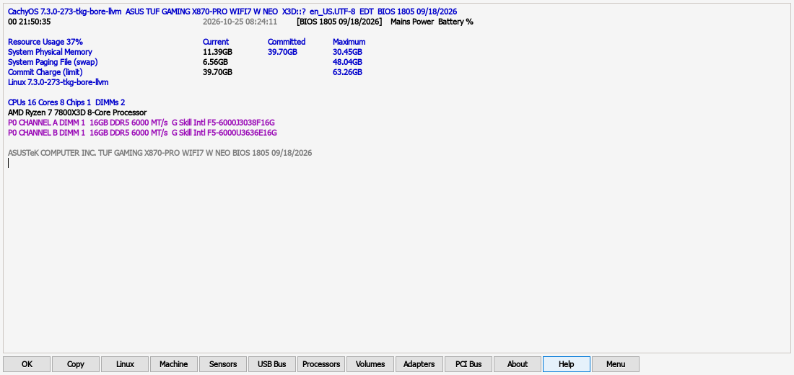
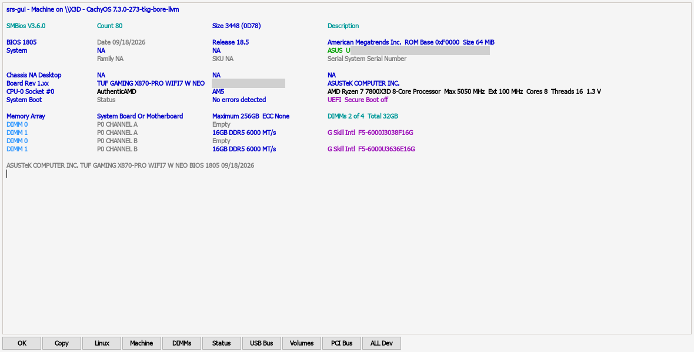
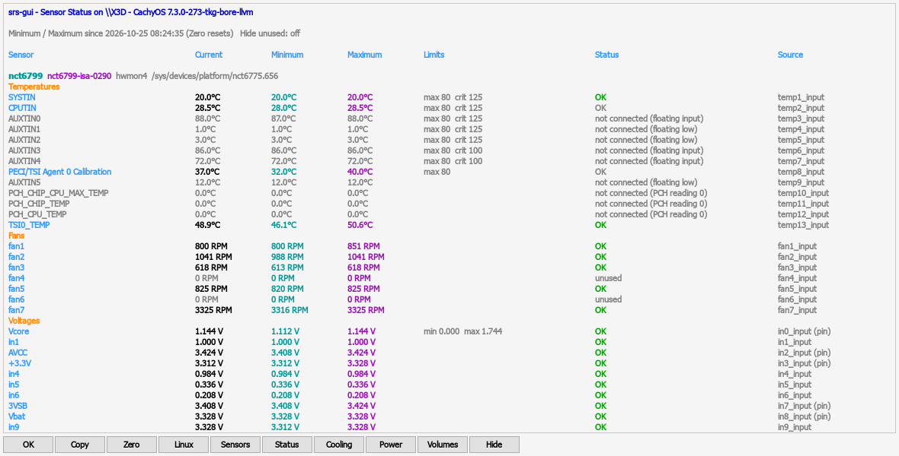
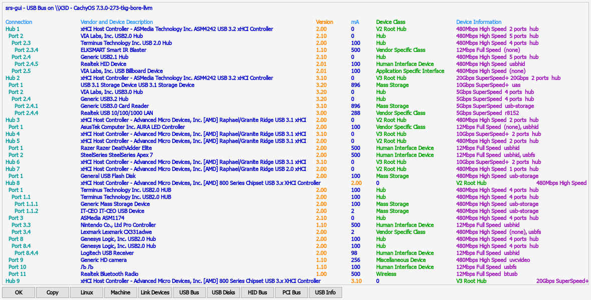
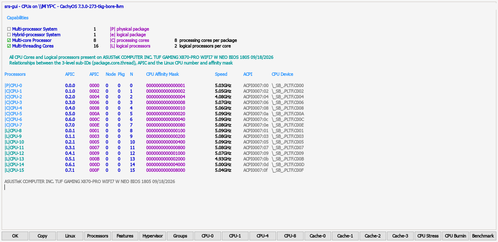
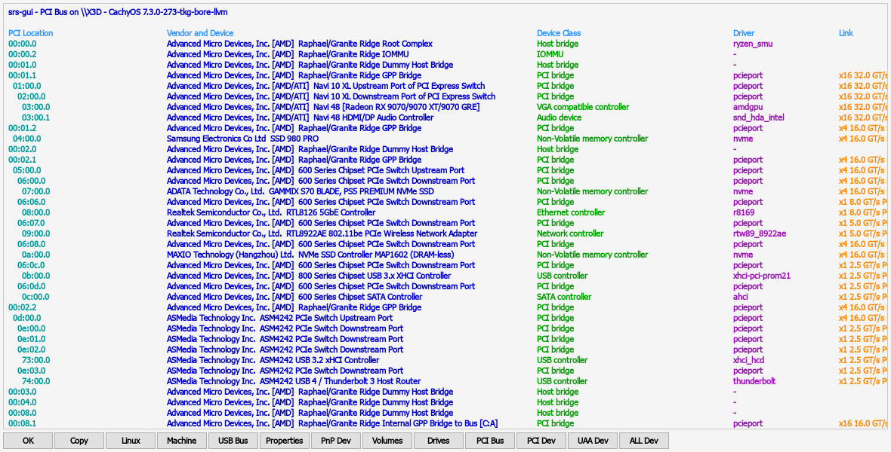
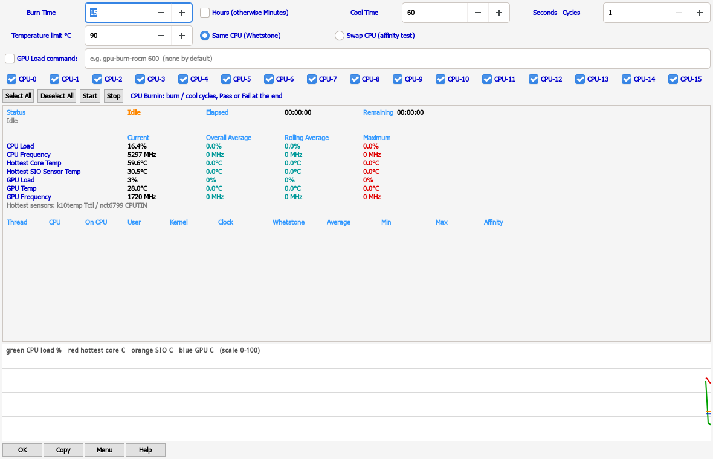
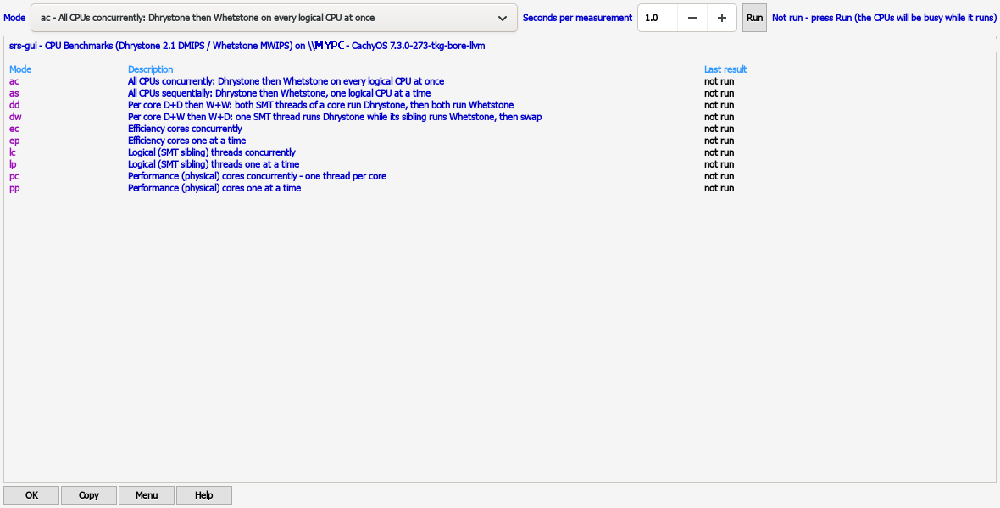
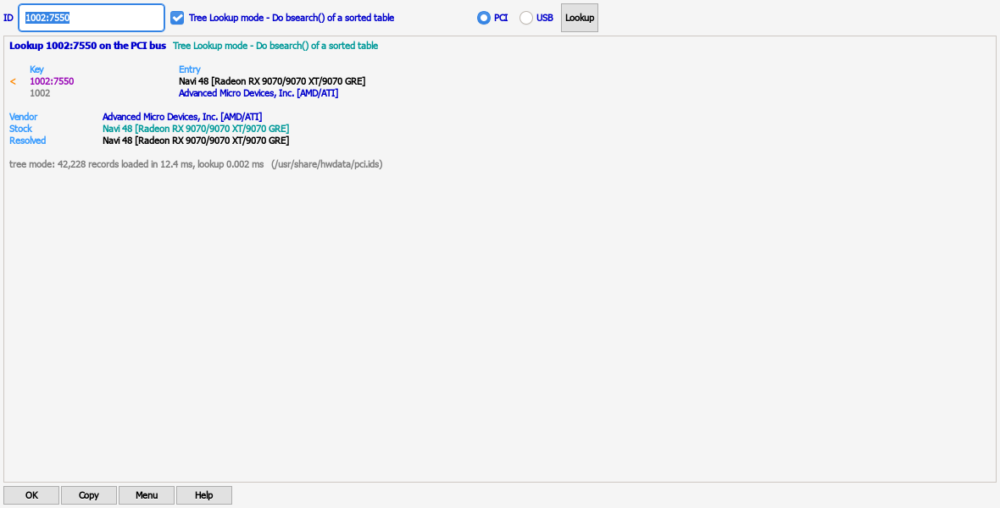
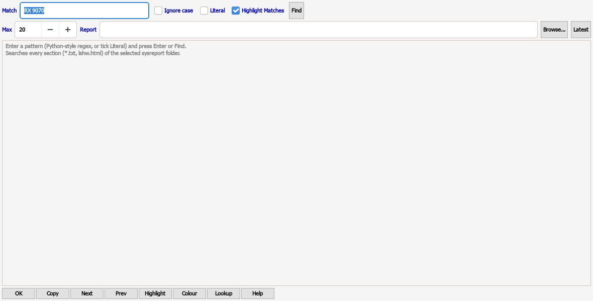

# SRS System Information - User Guide

Version 1.2.0. Package `srs-sysinfo`. Programs: `srs-gui`, `sysreport-search`, `srs-root`, `srs-sysreport`.

I wanted a Linux version of SIV (System Information Viewer) for myself, so I built one and set out to improve on it along the way. SRS is free and open source for the Linux and open-source community. (SRS is an independent project, not affiliated with SIV or its author.)

> **Credit.** SRS ("System Report Search") is modelled on **SIV64X - System Information Viewer**.
> SIV is the work of **Ray Hinchliffe, RH Software** (<https://rh-software.com>). All credit for
> SIV's design, its item set and its presentation belongs to Ray Hinchliffe.
>
> **No SIV code.** SRS contains **no SIV code, binaries or data files**, and SIV was **not
> disassembled or decompiled**. SRS was specified only from SIV's observable output (its `-save`
> text dump, its panels and its printable strings) and written independently in C on Linux data
> sources (sysfs, procfs, CPUID, hwmon, udev, hwdata). See `EVIDENCE.md` in the source.
>
> **Not affiliated.** SRS is an independent project. It is **not affiliated with, endorsed by or
> supported by RH Software**. Please do not send SRS questions or bug reports to RH Software.
> "SIV" and "System Information Viewer" are names of RH Software's product, used here only to say
> what SRS is modelled on.

Other pages:

- [SECTIONS/README.md](SECTIONS/README.md) - **Section Reference**: every one of the 545 items,
  field by field, what each value means, what is normal and what is not. Start here to *learn*.
- [CLI-REFERENCE.md](CLI-REFERENCE.md) - every command-line command and option.
- [GLOSSARY.md](GLOSSARY.md) - every technical word, in plain English.

---

## Contents

1. [What it is, in plain words](#1-what-it-is-in-plain-words)
2. [Who it is for](#2-who-it-is-for)
3. [Install](#3-install)
4. [First launch](#4-first-launch)
5. [Root-only data (srs-root)](#5-root-only-data-srs-root)
6. [A tour of the main window](#6-a-tour-of-the-main-window)
7. [The panels and their buttons](#7-the-panels-and-their-buttons)
8. [The Menu](#8-the-menu)
9. [Tools](#9-tools)
10. [Options](#10-options)
11. [System tray](#11-system-tray)
12. [Keyboard shortcuts](#12-keyboard-shortcuts)
13. [Reports and exports](#13-reports-and-exports)
14. [Settings and files](#14-settings-and-files)
15. [Reading results and comparing runs](#15-reading-results-and-comparing-runs)
16. [Known limits and differences from SIV](#16-known-limits-and-differences-from-siv)
17. [Privacy: before you share a report](#17-privacy-before-you-share-a-report)
18. [Troubleshooting](#18-troubleshooting)
19. [Uninstall](#19-uninstall)
20. [FAQ](#20-faq)
21. [Glossary](#21-glossary)

---

## 1. What it is, in plain words

SRS tells you **what is inside your computer and how it is doing right now**.

It lists your processor, memory sticks, motherboard, drives, graphics card, monitors, USB and PCI
devices, network adapters, sensors (temperatures, fan speeds, voltages) and a great deal of
operating-system detail. Most values update live.

It also has tools:

- **CPU Burnin / CPU Stress** - load every CPU thread to check the PC is stable and cool enough.
- **Benchmark** - classic Dhrystone and Whetstone CPU scores.
- **IPI Delay** - how long cores take to signal each other.
- **Latency** - how long memory takes to answer, by block size (shows your cache levels).
- **Device ID Lookup** - turn a number like `1002:7550` into a device name.
- **Find** - search a saved full system report.

SRS looks and behaves like SIV, the long-running Windows tool, so SIV users feel at home.
It has all 538 of SIV 5.87's report items (545 in total with SRS's own extras):

- **364** show real Linux data.
- **136** are hardware most PCs do not have (Itanium, IPMI, RAID cards...). On a normal PC they
  say "not present", as SIV would.
- **38** are Windows-only ideas. Most show the Linux equivalent instead
  (Windows services -> systemd units, drivers -> kernel modules, registry -> `/etc` and `~/.config`,
  Windows Error Reporting -> `coredumpctl`).

**SRS is read-only.** It never changes a setting, never writes to hardware or firmware, and makes
no network traffic except one `ping` to your router when you open the Ping item.

## 2. Who it is for

- **Beginners** who want to know what hardware they have ("which graphics card? how much RAM?
  is my RAM at its rated speed?") without opening the case.
- **Enthusiasts and tuners** who watch temperatures, clocks and fan speeds, run a burn-in after a
  change, and compare before and after.
- **SIV users moving to Linux** who want the same layout and item names.
- **Helpers and support people** who need a full text report from someone else's PC.
- **Power users** who script it: everything is also available as plain text from the command line.

## 3. Install

SRS runs on 64-bit x86 Linux with GTK 3. The command line (`sysreport-search`) also runs without
a desktop, for example over SSH.

### 3.1 Arch Linux and derivatives - AUR

```
yay -S srs-sysinfo
```

or by hand:

```
git clone https://aur.archlinux.org/srs-sysinfo.git
cd srs-sysinfo
makepkg -si
```

### 3.2 Arch Linux - prebuilt package from the release

```
sudo pacman -U srs-sysinfo-1.1.4-1-x86_64.pkg.tar.zst
```

### 3.3 Optional extras (recommended)

SRS works on its own. These packages let it show more (Arch names; other distributions use
similar names):

| Package | What it adds |
|---|---|
| `libayatana-appindicator` | System tray icon |
| `polkit` | The password prompt for `srs-root` |
| `dmidecode` | Memory stick, board and BIOS details, serials (via srs-root) |
| `smartmontools`, `nvme-cli` | Drive health (SMART) (via srs-root) |
| `i2c-tools` | Memory SPD decode (via srs-root) |
| `pciutils`, `usbutils` | Full PCI config space, `lsusb` in the full report |
| `lm_sensors` | Sensor labels and the full report's sensor section |
| `vulkan-tools`, `clinfo`, `mesa-utils` | Vulkan, OpenCL and OpenGL details |
| `iw`, `bluez-utils` | Wi-Fi link and Bluetooth details |
| `wireplumber`, `libpulse` | Audio graph details |
| `inxi`, `lshw`, `hwinfo` | Extra sections in the full system report |

### 3.4 Any other distribution - generic tarball

Each release has `srs-sysinfo-<version>-linux-x86_64.tar.gz`, built on an older distribution
(Ubuntu 24.04) so it runs on most current ones (glibc 2.38 or newer, GTK 3).

```
tar xzf srs-sysinfo-1.1.4-linux-x86_64.tar.gz
cd srs-sysinfo-1.1.4-linux-x86_64
./usr/bin/srs-gui                       # try it without installing
sudo cp -r usr/bin usr/share /usr/local/     # install for all users
```

The optional boot-time unit (see [5.3](#53-refresh-root-data-at-boot)) expects `/usr/bin/srs-root`.
`INSTALL.txt` in the tarball shows how to point it at `/usr/local/bin` instead.

Run-time needs: glibc 2.38+, GTK 3, GLib, Pango, Cairo, and **hwdata** (the PCI / USB name lists in
`/usr/share/hwdata`). Debian/Ubuntu: `sudo apt install hwdata libgtk-3-0`.

### 3.5 Build from source

You need `gcc`, `make`, `pkg-config` and the GTK 3 development files
(Arch `gtk3`; Debian/Ubuntu `libgtk-3-dev`; Fedora `gtk3-devel`).

```
git clone https://github.com/eugenesflanagin-spec/srs-sysinfo.git
cd srs-sysinfo
make native                                        # dist/native/srs-gui and sysreport-search
sudo make install-system DESTDIR= SYSPREFIX=/usr   # what the Arch package does
```

Other targets:

| Target | What it does |
|---|---|
| `make native` | Build for this machine, with your `CFLAGS` / `LDFLAGS` (the packaging path). |
| `make install-system DESTDIR=... SYSPREFIX=/usr` | Install programs, menu entries, icon, docs, systemd unit. |
| `make install` | Per-user install under `~/.local` (also builds the cross targets below, so it needs the cross compilers). |
| `make all` | Also i686 and aarch64 command-line builds and the Windows images `SRS64X.exe` / `SRS32X.exe` (needs mingw-w64 and cross gcc). |
| `make clean` | Delete `dist/`. |

Note: `make` / `make all` build into `dist/linux-x86_64/`; only `make native` builds `dist/native/`.
If you test from `dist/native/`, rebuild with `make native`.

The optional Windows images (`SRS64X.exe`, `SRS32X.exe`) contain only the device-ID lookup and
report search features, not the full system viewer.

## 4. First launch

Open your application menu. SRS installs four entries (category System / Monitor):

| Menu entry | Opens |
|---|---|
| **SRS System Information** | The main window. Right-click it in the menu for shortcuts: Sensors, Processors, CPU Burnin, CPU Stress, Benchmark, Device ID Lookup, Find in System Report. |
| **SRS CPU Burnin & Stress** | The CPU Burnin and CPU Stress windows (nothing starts until you press Start). |
| **SRS Benchmark** | The Benchmark, IPI Delay and Latency windows (nothing runs until you press Run). |
| **SRS Full System Report** | A terminal that writes a full text report folder (see [13.3](#133-full-system-report-srs-sysreport)). |

Or type `srs-gui` in a terminal.

**What you see first:** the main window. On the left is a list of pages; the first one,
**Overview**, tells you whether the PC looks healthy and shows its key facts. (The SIV-style
window of SRS 1.1 is still there: see [Classic view](#66-classic-view-the-siv-style-windows).)

**First things to try:**

1. Read **Is my PC OK?** on the Overview. Every line has a green, yellow or red light and says
   what it means; press **Details** to see the readings behind it.
2. Click **Sensors** on the left for temperatures, fans and voltages.
3. Click **Processor** for the CPU, its cores and caches, and **Memory** for the memory sticks.
4. Type a word such as `temperature` or `BIOS` into the search box at the top and pick an item.
5. Run **Menu -> Run as root (srs-root)...** once, so the items that need root data fill in
   (next section). Until then the drive health line says "Not checked yet".

## 5. Root-only data (srs-root)

### 5.1 In plain words

A few things on Linux can only be read by the administrator (root): memory stick details (SPD),
SMBIOS serial numbers and UUID, drive health (SMART), ACPI tables, CPU model-specific registers
(MSRs) and the full PCI configuration space.

SRS itself **always runs as your normal user**. Instead, a small helper called **`srs-root`**
reads those things once, as root, and saves them as text files in your own folder
`~/.cache/srs/root/`. From then on every panel shows them, without root.

`srs-root` is read-only. It runs: `dmidecode`, `decode-dimms`, `smartctl -x` and
`nvme smart-log` for each disk, copies of `/sys/firmware/acpi/tables`, `lspci -vvvnnxxx`, copies
of `/proc/ioports` and `/proc/iomem`, `dmesg`, `smbstatus` (if Samba is installed) and reads of a
fixed list of AMD and architectural MSRs through `/dev/cpu/N/msr` (it loads the `msr` kernel module
for that). It then gives the files to you (`chown`).

### 5.2 Three ways to run it

1. **From the window:** **Menu -> Run as root (srs-root)...** -> OK -> enter your password once.
   When it finishes, a dialog says "Root data collected into ~/.cache/srs/root" and every open
   panel refreshes.
2. **From a terminal:** `pkexec srs-root` (or `sudo srs-root`).
3. **At every boot, automatically:** see 5.3.

Run it again after you change hardware (new RAM, new drive) or update the BIOS, so the cache is
current. `~/.cache/srs/root/collected.txt` holds the date of the last collection.

**USB drives:** SMART is skipped for USB-attached disks by default, because SMART pass-through is
meaningless on USB sticks and can upset flaky USB enclosures. To include them anyway:
`pkexec env SRS_SMART_USB=1 srs-root`.

**Running the command line as root:** `sudo sysreport-search -save` uses the cache of the user who
ran sudo (or collects one first if there is none). You do not need to do this normally.

### 5.3 Refresh root data at boot

**Menu -> Options -> Refresh root data at boot** keeps the cache fresh with no prompts.

- Ticking it asks for your password **once** and enables the systemd unit
  `srs-root@<your user>.service`. It also collects straight away.
- At every boot the unit runs `srs-root --user <you>` as root, at the lowest CPU priority (Nice 19)
  and idle disk priority, so boot is not slowed. The files are owned by you.
- Unticking it disables the unit (one password prompt). If you cancel the prompt, the tick stays
  as it was.
- By hand: `sudo systemctl enable --now srs-root@$USER.service` (or `disable`).
- The option is greyed out if the unit file is not installed (`/usr/lib/systemd/system/srs-root@.service`
  or `/etc/systemd/system/srs-root@.service`).

## 6. A tour of the main window

The main window is one window with everything in it. In plain words: **the left side is a list of
topics, the right side shows the topic you picked.** Nothing that SRS showed before is gone: every
detail is still on the pages, and the SIV-style windows are one click away
([6.6](#66-classic-view-the-siv-style-windows)).

From top to bottom:

| Part | What it is |
|---|---|
| **Title bar** | **Refresh** (left; also **F5**) reads the page again. The **search box** finds any item or text ([6.4](#64-search)). The **menu button** (three lines; also **Ctrl+M**) has Save Report, Options, Run as root and more ([6.5](#65-the-menu)). |
| **Sidebar** (left) | The pages: Overview, Processor, Memory, Motherboard & BIOS, Graphics & audio, Storage, Network, Sensors, USB & PCI devices, Operating system, Benchmarks & stress, Tools. **Alt+1** ... **Alt+9**, **Alt+0**, **Alt+-** and **Alt+=** jump straight to them. Below the list: **Classic view** and the SRS version. |
| **Page** (right) | What you picked. The title bar's second line names it. |

The window follows your desktop's light or dark theme (see **Options -> Theme** in [10](#10-options)).

### 6.1 The pages and the items on them

Every page groups the items of one topic. "Item" is SRS's word for one table of information, such
as **Sensor status** or **SMART drives**; there are 545 of them.

| Page | What it covers | Tabs |
|---|---|---|
| **Overview** | Is the PC healthy, and its key facts | - |
| **Processor** | The CPU: model, cores and threads, clocks, features, caches | CPU Summary, Processors, CPU Clocks, CPUID Features, Cache Levels, CPUID, Microcode, Speculation Control |
| **Memory** | RAM: installed, in use, the sticks and their timings | Memory, DIMMs, SPD, Memory timings, DIMM status, Physical memory map, NUMA |
| **Motherboard & BIOS** | The board and its firmware | Machine, Hardware summary, Firmware, BIOS / SMBIOS tables, UEFI information, ACPI tables, TPM device |
| **Graphics & audio** | Graphics cards, monitors, sound | Graphics, GPU information, GPU clock speeds, GPU temperatures, Monitors, OpenCL, Audio devices |
| **Storage** | Drives, file systems, drive health | Disk drives, Volumes, SMART drives, Partitions, Disk performance, USB disk drives |
| **Network** | Adapters, addresses, Wi-Fi, Bluetooth, connections | Network adapters, IP address, Wi-Fi, Bluetooth, Routing, TCP V4 ports, TCP/IP counters |
| **Sensors** | Temperatures, fans, voltages, power | Sensor status, Hardware status, Cooling status, Power status |
| **USB & PCI devices** | Every device in or plugged into the PC | ALL Devices, PCI bus, USB bus, USB tree, HID bus, Thunderbolt |
| **Operating system** | Linux itself | Linux (SIV's "Windows" panel), Drivers, Processes, Startup, Installed software, Environment, Users |
| **Benchmarks & stress** | Measure or load the CPU and memory | CPU Benchmarks, CPU IPI Delay, Memory Latency (the last results) |
| **Tools** | Look-ups, reports and SRS's own items | About, Help |

The tabs are the items most people need. **All N items** at the right end of the tab row lists
**every** item of the page, the expert ones included, in alphabetical order; "(not present)" and
"(Windows-only)" mark the ones SIV has but this PC or Linux does not. Picking one opens it as an
extra tab with a close button (x, or **Ctrl+W**). On the Processor page the list also has **Each
CPU** and **Cache levels of each CPU** (SIV's CPU-n and Cache-n buttons).

### 6.2 Overview: "Is my PC OK?"

The Overview starts with a line about the PC (board, Linux distribution, time since start-up), then
**Is my PC OK?**: one line per check, each with a light and a plain-words verdict.

| Light | Means |
|---|---|
| Green dot, "OK:" | Normal. |
| Yellow dot, "Check:" | Worth a look, not urgent. |
| Red dot, "Problem:" | Act on it (the text says what to do). |
| Hollow grey circle, "Unknown:" | SRS could not check it (for example no sensor, or no root data yet). |

| Check | Based on | OK / check / problem |
|---|---|---|
| **CPU temperature** | The hottest CPU sensor (k10temp, coretemp, zenpower) | below 85 °C / 85-94 °C / 95 °C and up |
| **Graphics temperature** | The GPU's hotspot (junction) sensor, which runs hotter than the edge | below 95 °C / 95-104 °C / 105 °C and up |
| **Drive health (SMART)** | Each drive's own self-check, from srs-root's cache | all PASSED / - / any FAILED. "Not checked yet" until srs-root has run once. USB adapters usually cannot pass SMART on. |
| **Drive temperature** | The warmest drive | below 60 °C / 60-69 °C / 70 °C and up |
| **Hardware errors** | Kernel taint flag M (the CPU reported a machine check), EDAC counters (ECC memory), HardwareCorrupted in /proc/meminfo | none / corrected ECC errors / a machine check, uncorrected errors or faulty pages taken out of use |
| **Free disk space** | The file system mounted at / | below 90 % used / 90-96 % / 97 % and up |
| **Memory in use** | Memory used by programs (cache does not count) | below 90 % / 90-94 % / 95 % and up |
| **Sensor alarms** | Alarm flags of the hardware monitor chips | none / any |
| **CPU throttling** | Thermal throttling counters (shown only on CPUs that count them, such as Intel) | never / any |

Hover over a line for its limits; **Details** opens the page and tab with the full readings. The
checks repeat every 3 seconds (drive data every 30 seconds); **F5** reads everything again now.
They only read what SRS already shows, and change nothing.

Below the checks, **At a glance** has a card for the processor, graphics, memory, storage, operating
system and motherboard, with the numbers people look for (model, cores, speed now, memory in use,
free space, kernel, BIOS version ...). The button on each card opens its page.

### 6.3 A page

Each page has three parts:

1. **The heading:** the topic and one sentence about what it is.
2. **Key facts** as tiles (for example Model, Cores, Speed now, Busy, Temperature on the Processor
   page). They update while the page is open; hover over a tile for an explanation and the full
   value.
3. **The tabs** with the full items - the same text and colours as the classic panels, nothing
   left out. Above the text:

| Control | What it does |
|---|---|
| **Source:** | Where the data comes from (sysfs file, tool, srs-root cache). Hover for the item's id. |
| **Needs root data...** | Shown when part of the item can only be read as root and srs-root has not run yet. |
| **Live** switch | Live items (sensors, clocks, counters ...) refresh by themselves while shown. Turn it off to freeze this tab. **Options -> Update interval** sets the rate for all. |
| **Zero**, **Hide unused** | Sensor status only: start minimum / maximum again; hide sensors that read nothing. |
| **Refresh** | Read the item again (**F5**). |
| **Copy** | Copy all the text. With **Options -> Redact** on, serials, UUIDs, MACs and the computer name are masked in the copy ([17](#17-privacy-before-you-share-a-report)). |
| **Guide** | This guide at the item's section (**F1**). |
| **Open in window** | The item as a classic panel with its SIV-style button row. |

Double-click a line with a PCI or USB ID to look it up (it opens as a tab on the Tools page).
Right-click the text for Copy, Select All, the guide link and the Classic Menu.

The **Benchmarks & stress** page has buttons that open the CPU Benchmark, IPI Delay, Memory Latency,
CPU Burnin and CPU Stress windows ([9](#9-tools)); nothing runs until you press **Run** or
**Start** there. Its tabs show the last results. The **Tools** page opens Device ID Lookup, Find in
a system report, Save Report, Run as root and the Classic view.

### 6.4 Search

The search box in the title bar (**Ctrl+F**):

- **Find an item:** type part of a name or id, for example `temperature`, `smart`, `bios` or
  `usb`, and pick from the list (arrow keys + Enter, or click). The item opens on its page. Page
  names work too. Every word you type must match, so `cpu clock` finds CPU Clocks.
- **Find text on the current tab:** type the text and press **Enter**. All matches are
  highlighted and the first one is selected; **F3** / **Shift+F3** go to the next / previous one.
  The title bar shows how many there are.
- **Item ids with an argument:** type the id and press Enter, for example `processor:3` (CPU-3),
  `cache:0`, `volumes:/`.
- **Esc** clears the box and the highlights.

To search a full text report on disk, use **Find in System Report** (**Ctrl+Shift+F**, see
[9.6](#96-find-search-a-full-system-report)).

### 6.5 The menu

| Entry | What it does |
|---|---|
| **Save Report...** (Ctrl+S) / **Save All Items...** | Save a text report ([13.1](#131-save-report-and-save-all-items-siv-format-text)). |
| **Copy This Tab** | Same as the tab's Copy button. |
| **Options** | See [10](#10-options). |
| **Run as root (srs-root)...** | Collect the root-only data ([5](#5-root-only-data-srs-root)). |
| **Find in System Report...** (Ctrl+Shift+F) / **Device ID Lookup...** (Ctrl+L) | The tools of [9.6](#96-find-search-a-full-system-report) and [9.5](#95-device-id-lookup). |
| **Classic View** | Opens the classic main window ([6.6](#66-classic-view-the-siv-style-windows)). |
| **Classic Menu** | The full menu of the classic view: every item by group and every tool ([8](#8-the-menu)). Items open as classic panels. |
| **User Guide** (F1) / **About SRS** | This guide; version, build and data files. |
| **Quit** (Ctrl+Q) | Exit SRS. |

### 6.6 Classic view (the SIV-style windows)

The classic view is SRS's SIV-style interface, exactly as in SRS 1.1: a main window with SIV's
button row, and every item in its own panel window with its own buttons ([7](#7-the-panels-and-their-buttons)).

- **Open it** from **Menu -> Classic View**, the **Classic view** button under the sidebar, or the
  Tools page. Closing it does not close SRS.
- **Start SRS in it:** `srs-gui --gui-classic`, the **Classic View** action of the SRS menu entry
  (right-click it in your application menu), or tick **Options -> Start in classic view** to make it
  the default. From the classic Menu, **Open the new main window** brings the sidebar window back;
  `srs-gui --gui-new` starts with it whatever the option says.



*The classic main window on the author's PC (Ryzen 7 7800X3D, ASUS TUF GAMING X870-PRO WIFI7, 2 x 16 GB DDR5-6000).*

The classic main window is SRS's version of SIV's main panel: **one screen that tells you what this
PC is and how busy it is**. From top to bottom:

| Line | Meaning |
|---|---|
| First line | Operating system and kernel (`CachyOS 7.3.0-...`), motherboard, `host::user`, locale, time zone, BIOS version and date. |
| Second line | Up-time (days, hours:minutes:seconds), current date and time, BIOS, power source (`Mains Power`) and battery charge (empty on a desktop). |
| **Resource Usage** | How much of the memory budget is in use, in percent. |
| **System Physical Memory** | RAM in use now, the total "committed" (promised to programs), and the RAM size. |
| **System Paging File (swap)** | Swap in use and swap size. |
| **Commit Charge (limit)** | Memory promised to programs vs. the kernel's limit (RAM + swap, depending on settings). |
| Kernel line | The running Linux kernel. |
| **CPUs / Cores / Chips / DIMMs** | Logical CPUs (threads), physical cores, CPU packages (sockets) and memory sticks. |
| CPU name | The processor model, as the CPU reports it. |
| DIMM lines | One per memory stick: slot, size, type, speed, maker and part number (needs srs-root data). |
| Last line (grey) | Board maker, model and BIOS. |

The classic main window refreshes every 2 seconds (see [Options -> Update interval](#10-options)).

The full meaning of every value is in the Section Reference: [srs-items.md](SECTIONS/srs-items.md)
and [machine.md](SECTIONS/machine.md).

#### The button row

| Button | Opens |
|---|---|
| **OK** | Closes the window. On the main window this exits SRS. (The window's own close button [X] hides SRS to the tray instead when "Close button hides to tray" is on, see [11](#11-system-tray).) |
| **Copy** | Copies the window's whole text to the clipboard. |
| **Linux** | The operating-system panel (SIV's "Windows" button). |
| **Machine** | Board, BIOS, SMBIOS and memory sticks. |
| **Sensors** | Temperatures, fans, voltages, power. |
| **USB Bus** | The USB tree. |
| **Processors** | CPUs, cores, threads, caches, clocks. |
| **Volumes** | Mounted file systems and disks. |
| **Adapters** | Network adapters. |
| **PCI Bus** | PCI / PCI Express devices. |
| **About** | Version, build, data files, credit and licence. |
| **Help** | Help text and command-line qualifiers. |
| **Menu** | The full menu of every item and tool ([section 8](#8-the-menu)). |

Every button label has an underlined letter: press **Alt + that letter** to click it.

## 7. The panels and their buttons

In the classic view ([6.6](#66-classic-view-the-siv-style-windows)), and from **Open in window** on
any tab, each panel opens in its own window with its own button row, like SIV. Every panel has **OK**
(close) and **Copy** (copy all text). Live panels refresh on a timer; press **F5** to refresh now.

Every panel also has a **Guide** button (right end of the button row; also **F1**, and **Open guide
for this item** in the panel's right-click menu). It opens this guide at that panel's section of the
Section Reference: in the PDF viewer if it is Okular, Evince or Papers (they can jump to a section),
otherwise the HTML copy of the guide in your web browser. **Menu -> User Guide...** opens the start
of the guide. The guide files are `/usr/share/doc/srs-sysinfo/SRS-User-Guide.pdf` and
`/usr/share/doc/srs-sysinfo/html/SRS-User-Guide.html`; the menu entry **SRS User Guide (PDF)**
opens the PDF.

Below is what each panel's extra buttons do. For the meaning of every column and value, follow the
link to the Section Reference.

### 7.1 Linux (SIV's "Windows" panel)

The operating system: distribution, kernel, boot, desktop session, directories, kernel command
line, per-CPU identification, time zone, up-time, user and locale, displays.
Buttons: Linux, Machine, Sensors, USB Bus, Processors, Volumes, PCI Bus, **ALL Dev** (every device),
**Graphics**.
Reference: [linux-os.md](SECTIONS/linux-os.md), [graphics.md](SECTIONS/graphics.md).

### 7.2 Machine

SMBIOS version, BIOS, system, chassis, board, CPU socket, boot status, memory array and every DIMM slot.



*Machine panel (serial number and UUID blanked out in this picture).*

Buttons: Linux, Machine, **DIMMs** (memory stick details), **Status** (DIMM temperatures and status),
USB Bus, Volumes, PCI Bus, ALL Dev.
Reference: [machine.md](SECTIONS/machine.md).

### 7.3 Sensors

Every hardware monitoring chip the kernel knows (Super-I/O, CPU, GPU, drives, memory, others):
current, minimum, maximum, limits and a plain status for each reading.



Buttons:

- **Zero** - resets the Minimum and Maximum columns to the current values (the "since" time on the
  second line resets too).
- **Status** - the hardware status summary.
- **Cooling** - fans and fan control.
- **Power** - power readings (CPU package, GPU, battery...).
- **Hide** - hides sensors that are unused or not connected; press again to show them.
- Linux, Sensors, Volumes.

Some motherboard inputs are not wired to anything and show nonsense values (for example 70-88 C,
or 0 C). SRS greys them out and labels them "not connected". The Section Reference explains why:
[sensors.md](SECTIONS/sensors.md).

### 7.4 USB Bus

The USB tree: each hub and port, device name, USB version, power draw (mA), class and speed.



Buttons: Linux, Machine, **Link Devices**, USB Bus, **USB Disks**, **HID Bus** (keyboards, mice,
game controllers...), PCI Bus, **USB Info**.
Reference: [buses-1.md](SECTIONS/buses-1.md), [buses-2.md](SECTIONS/buses-2.md).

### 7.5 Processors

Capabilities (packages, cores, threads), and for every logical CPU: IDs, APIC ID, affinity mask,
current clock, ACPI name.



Buttons: Linux, Processors, **Features** (CPU feature flags), **Hypervisor** (virtualisation),
**Groups** (CPU groups / scheduling), **CPU-0, CPU-1, CPU-4, CPU-8** (one CPU's full details),
**Cache-0 ... Cache-3** (cache levels), **CPU Stress**, **CPU Burnin**, **Benchmark**.
Reference: [processors.md](SECTIONS/processors.md).

### 7.6 Volumes

Every mounted file system: label, format, free, total, used percent, cluster size, type and volume ID.
Buttons: Linux, Machine, Sensors, USB Bus, Volumes, **Drive /** (details of the root file system),
**FS** (file-system statistics), ALL Dev.
Reference: [storage.md](SECTIONS/storage.md).

### 7.7 Adapters

Network adapters: name, driver, link, speed, addresses.
Buttons: Linux, Adapters, **Counters** (traffic counters), **Interface**, **ARP** (neighbour table),
**Routing**, **TCP V4** / **TCP V6** (open ports and connections), **Wi-Fi**, **Bluetooth**,
**Show DNS**, **Ping** (pings your default gateway), **Main** (brings the main window to the front).
Reference: [network.md](SECTIONS/network.md).

### 7.8 PCI Bus

Every PCI / PCI Express device: location, vendor and device name, class, driver, and the current
PCIe link (width and speed).



Buttons: Linux, Machine, USB Bus, **Properties** (udev properties), **PnP Dev** (ACPI / Plug and
Play devices), Volumes, **Drives**, PCI Bus, **PCI Dev**, **UAA Dev** (audio devices), **ALL Dev**.
Reference: [buses-1.md](SECTIONS/buses-1.md), [buses-2.md](SECTIONS/buses-2.md).

**Tip:** in any panel, **double-click a line that contains a PCI ID** like `1002:7550` to open it in
Device ID Lookup. (USB IDs open on the PCI bus; switch the lookup to USB by hand.)

### 7.9 About and Help

**About** shows the program and version, build, the data files in use (hwdata `pci.ids`, `usb.ids`,
`pnp.ids` with their dates), where settings live, the statement of origin, credit and licence.
**Help** shows help text and the command-line qualifiers.
Their buttons: Linux, DNS Names, Lookup (data files), USB Dev, About, Help; the Lookup panel adds
Signature, SRS DLLs and ID Lookup.
Reference: [srs-items.md](SECTIONS/srs-items.md).

### 7.10 Every other item

Every other item opens in a window with **OK, Copy, Refresh, Menu, Help**.

## 8. The Menu

This is the classic view's Menu. Press **Menu** on the classic main window, press **Ctrl+M** in any
classic window, right-click the text of any panel and choose **SRS Menu**, or use **Menu ->
Classic Menu** in the main window. It has:

1. **Tools:** CPU Burnin..., CPU Stress..., Benchmark..., IPI Delay..., Latency...,
   Device ID Lookup..., Find in Report..., and **Classic view** (from the main window) or
   **Open the new main window** (when SRS started in the classic view).
2. **Every item, grouped** (the same groups as the Section Reference):
   - Processors
   - Machine / BIOS / Memory
   - Sensors / Cooling / Power
   - Volumes / Drives
   - Network
   - Linux (SIV Windows items)
   - Graphics / Monitors / Audio
   - Buses / Devices
   - Tools
   - SRS (SIV items)

   Each entry shows the title and the item id in brackets, e.g. `Cache Levels [cache]`. Items for
   hardware most PCs lack are marked "(not present)"; Windows-only items are marked "(Windows-only)".
3. **Options** ([section 10](#10-options)).
4. **Save Report...**, **Save All Items...** ([section 13](#13-reports-and-exports)).
5. **Run as root (srs-root)...** ([section 5](#5-root-only-data-srs-root)).
6. **Exit.**

## 9. Tools

Nothing in this section ever starts by itself: not at launch, not from the menu, and not from a
saved report. You always press Start or Run.

### 9.1 CPU Burnin and CPU Stress

**In plain words:** they make your CPU work at 100% so you can see whether it stays stable and how
hot it gets. Use them after building a PC, changing cooling, or changing BIOS settings such as
overclocks, undervolts (Curve Optimizer) or power limits.



Open: Processors -> CPU Burnin / CPU Stress, Menu -> Tools, or the menu entry
"SRS CPU Burnin & Stress".

The difference:

- **CPU Burnin** runs for a set **Burn Time**, then rests for a **Cool Time**, for a number of
  **Cycles**, and ends with **Pass** or **Fail**.
- **CPU Stress** runs **until you press Stop** (with a safety cap of 750 hours).

Controls:

| Control | Meaning | Default |
|---|---|---|
| **Burn Time** + "Hours (otherwise Minutes)" | How long each burn lasts (Burnin only). | 15 minutes |
| **Cool Time** | Rest between burns, seconds (Burnin only). | 60 s |
| **Cycles** | How many burn + cool rounds (Burnin only). | 1 |
| **Temperature limit C** | The run stops at once if the hottest CPU sensor reaches this. | 90 C |
| **Same CPU (Whetstone)** | Each worker stays on its CPU and runs the Whetstone floating-point test, giving a score per CPU. | on |
| **Swap CPU (affinity test)** | Workers move between CPUs, checking that the system moves them correctly. | off |
| **GPU Load command** | Optional: a program to run at the same time to load the graphics card (for example a GPU stress tool you have installed). Saved for next time. | empty |
| **CPU-0 ... CPU-n** tick boxes | Which logical CPUs get a worker. | all |
| **Select All / Deselect All** | Tick or untick every CPU. | |
| **Start / Stop** | Start (asks first) / stop. Closing the window also stops. | |

Before it starts, SRS shows a warning saying how many CPUs will be 100% busy and the temperature
limit. If a GPU Load command is set, SRS first checks that the program exists; if not, it shows
an error and starts nothing.

What you see while it runs:

- **Status** (Idle / Burning / Cooling / Pass / Fail / Stopped), **Elapsed**, **Remaining**.
- A table with **Current, Overall Average, Rolling Average, Maximum** for: CPU Load, CPU Frequency,
  Hottest Core Temp, Hottest SIO (motherboard) Sensor Temp, GPU Load, GPU Temp, GPU Frequency.
  The line under it names which sensors are "hottest" (e.g. `k10temp Tctl / nct6799 CPUTIN`).
- **GPU Load** status line (when a command is set): running, finished (exit code), failed, not found
  (127), not executable (126), killed by signal. The command's own output is saved to
  `~/.cache/srs/gpu-load.log`.
- A table per worker thread: Thread, CPU (where it was placed), On CPU (where it is now), User and
  Kernel CPU time, Clock, Whetstone score (last / average / min / max, MWIPS) and **Affinity**
  (`ok`, or `FAIL` if a worker was found on the wrong CPU).
- A graph: green = CPU load %, red = hottest core C, orange = motherboard sensor C, blue = GPU C
  (scale 0-100).

How to read the result:

- **Pass** - the run finished, no worker failed and the temperature limit was not reached.
- **Fail** - a worker failed (affinity error) or the temperature limit was hit. A temperature stop
  means your cooling cannot keep up at this load: check the cooler mounting, fans, thermal paste and
  BIOS fan curves. A worker failure or a PC crash/freeze during the run points to instability
  (overclock, undervolt or memory settings too aggressive).
- Compare Whetstone scores per CPU: a CPU far below the others may be throttling or busy with
  something else.

**Saved results.** Every run that ends (Pass, Fail or Stopped, in Burnin and in Stress) is saved to
its own file, `~/.cache/srs/burnin-YYYYMMDD-HHMMSS.txt` (the date and time it ended). The file holds
the same text as the **Copy** button: status, the sensor table and the thread table. The status line
shows the file name. To compare two runs, for example before and after a BIOS change:
`diff ~/.cache/srs/burnin-20261025-101500.txt ~/.cache/srs/burnin-20261025-113000.txt`
or open both in `meld`. SRS never deletes these files.

Full details of every column: [tools.md](SECTIONS/tools.md).

### 9.2 Benchmark (Dhrystone and Whetstone)

**In plain words:** two classic, small CPU tests. **Dhrystone** measures whole-number (integer)
work and reports **DMIPS** (Dhrystone millions of instructions per second). **Whetstone** measures
decimal (floating-point) work and reports **MWIPS** (millions of Whetstone instructions per second).
Higher is better. They are good for comparing the same PC before and after a change, less good for
comparing very different CPUs.



Controls: **Mode**, **Seconds per measurement** (0.1-10, default 1), **Run**.
The modes, as in SIV:

| Mode | What runs |
|---|---|
| `ac` | All CPUs concurrently: Dhrystone then Whetstone on every logical CPU at once. |
| `as` | All CPUs sequentially: one logical CPU at a time. |
| `dd` | Per core D+D then W+W: both SMT threads of a core run Dhrystone, then both run Whetstone. |
| `dw` | Per core D+W then W+D: one thread runs Dhrystone while its sibling runs Whetstone, then swap. |
| `ec` / `ep` | Efficiency cores concurrently / one at a time (hybrid CPUs). |
| `lc` / `lp` | Logical (SMT sibling) threads concurrently / one at a time. |
| `pc` / `pp` | Performance (physical) cores concurrently (one thread per core) / one at a time. |

The window lists the last result of every mode. Results are kept between sessions.

### 9.2.1 What hyperthreading (SMT) really does - a worked example

**In plain words:** most modern CPUs run two "threads" on every core. AMD calls this SMT
(simultaneous multithreading), Intel calls it Hyper-Threading. Linux shows each thread as its own
CPU, so an 8-core CPU appears as 16 CPUs. The two threads of a core are **not** two cores: they
share the same core and take turns using its parts. The benchmark modes let you see exactly what
that sharing is worth. This page walks through one real set of results.

**The PC.** One Ryzen 7 7800X3D: 8 cores, 16 threads. Linux numbers its threads so that CPU-0 to
CPU-7 are the first thread of cores 0 to 7, and CPU-8 to CPU-15 are the second thread of the same
cores (CPU-0 and CPU-8 share core 0, CPU-1 and CPU-9 share core 1, and so on). Your PC may number
them differently; the benchmark uses Linux's own list of which threads share a core.

> These numbers are one PC's example, measured on one day. Your CPU, cooling, BIOS settings and
> kernel will give different numbers. Some modes ran 5 seconds per measurement and some 20, and
> differences of 1-2 % between runs are normal noise. What carries over to other PCs is the
> **pattern**, not the exact scores.

**The results** (Total of each mode; higher is better):

| Mode | What ran | Threads busy at once | Dhrystone (DMIPS) | Whetstone (MWIPS) |
|---|---|---|---|---|
| `pp` | first thread of each core, one core at a time | 1 | 1,018,068 | 119,397 |
| `lp` | second thread of each core, one at a time | 1 | 1,012,772 | 118,632 |
| `pc` | first thread of all 8 cores at once | 8 | 971,275 | 112,851 |
| `lc` | second thread of all 8 cores at once | 8 | 967,107 | 112,073 |
| `ac` | all 16 threads at once | 16 | 1,611,893 | 197,840 |
| `dd` | both threads of one core run the same test, one core at a time | 2 | 1,772,110 | 214,340 |
| `dw` | one thread runs Dhrystone while its partner runs Whetstone, one core at a time | 2 | 1,899,990 | 227,781 |

What the numbers show, step by step:

1. **The "physical" and the "logical" thread are equally fast.** `pp` and `lp` differ by about
   0.5 %, and `pc` and `lc` by less than 1 %. That is noise. When a thread has a core to itself,
   it does not matter whether Linux calls it the first or the second thread of that core: it is
   the same core. There is no "real" core and "fake" core.

2. **Loading every core at once costs a few percent.** `pc` (8 cores busy) is about 5 % below
   `pp` (one core busy at a time): Dhrystone -4.6 %, Whetstone -5.5 %. That is not SMT at all. It
   is boost: a CPU runs its highest clock when only one or two cores are busy, and drops the clock a
   little when all of them are, to stay inside its power and temperature limits.

3. **The second thread adds a lot of work.** `ac` (all 16 threads) against `pc` (one thread per
   core, same 8 cores): **+66 % Dhrystone, +75 % Whetstone**. So a second thread did not double
   the work, but it added two thirds or more. Each thread in `ac` kept about 83 % (Dhrystone) and
   88 % (Whetstone) of the speed it had with the core to itself. This happens because one thread
   alone rarely keeps every part of a core busy; the second thread fills the gaps.

4. **The same gain shows on a single core.** `dd` (both threads of one core, one core at a time)
   against `pp` (one thread, one core at a time): **+74 % Dhrystone, +80 % Whetstone**. This is a
   little more than in step 3 because only one core is busy, so it keeps its highest boost clock
   (`dd` is about 10 % above `ac` for that reason).

5. **Mixed work shares a core better than identical work.** `dw` against `dd`: **+7 % Dhrystone,
   +6 % Whetstone**. In `dd` both threads want the same parts of the core (both doing whole-number
   work, then both doing decimal work). In `dw` one thread does whole-number (integer) work while
   its partner does decimal (floating-point) work. Those use mostly different parts of the core, so
   they get in each other's way less: each thread kept about 93-95 % of its solo speed.

6. **One core scores a little lower than the rest.** In the `pp`, `pc`, `ac` and `dd` runs, core 1
   (CPU-1, and its partner CPU-9) was the slowest, a few percent below the others. On this PC that
   core handles most of the hardware interrupts (network, disk and USB events), and every interrupt
   takes a little time away from the benchmark. It is not a faulty core. To see where interrupts land
   on your PC, look at the counts per CPU in `/proc/interrupts`.

**What this means for you:**

- Leave SMT on for work that uses many threads at once (compiling, video encoding, rendering,
  compression): here it gave 66-75 % more total work from the same 8 cores.
- A single thread gains nothing from SMT, and loses nothing either: one thread alone on a core runs
  at full speed.
- Turning SMT off in the BIOS mostly helps in special cases (some games that are sensitive to
  timing, or security settings that ask for it). Measure before and after: run `ac` and `pc` with
  SMT on, then `ac` with SMT off. With SMT off, `ac` should land close to the SMT-on `pc` result.
- To check your own PC, run `pp`, `pc`, `ac`, `dd` and `dw` back to back on an idle PC, two or
  three times, and compare the same steps as above. The [Tools reference](SECTIONS/tools.md)
  explains each mode in detail.

### 9.2.2 Reading the CPU IPI Delay table - a worked example

**In plain words:** the IPI Delay tool (Menu > Tools > IPI Delay, section 9.3) times how long one
CPU takes to hand a small piece of data to another CPU, for every pair of CPUs. When two threads of
a program share data (a lock, a queue, a game engine's job list), this is the delay they pay each
time. The result is a big grid of numbers. This page shows how to read it, using one real result.

**The PC.** One Ryzen 7 7800X3D: one CCD (core complex die, the chip that holds the cores), 8 cores,
16 threads. As in 9.2.1, CPU-0 to CPU-7 are the first thread of cores 0 to 7, and CPU-8 to CPU-15
are the second thread of the same cores (CPU-0 and CPU-8 share core 0, and so on). The test ran
100,000 rounds per pair. Each number is in nanoseconds (ns, billionths of a second): the time for
one cache line (a 64-byte block of memory) to go there and back, divided by 2, so it is the one-way
time.

> These numbers are one PC's example. Other CPUs, BIOS settings and kernels give different numbers,
> and a difference of 1-2 ns between runs is normal noise. What carries over is the **pattern**.

**The result:**

```
From\To 0  1  2  3  4  5  6  7  8  9  10 11 12 13 14 15
CPU-0   -  28 30 29 30 32 34 33 25 28 30 29 30 31 34 33
CPU-1   28 -  30 28 31 28 33 34 28 23 30 27 31 28 32 31
CPU-2   30 30 -  31 29 31 29 31 29 30 23 31 29 32 29 31
CPU-3   29 28 31 -  31 27 30 29 28 28 31 23 31 27 30 29
CPU-4   30 31 29 31 -  29 29 29 29 31 29 32 23 30 29 29
CPU-5   32 28 31 27 29 -  31 27 29 28 31 27 30 23 32 28
CPU-6   34 33 29 30 29 31 -  31 32 32 30 31 28 32 23 30
CPU-7   33 34 31 29 29 27 31 -  33 31 33 29 29 27 31 24
CPU-8   25 28 29 28 29 29 32 33 -  27 29 29 29 30 32 32
CPU-9   28 23 30 28 31 28 32 31 27 -  31 28 31 28 32 30
CPU-10  30 30 23 31 29 31 30 33 29 31 -  31 29 31 29 32
CPU-11  29 27 31 23 32 27 31 29 29 28 31 -  32 27 30 28
CPU-12  30 31 29 31 23 30 28 29 29 31 29 32 -  28 29 29
CPU-13  31 28 32 27 30 23 32 27 30 28 31 27 28 -  32 27
CPU-14  34 32 29 30 29 32 23 31 32 32 29 30 29 32 -  30
CPU-15  33 31 31 29 29 28 30 24 32 30 32 28 29 27 30 -
```

**How to read it:**

- Each **row** is the CPU that sends, each **column** is the CPU that receives. Find the row of one
  CPU and the column of the other: the number where they cross is the delay in ns. Lower is faster.
- The `-` on the diagonal is a CPU paired with itself. That is not measured.
- Each pair is measured once, so the table is a mirror: CPU-3 to CPU-5 is the same number as
  CPU-5 to CPU-3.

What the numbers show, step by step:

1. **The two threads of one core are the fastest pair in every row: 23-25 ns.** CPU-0 and CPU-8
   (25), CPU-1 and CPU-9 (23), and so on up to CPU-7 and CPU-15 (24). Every row has its smallest
   number in the column of its partner thread (CPU n and CPU n+8). These two threads live on the
   same core and share its L1 and L2 caches, so the data never has to leave the core.

2. **Every other pair is 27-34 ns.** Two different cores do not share L1 or L2. The data travels
   through the L3 cache, which all 8 cores on the CCD share. That costs a few nanoseconds more.

3. **Distance on the chip still shows a little.** The highest numbers are core 0 to cores 6 and 7
   (CPU-0 to CPU-6: 34, CPU-0 to CPU-7: 33, and the same for their partner threads), and core 1 to
   cores 6 and 7 (33-34). The cores reach the L3 over a ring, and cores that sit farther apart on
   that ring take a little longer. The whole spread is only about 7 ns.

4. **The table is even.** Apart from the partner threads, no block of the table stands out. That is
   what a one-CCD CPU looks like: all cores are on the same die and share one L3.

**On a CPU with two CCDs** (for example a Ryzen 9 7950X or 9950X) the table typically looks
different. Pairs on the same CCD look like the table above, but pairs where one CPU is on the first
CCD and the other is on the second CCD show a second block of much higher numbers, typically around
70-80 ns. Those pairs do not share an L3: the data has to cross the Infinity Fabric link between
the two dies. The exact numbers depend on the CPU, the memory and fabric clocks, and the BIOS.

**What this means for you:**

- **Find partner threads.** The smallest number in each row tells you which two CPUs share one
  core, whatever numbering your PC uses.
- **See the CCD layout.** A block of much higher numbers shows where one CCD ends and the next
  begins, and which CPUs belong to which CCD.
- **Pin threads that talk to each other a lot.** Games, audio work (a DAW and its plug-ins) and other
  timing-sensitive programs run smoother when their busy threads stay on one CCD, and the lowest
  delay is on one core's two threads. Tools such as `taskset` can keep a program on chosen CPUs.
- **Do not expect it to change with tuning.** Curve Optimizer and voltage changes move the clock
  speed and temperature, but the delay mostly depends on how the chip is built, so this table stays
  about the same. Run it to learn your CPU's layout, not to measure a tweak.

### 9.3 IPI Delay

**In plain words:** measures how long it takes one CPU core to "ping" another and get an answer,
for every pair of CPUs. Shows as a table in nanoseconds and a colour heat map (green = fast,
red = slow). Cores that share a cache or a chip answer faster; cores on different chips
(for example two CCDs on a Ryzen 9) answer slower.
Controls: **CPUs** (how many to test), **Rounds per pair** (default 20,000), **Run**.
For a step-by-step reading of one real result (partner threads, the L3, what a two-CCD CPU
looks like), see [9.2.2 Reading the CPU IPI Delay table - a worked example](#922-reading-the-cpu-ipi-delay-table---a-worked-example).

### 9.4 Latency

**In plain words:** measures how long one memory read takes, for blocks from tiny to large. Small
blocks fit in L1 and answer in about 1 ns; as the block grows past each cache, the time steps up:
L2, L3, then RAM. The steps in the graph show you your cache sizes.
Controls: **Largest block (MB)** (1-1024, default 256), **Run**. Results: a table (block size,
time in ns, level) and a curve.

For a full Cache & Memory **bandwidth** benchmark, see the sister project
[lsa-sysinfo](https://github.com/eugenesflanagin-spec/lsa-sysinfo).

### 9.5 Device ID Lookup

**In plain words:** every PCI and USB device has a number pair: **vendor ID : device ID**
(for example `1002:7550` = AMD : Radeon RX 9070 series). This tool turns the numbers into names.



Open: **Ctrl+L**, Menu -> Tools, the Lookup panel's ID Lookup button, or double-click an ID in a panel.

Controls:

- **ID** - type the ID and press Enter or **Lookup**. Formats:
  `VVVV`, `VVVV:DDDD`, `VVVV:DDDD:SSSS:ssss` (with subsystem vendor and device), and an optional
  `:RR` revision at the end, e.g. `1002:7550:1EAE:7550:C0`.
- **PCI / USB** - which list to search.
- **Mode** tick box - cycles through three modes, like SIV:
  - **Tree** - "bsearch() of a sorted table": loads the whole hwdata list once, then finds the ID
    instantly. Tries the most specific key first and falls back step by step.
  - **Scan** - reads the `.ids` file line by line. Slower, same answer; useful to check.
  - **Info** - asks the operating system's own device database (systemd-hwdb) instead of the file.

Output: each key tried (the matching one is marked `<`), then **Vendor**, **Subsystem** (if any),
**Stock** (the plain device name) and **Resolved** (the best name found), and how long it took.

### 9.6 Find (search a full system report)

**In plain words:** search a saved full system report (made by **SRS Full System Report**,
[13.3](#133-full-system-report-srs-sysreport)) for any text, like `grep`, with highlighting.



Open: **Ctrl+F**, Menu -> Tools -> Find in Report..., or the menu entry's "Find in System Report" action.

Controls:

| Control | Meaning |
|---|---|
| **Match** | What to search for. A regular expression (Python-style) unless Literal is ticked. Press Enter or **Find**. |
| **Ignore case** | Upper and lower case count as the same. |
| **Literal** | Search for the exact text; characters like `.` `[` `(` have no special meaning. |
| **Highlight Matches** | Colour each match (also **Ctrl+H** or the **Highlight** button). |
| **Max** | Show at most this many matches per report file (default 20). |
| **Report** | The report folder to search. Filled with the newest one in `~/sysreports`. |
| **Browse...** / **Latest** | Pick another folder / go back to the newest. |
| **Next / Prev** (or **F3 / Shift+F3**) | Jump between matches. |
| **Colour** | Choose the highlight colour (saved). |
| **Lookup** | Open Device ID Lookup. |

If there is no report yet, Find tells you to run SRS Full System Report first.

## 10. Options

**Menu -> Options** (in the main window's menu, the classic Menu and the tray's SRS Menu). All are
saved in `~/.config/srs/SRSDEF.ini` and apply at once to every open window.

| Option | What it does | Default |
|---|---|---|
| **Theme -> Light (SIV classic)** | SIV's light look and colours. | classic view |
| **Theme -> Dark** | Dark panels, SIV's colours brightened so they stay readable, dark graphs. | |
| **Theme -> Follow desktop** | Uses your desktop's light/dark setting (via xdg-desktop-portal, set by KDE Plasma and GNOME) and switches live when you change it. Without a portal, it reads `GTK_THEME` or `~/.config/gtk-3.0/settings.ini`. | main window |
| **Update interval** | How often live panels refresh: **Default** (each panel's own rate; the main window every 2 s), 0.5, 1, 2, 3, 5 or 10 seconds, or **Paused** (press F5 to refresh by hand). CPU Burnin / Stress always updates every second. | Default |
| **System tray icon** | Show the tray icon. | on |
| **Close button hides to tray** | Closing the main window hides it instead of exiting. | off |
| **Minimize hides to tray (X11 / XWayland)** | Minimising hides it to the tray. Native Wayland apps are not told when they are minimised, so this works only on X11 / XWayland. | off |
| **Start hidden in tray** | Start with no window, just the tray icon. | off |
| **Start with the desktop (autostart)** | Writes `~/.config/autostart/srs-gui.desktop`, which runs `srs-gui --gui-tray` at login. Untick to remove it. | off |
| **Refresh root data at boot** | See [5.3](#53-refresh-root-data-at-boot). | off |
| **Redact identifiers in saved reports and copied text** | Save Report / Save All Items, the **Copy** button and right-click **Copy** / Ctrl+C mask serial numbers, UUIDs, MAC addresses (vendor half kept), boot / machine IDs and the host name - see [17](#17-privacy-before-you-share-a-report). The panels still show everything. | off |
| **Start in classic view** | Start SRS in the SIV-style main window instead of the window with the sidebar ([6.6](#66-classic-view-the-siv-style-windows)). | off |
| **Hide to Tray** | Hide all SRS windows now. | |

Until you pick a Theme, the main window follows the desktop and the classic view starts light.

The tray options are greyed out if the tray library is not installed (the menu then says
"(tray needs libayatana-appindicator)").

## 11. System tray

Like SIV's Icon Tray, SRS can live in the system tray (needs `libayatana-appindicator`; works on
KDE Plasma, XFCE, and GNOME with the AppIndicator extension).

- **Tooltip:** CPU temperature and load, GPU temperature and load, updated every 2 seconds.
- **Middle-click:** show / hide SRS.
- **Tray menu:** Show SRS / Hide to Tray, Sensors, Processors, CPU Burnin..., CPU Stress...,
  Benchmark..., Find..., **SRS Menu** (the full menu), Exit. Sensors and Processors open their
  page in the main window (or their panel in the classic view).
- `srs-gui --gui-tray` starts hidden in the tray.
- Safety: SRS only hides its windows if a tray icon really exists, so it cannot get lost.

## 12. Keyboard shortcuts

In the main window:

| Keys | Action |
|---|---|
| **Alt+1** ... **Alt+9**, **Alt+0**, **Alt+-**, **Alt+=** | Go to page 1 to 12 (Overview ... Tools) |
| **Ctrl+F** | Search box ([6.4](#64-search)) |
| **Enter** in the search box | Find the text on the current tab |
| **F3 / Shift+F3** | Next / previous match on the tab |
| **Esc** in the search box | Clear it and the highlights |
| **Ctrl+Shift+F** | Find in System Report |
| **Ctrl+L** | Device ID Lookup |
| **Ctrl+D** | ALL Devices tab |
| **Ctrl+S** | Save Report |
| **Ctrl+M** | Open the menu |
| **Ctrl+W** | Close an extra tab |
| **Ctrl+PageUp / Ctrl+PageDown** | Previous / next tab (when the tab row has the focus) |
| **F5** | Read the page again |
| **F1** | User guide at the current tab's item (the Overview opens the start) |
| **Shift+F1** | Help item |
| **Ctrl+Q** | Quit |
| **Alt + underlined letter** | Press that button |
| **Double-click a PCI or USB ID** | Look it up |

In the classic view:

| Keys | Action |
|---|---|
| **Ctrl+M** | Open the Menu |
| **Ctrl+F** | Find |
| **Ctrl+L** | Device ID Lookup |
| **Ctrl+D** | ALL Dev (every device) |
| **Ctrl+S** | Save Report |
| **Ctrl+H** | Highlight matches on / off (Find) |
| **F3 / Shift+F3** | Next / previous Find match |
| **F5** | Refresh this panel now |
| **F1** | Open the user guide at this panel's section |
| **Shift+F1** | Help panel |
| **Esc** | Close this panel (not the main window) |
| **Alt + underlined letter** | Press that button |
| **Double-click a PCI or USB ID** | Look it up (USB IDs from USB items, `VID_xxxx PID_xxxx` and HID names such as `0003:046D:C52B.0001` open a USB lookup) |
| **Right-click panel text** | Copy / Select All, plus the SRS Menu |

## 13. Reports and exports

### 13.1 Save Report and Save All Items (SIV-format text)

- **Menu -> Save Report...** (or **Ctrl+S**) saves SIV's default set of items as text.
  Default file name: `srs-<hostname>.txt` (`srs-report.txt` when **Options -> Redact identifiers in
  saved reports** is on).
- **Menu -> Save All Items...** saves every one of the 545 items. Default name: `srs-<hostname>-all.txt`.
  On the author's PC this is about 52,000 lines and takes about 12 seconds.

The same from the command line ([CLI-REFERENCE.md](CLI-REFERENCE.md)):

```
sysreport-search -save                         # default items to the screen
sysreport-search -save=report.txt              # ... to a file
sysreport-search '-save=[cpuid][sensors]'      # chosen items
sysreport-search '-save=[all]=everything.txt'  # every item to a file
sysreport-search '-save=[all]=share.txt' --redact   # every item, identifiers masked
```

File layout: a header line with program, version, host, date and the item list, then each item
starting with a line `[id]  [category]`:

```
srs-gui - System Report Search V1.1.0 MYPC 2026-10-25 08:18:54  [[cache][sensors]]

[cache]  [hardware]

srs-gui - Cache Levels of CPU-0 on \\MYPC - CachyOS 7.3.0-273-tkg-bore-llvm

Cache                 Size      Ways      Line        Sets       Shared by      CPUs
L1 Data Cache         32K       8         64          64         2              0,8
...
```

Saving a report **never** starts the burner or a benchmark; benchmark items show their last stored
result.

### 13.2 Copy

**Copy** on any window puts its whole text on the clipboard, ready to paste into a forum post or chat.

### 13.3 Full System Report (srs-sysreport)

**In plain words:** one click writes a folder with the output of many standard Linux tools, plus an
`index.html` page that links them, and opens it in your browser. Good for sending to someone who
helps you, and it is what **Find** searches.

Run: the menu entry **SRS Full System Report**, or `srs-sysreport` in a terminal.

- Output folder: `~/sysreports/sysreport-YYYYMMDD-HHMMSS/`.
- Without root: `inxi`, `lscpu`, `cpuid`, `sensors`, `lspci -vvnn`, `lsusb -tv`, GPU (DRM) info,
  `/proc/meminfo`, `lsblk -O`, mounts, kernel and command line, and SRS's own `devices.txt`
  (every PCI/USB device resolved to a name).
- With **one** `pkexec` password prompt: `dmidecode`, `decode-dimms`, `hwinfo --all`, `lshw -html`
  and `smartctl -x` for each NVMe and SATA disk. If you cancel the prompt, those are skipped and a
  note file says so.
- Missing tools just leave a short error in that section's file.

### 13.4 Device list

`sysreport-search devices` prints every PCI and USB device in the PC with its ID and resolved name.
See [CLI-REFERENCE.md](CLI-REFERENCE.md).

## 14. Settings and files

| Path | What |
|---|---|
| `~/.config/srs/SRSDEF.ini` | Settings (SRS's version of SIV's SIVDEF file). See below. |
| `~/.config/autostart/srs-gui.desktop` | Only if "Start with the desktop" is on. |
| `~/.cache/srs/root/` | Root-only data from `srs-root` (`dmidecode.txt`, `spd.txt`, `smart-*.txt`, `nvme-*.txt`, `acpi-tables/`, `pci-all.txt`, `ioports.txt`, `iomem.txt`, `dmesg.txt`, `msrs.txt`, `collected.txt`). |
| `~/.cache/srs/gpu-load.log` | Output of the last GPU Load command (Burnin / Stress). |
| `~/.cache/srs/burnin-YYYYMMDD-HHMMSS.txt` | The summary of each finished Burnin / Stress run (one file per run). |
| `~/.cache/srs/bench-<mode>.txt` | The last result of each benchmark mode, IPI Delay and Latency. |
| `~/sysreports/sysreport-*/` | Full system reports. |
| `/usr/share/hwdata/pci.ids`, `usb.ids`, `pnp.ids` | Device name lists (from the hwdata package, not part of SRS). |
| `/usr/lib/systemd/system/srs-root@.service` | The boot-time collector unit. |
| `/usr/share/doc/srs-sysinfo/` | README, CHANGELOG, EVIDENCE, CHECKLIST.tsv (the full item list), this guide as `SRS-User-Guide.pdf`, `html/SRS-User-Guide.html` and the Markdown sources (`USER-GUIDE.md`, `CLI-REFERENCE.md`, `GLOSSARY.md`, `SECTIONS/`, `images/`). |
| `/usr/share/applications/srs-user-guide.desktop` | The **SRS User Guide (PDF)** menu entry. |

`SRSDEF.ini` keys (section `[SRSDEF]`). You normally change these through the menus; editing by
hand is fine while SRS is closed.

| Key | Values | Meaning |
|---|---|---|
| `Theme` | `Light`, `Dark`, `System` | Options -> Theme (`System` = Follow desktop). Not set: the main window follows the desktop, the classic view is light. |
| `Update Interval` | milliseconds; `0` = default, `-1` = paused | Options -> Update interval |
| `Tray Icon` | `1` / `0` | Options -> System tray icon |
| `Close To Tray` | `1` / `0` | Options -> Close button hides to tray |
| `Minimize To Tray` | `1` / `0` | Options -> Minimize hides to tray |
| `Start In Tray` | `1` / `0` | Options -> Start hidden in tray |
| `GPU Load Command` | text | Burnin / Stress GPU Load command |
| `Colour Find Text` | 6 hex digits, e.g. `FFFF00` | Find highlight colour |
| `Highlight Matches` | `1` / `0` | Find highlighting |
| `Font Name` | text | Kept for SIV compatibility; not used for drawing |
| `Redact Reports` | `1` / `0` | Options -> Redact identifiers in saved reports and copied text |
| `Classic View` | `1` / `0` | Options -> Start in classic view |
| `SIO Sensors` | e.g. `nct6799:AUXTIN1` | Super-I/O inputs the burner should treat as connected |

Environment variables:

| Variable | Effect |
|---|---|
| `SRS_SMART_USB=1` | `srs-root` also reads SMART from USB-attached disks. |
| `SRS_KWH_COST`, `SRS_CURRENCY` | Electricity price and currency symbol for the kWh Cost item (default `$0.15` per kWh). Example: `SRS_KWH_COST=0.30 SRS_CURRENCY=EUR srs-gui`. |
| `SRS_OPEN=item,item` | Same as `--gui-open=` (open panels or tools at start). |
| `SRS_DOC_DIR=folder` | Where the Guide button, F1 and `guide` look for `SRS-User-Guide.pdf` and `html/` (default `/usr/share/doc/srs-sysinfo`, then beside the program). |
| `GTK_THEME` | Remembered for "Follow desktop"; the Theme option drives SRS's own look. |

## 15. Reading results and comparing runs

- **Learn what normal looks like on your PC.** Open Sensors at idle and note the temperatures,
  fan speeds and voltages. Then you can spot a change later.
- **Minimum / Maximum** columns in Sensors record the extremes since SRS started (or since you
  pressed **Zero**). Press Zero, play a game or run a burn-in, then look at Maximum.
- **Compare two reports:** save `-save=[all]` before and after a change and compare them with any
  diff tool, for example `diff -u before.txt after.txt | less` or `meld before.txt after.txt`.
  Expect live values (clocks, temperatures, up-time, counters) to differ every time; look for
  changes in settings, versions, link speeds, memory speed.
- **Burn-in and benchmarks:** run them on an idle PC, the same way each time, and repeat 2-3 times.
  A difference smaller than the run-to-run spread is noise. Each burn-in is kept in
  `~/.cache/srs/burnin-YYYYMMDD-HHMMSS.txt`, so you can put two runs side by side
  (`meld old.txt new.txt`). Benchmarks keep only the last run of each mode
  (`~/.cache/srs/bench-<mode>.txt`): copy that file somewhere before you run the mode again if you
  want to keep it.
- **Watch the PCIe link** (PCI Bus panel): a graphics card should normally show its full width
  (x16) and speed under load; x4 or x8 can mean the wrong slot or a slot that shares lanes.
- **Watch memory speed** (main window, Machine): if it shows 4800 MT/s for a 6000 MT/s kit, the
  XMP / EXPO profile is not enabled in the BIOS.

The Section Reference has "Healthy / typical values" and "Unusual values" for every item:
[SECTIONS/README.md](SECTIONS/README.md).

## 16. Known limits and differences from SIV

- **Linux sources, not Windows ones.** Values come from the Linux kernel and standard tools, so
  wording and some figures differ from SIV on Windows for the same PC.
- **Root data is a snapshot.** Panels that use `~/.cache/srs/root` show what was true when
  `srs-root` last ran.
- **No direct hardware access.** SRS never touches SMBus / I2C, monitor DDC, raw HID, or the CPU's
  management firmware (SMU). Some SIV readings that need that are not available.
- **136 "not present" items** are for hardware most PCs do not have. **38 Windows-only items**
  show a Linux equivalent or explain why there is none.
- **Benchmarks** are SRS's own implementations of Dhrystone 2.1 and Whetstone. Scores are for
  comparing runs on the same PC, not for comparing with SIV's own numbers.
- **Minimize to tray** works on X11 / XWayland only.
- **Hybrid (P-core / E-core) CPUs:** E-cores are found from `/sys/devices/cpu_atom/cpus`, which
  Linux provides for Intel hybrid CPUs. AMD CPUs with mixed core types (Zen 5 / Zen 5c) are not
  told apart yet, so `ec` / `ep` report "No efficiency cores detected" there.
- **Latency tool level labels** (L1 / L2 / L3 / DRAM) use your CPU's cache sizes from
  `/sys/devices/system/cpu/cpu0/cache`: a block is labelled with the smallest cache it fits in.
  Labels are indicative; the steps in the curve are the real boundaries.
- **Notes about fan control, RGB and Thunderbolt** describe what SRS finds on your PC: which
  fan-control program is running (LACT, CoolerControl, CoreCtrl, fancontrol), whether the kernel
  exposes LED devices for the GPU, and which Thunderbolt / USB4 controllers and routers exist.
- **Super-I/O "not connected" inputs:** an `AUXTIN` temperature far above the board's own `SYSTIN` /
  `CPUTIN` readings (more than 25 degrees C) is shown greyed as "probably not connected (floating
  high)". If you have a probe on that header, give the input a label in `/etc/sensors.d/` and SRS
  treats it as connected.
- **DDR5 SPD:** `decode-dimms` cannot read DDR5 SPD hubs; the SPD item then shows the SMBIOS
  memory-device summary instead (no timings or EXPO / XMP profiles).
- The optional **Windows images** (`SRS64X.exe`, `SRS32X.exe`, source build only) have only the
  ID lookup and report search features.

## 17. Privacy: before you share a report

A full report describes your PC in detail. Some items include identifiers you may not want to post
publicly:

- Board and system **serial numbers** and the system **UUID** (Machine, and SMBIOS-related items).
- **Disk serial numbers**, volume serials and partition IDs (Volumes, storage items).
- **MAC addresses**, IP addresses, Wi-Fi network names (Network items).
- **Monitor serial numbers** and the GPU unique ID (Graphics items).
- USB device serial numbers (Properties).
- The **kernel command line**, which contains your root file system's UUID (Linux, Speculation).
- The **boot ID**, machine ID and your PC's host name.

**Redact before you share.** Save the report with identifiers masked:

```
sysreport-search '-save=[all]=for-forum.txt' --redact
```

or tick **Menu -> Options -> Redact identifiers in saved reports and copied text** and use **Save
Report** / **Save All Items**. With the option on, the **Copy** button and right-click **Copy** (or
Ctrl+C on a selection) mask the same things, so text you paste into a forum post is safe too. Serial numbers, UUIDs, WWNs, the GPU / Thunderbolt unique IDs, the boot and machine IDs and
the host name become `XXXX` (same length, so columns stay aligned); MAC addresses keep their
vendor half (`04:7c:16:XX:XX:XX`), which is useful for telling network chips apart. The report's
first line ends with `(identifiers redacted)`. Published constants such as GPT partition-type GUIDs
are not masked.

Not masked: **IP addresses** and **Wi-Fi network names**. Look for them (or use Find) before you
post. Or save only the items you need: `sysreport-search '-save=[processors][sensors]=for-forum.txt'`.

## 18. Troubleshooting

| Problem | What to do |
|---|---|
| DIMM lines, serials, SMART or SPD panels are empty or say to run srs-root | Run **Menu -> Run as root** once (needs `polkit` for the password prompt), or `sudo srs-root`. Install `dmidecode`, `smartmontools`, `nvme-cli`, `i2c-tools` for full data. |
| Run as root does nothing / "did not complete" | You cancelled the password prompt, or no polkit agent is running (some minimal window managers). Use `sudo srs-root` in a terminal instead. |
| No tray icon | Install `libayatana-appindicator`. On GNOME, install and enable the AppIndicator extension. |
| Closing the window does not exit SRS | "Close button hides to tray" is on. Use **Menu -> Exit** or the tray's Exit, or untick the option. |
| SRS starts hidden | "Start hidden in tray" or "Start with the desktop" is on; click the tray icon. |
| Minimize to tray does nothing | You are on native Wayland. The option works only on X11 / XWayland. |
| Colours look wrong or half-dark | Pick **Options -> Theme** explicitly (Light or Dark). |
| Temperatures of 70-90 C or 0 C on some motherboard inputs | Those inputs are not connected to a sensor. SRS greys them out ("not connected"). Ignore them. See [sensors.md](SECTIONS/sensors.md). |
| Sensors panel is nearly empty | The kernel has no driver for your board's monitoring chip. Run `sudo sensors-detect` (from `lm_sensors`) and load the module it suggests. |
| CPU Burnin stops quickly with Fail | The temperature limit was reached. Check cooling. Raise the limit only if you know your CPU's safe maximum. |
| "GPU load command not found" | The program in GPU Load command is misspelled or not installed. Fix it, or untick GPU Load command. Its output is in `~/.cache/srs/gpu-load.log`. |
| Find says there is no report | Run **SRS Full System Report** first. |
| Device names show "Unknown Device" | Your `hwdata` package is old. Update it (new hardware is added to `pci.ids` / `usb.ids` regularly). |
| Panels update too often / use CPU | **Options -> Update interval** -> 2 or 5 seconds, or Paused. |
| `-save=[...]` gives "no matches found" in zsh | Quote it: `sysreport-search '-save=[cpuid]'` (the brackets are a pattern in zsh). |
| Ping item hangs a moment | It waits for your router to answer. Normal. |

## 19. Uninstall

- **Arch:** `sudo pacman -R srs-sysinfo`
- **Generic tarball:** remove the files you copied (the tarball's file list), for example from
  `/usr/local/bin` and `/usr/local/share`, and any unit you placed in `/etc/systemd/system`.
- **Before uninstalling**, if you enabled "Refresh root data at boot":
  `sudo systemctl disable srs-root@$USER.service`
- **Your data** (optional):
  `rm -r ~/.config/srs ~/.cache/srs ~/sysreports` and
  `rm -f ~/.config/autostart/srs-gui.desktop`

## 20. FAQ

**Is this SIV?**
No. It is an independent Linux program modelled on SIV's layout and items. It contains nothing from
SIV and is not connected with RH Software.

**Does it need root?**
No. It always runs as your user. Root is used only by the optional `srs-root` helper, once, to save
root-only data for you.

**Can it harm my PC?**
The viewer is read-only. The burn-in and benchmarks load the CPU like any stress tool; they ask first,
stop at a temperature limit (default 90 C) and stop when you close the window.

**Why are there items that say "not present"?**
They are SIV items for hardware most PCs do not have (Itanium, IPMI, RAID cards...). SRS keeps them
so the item list matches SIV's.

**Why "Linux" where SIV says "Windows"?**
The button opens the operating-system panel. On Linux that is Linux.

**Can I use it over SSH or in a script?**
Yes. `sysreport-search` needs no desktop. See [CLI-REFERENCE.md](CLI-REFERENCE.md).

**Where do device names come from?**
From the hwdata project's `pci.ids`, `usb.ids` and `pnp.ids` lists on your system, and the systemd
hardware database. They are not part of SRS.

**Does it run on ARM?**
The command line builds for aarch64 (`make all`), and the viewer is plain C. The release packages are
x86-64.

## 21. Glossary

The full A-Z glossary is in [GLOSSARY.md](GLOSSARY.md). The Section Reference explains each term the
first time it uses it.
